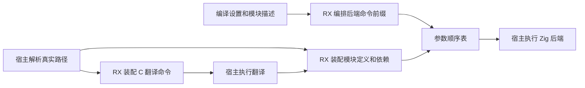
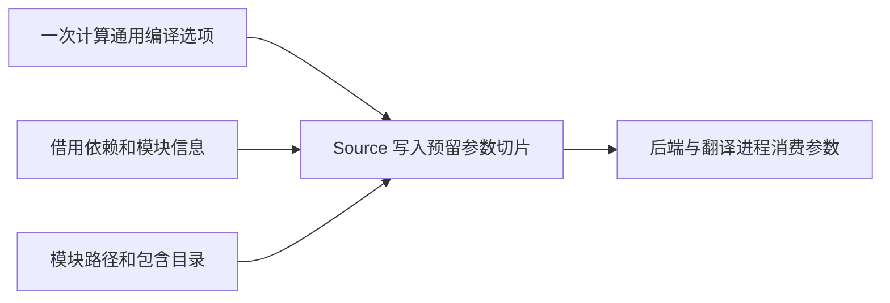

# 原生后端命令装配自举

## Intent · 目标

把正式应用构建和 C 头文件翻译的 Zig 参数装配迁入 RX/ZX，保持进程、Node 和 Wasm 的模块顺序、链接参数及监听协议。

## Data · 正式路径

普通 `build` 和 watch 共用 `cli/build.zig` 的准备入口。原实现重复插入模块编译选项、依赖、ABI 映射和模块源路径，在 Zig 中定义完整命令。C 头文件路径还会在主命令和翻译命令中重复解析同一批包含路径。

## Edges · 边界与限制

原生路径解析、产物写入和子进程执行继续使用 Zig 平台库。命令的各段写入宿主预留的参数切片。现有参数字符串可直接借用，只有路径拼接、ABI 映射和 Zig 模块参数等复合值需要生成新文本。

应用和库共用原生包含目录的查找与优先级。显式包含目录优先于所属包和项目默认值，显式空列表也保留。ABI 视图的查找沿用应用首次命中、库最后一次命中的规则。主构建与 C 翻译借用同一批归一化的包含路径。标准库依赖选择另有正式入口。

## Answer · 验收

后端发布、真实后端协议、C 头文件监听、Node 协议和声明、Wasm、原生库发布及 ABI 别名八组回归通过。修复了后端测试宿主缺少 `compiler` 导入的问题，受影响的两组回归通过 30 个构建步骤、18 项 Zig 测试。初始 seed 和 Source 引导器生成的 CLI 入口文件及类型 ABI 逐字节一致。

使用实际 Zig 后端记录六组命令，覆盖带 `--asm`、`--cpu` 的普通应用、52 个原生模块、C 头文件的一次构建与 watch、Node 和 Wasm。去掉一次构建的随机暂存路径标识后，参数和顺序一致。普通应用、原生应用、C 应用、汇编和 Wasm 产物逐字节一致。macOS Node 动态库的随机暂存名称还影响 Mach-O 的 UUID 和签名。同一版重复构建复现相同差异范围，按这三个字段归一化后代码和数据逐字节一致。Node 执行行为由原有协议与声明回归验收。

macOS arm64、Zig 0.17.0。固定基线为 `dadb1f21a`，直接对照为 `32ec5d0db`。三套 CLI 均由 `7c9b225c3` 的 Source 引导器构建，运行时使用 Source 分析与生成。禁用 zxc 生成缓存，复用相同的 Zig 缓存和工具链。应用产物使用 ReleaseSmall。三版交错执行，去掉首轮后取七轮中位数。

| 场景           | 墙钟，固定 / 直接 / 候选（ms） | CPU，固定 / 直接 / 候选（ms） | 峰值 RSS，固定 / 直接 / 候选（MB） |
| -------------- | -----------------------------: | ----------------------------: | ---------------------------------: |
| 普通应用       |       847.91 / 848.86 / 847.79 |      902.19 / 904.42 / 903.08 |           179.44 / 179.32 / 179.49 |
| 52 个原生模块  |       880.76 / 881.01 / 879.31 |      948.57 / 951.79 / 954.62 |           182.27 / 182.32 / 182.42 |
| C 头文件应用   |       893.80 / 893.36 / 894.17 |      944.93 / 943.99 / 947.82 |           182.19 / 182.52 / 182.08 |
| Node 动态库    |          91.29 / 91.28 / 91.33 |      146.13 / 148.33 / 146.93 |           117.23 / 117.03 / 117.26 |
| Wasm           |       277.47 / 277.55 / 277.18 |      334.41 / 334.74 / 333.55 |           116.15 / 115.33 / 115.49 |
| 带原生资源的库 |          18.38 / 17.22 / 17.90 |         19.77 / 18.91 / 19.28 |              12.83 / 12.63 / 12.57 |

相对上一提交，墙钟变动最大约 1.70 ms，CPU 增幅最大 3.83 ms，峰值 RSS 增幅最大 0.23 MB。相对固定基线，CPU 增幅最大 6.05 ms。实测覆盖完整应用构建与库发布，未单独测量参数装配，也未重测编译器冷自举。原始结果保存在 `.zig-cache/verification-tmp/backend-command/`。
