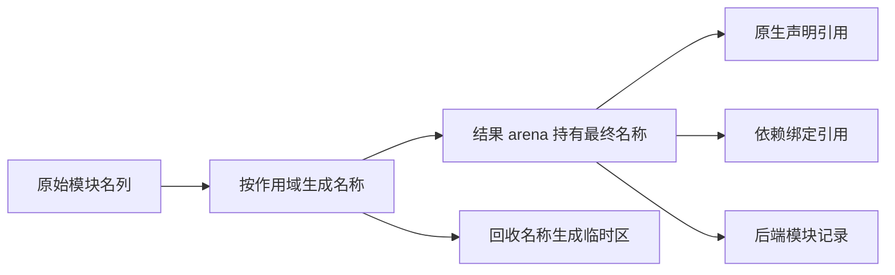

# 原生模块配置与依赖绑定自举

## Intent · 目标

把原生声明和模块的配置校验、后端名称分配、依赖绑定完整迁入 RX/ZX。保持源码包、当前入口包和编译库的命名协议以及公开错误。让同一个已声明模块的后端名称由声明、模块记录和依赖共同使用。

## Data · 正式路径

CLI 的包作用域装载先检查外部声明，逐个校验并读取声明文件，再校验原生模块。此前 Zig 判断允许的声明类别、文件后缀和模块命名，遍历候选模块查找依赖，并为同一个本地名称反复生成后端名称。这些判断已经接入 Source。底层只按原顺序读取文件和归集结果。

## Edges · 契约与存储

保持外部声明、接口文件和模块各自的诊断顺序。配置仍要求模块恰好提供 Zig 路径或 C 头文件。保留模块名字符范围、保留字、包内重名、跨作用域后端名称重名和未知依赖检查。依赖仍按首个等号拆分，省略等号时用本地名称作别名。源码包的 SHA-256 输入仍为包路径、一个空字节和本地名称，编译库沿用自身的名称域。

同一作用域为已声明模块生成一份拥有的后端名称。声明、模块和依赖借用该结果，名称表指针在作用域归集后释放。摘要、十六进制与中间文本使用短期工作区。路径规范化、声明文件读取、文件变更观察和向构建器传入最终配置仍由 Zig 完成。初始 seed 的编译库算法保留。

## Answer · 验收

八组正式回归通过 102 个构建步骤、63 项 Zig 测试和 2,042 项公开命令检查，覆盖原生声明和链接、安装包隔离、库重发、清单导入及缺失 C 头文件的监听恢复。

额外对照了由两个包组成、含 52 个原生模块和 142 条依赖的样本。源码应用和编译库消费应用分别与上一提交逐字节一致，执行三组输入的结果一致。未知依赖、非法模块名、保留名、重名、错误的声明文件后缀均保留原诊断，失败时均未发布二进制。

三套工具均由 `7c9b225c3` 的 Source 引导器构建，执行 Source 分析和生成。macOS arm64、Zig 0.17.0、ReleaseSmall，关闭 zxc 生成缓存。每组交错执行，去掉首轮后取八轮中位数。固定基线为 `dadb1f21a`，直接对照为 `925fdea9e`。六组共 324 个发布文件逐字节一致。

| 发布场景           | 墙钟，固定 / 直接 / 候选（ms） | CPU，固定 / 直接 / 候选（ms） | 峰值 RSS，固定 / 直接 / 候选（MB） |
| ------------------ | -----------------------------: | ----------------------------: | ---------------------------------: |
| 源码包，默认配置   |          17.48 / 18.31 / 18.88 |         18.99 / 19.80 / 20.35 |              12.62 / 12.42 / 12.39 |
| 源码包，大量别名   |          20.48 / 19.00 / 18.94 |         21.63 / 20.25 / 20.05 |              14.43 / 14.19 / 14.20 |
| 编译库，显式配置   |          16.24 / 16.02 / 16.43 |         17.47 / 17.28 / 17.68 |              11.30 / 10.99 / 10.98 |
| 编译库，大量别名   |          19.40 / 19.14 / 18.04 |         20.73 / 19.93 / 19.41 |              13.58 / 13.32 / 13.26 |
| 源码包，多模块依赖 |          77.40 / 77.08 / 77.02 |         78.58 / 78.29 / 78.41 |              16.24 / 16.09 / 16.06 |
| 编译库，多模块依赖 |          77.18 / 76.74 / 76.96 |         77.93 / 77.50 / 77.86 |              15.86 / 15.53 / 15.44 |

该对照在库发布入口测量，包含配置装载、分析、生成和写出。普通源码包较直接对照多约 0.57 ms 墙钟，较固定基线多约 1.40 ms。多模块样本已消除逐依赖计算后端名称，但端到端耗时变化不足 1 ms。完整冷自举未重测。原始记录位于 `.zig-cache/verification-tmp/native-configuration/`。
