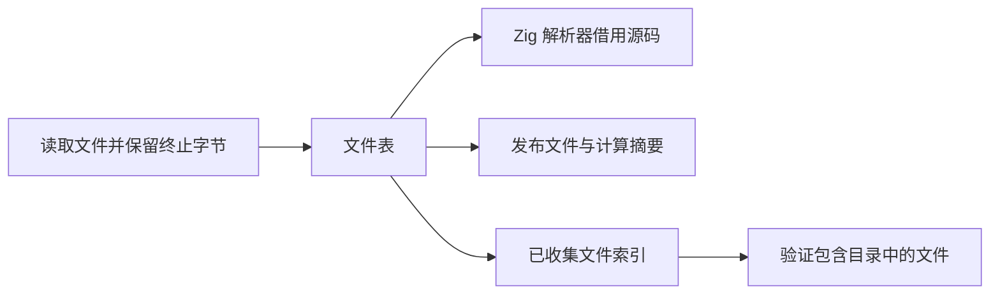

# 原生资源发现与库发布自举

## Intent · 目标

让正式库发布及重发使用 RX/ZX 决定要跟踪的原生依赖、要归集的文件和包含目录，以及哪些输出路径属库管理。保留源文件顺序、相对路径规则和现有错误。

## Data · 正式路径

`library/publish.zig` 调用 `library/resources.zig`。资源收集以 Zig 语法树、显式资源和磁盘文件为输入，解析静态导入、嵌入资源以及动态资源。收集成功后确定包含目录能否迁移，最后记录发布清单。watch 重发依据同一清单识别旧文件。

## Edges · 边界与限制

按既有的首次发现顺序处理文件。同一路径从普通资源升级为 Zig 源码时复用同一份字节。包含目录一旦找到归集资源便停止扫描，再用已收集索引确认目录中的每个文件都在发布范围内。清单路径按原有发布格式校验，重发仍核对旧文件的实际路径和摘要。

路径的绝对与相对解释、真实路径验证、目录遍历、Zig AST 和文件 I/O 使用宿主平台入口。按文件推进的待处理队列、索引容器的内存维护、产物搬运和摘要计算仍由 Zig 执行。

## Answer · 验收

库发布、已安装包的原生模块、原生 ABI 别名、原生链接、C 头文件 watch 和库 watch 六组正式回归通过，共 91 个构建步骤。另用已有种子和 Source 引导器分别生成 CLI 清单，入口文件和类型 ABI 逐字节一致。

扩展样本由两个包组成，包含 518 个原生文件和两个可搬迁的包含目录。上一提交与候选均正确搬迁目录，库迁移后四组输入得到相同原生执行结果。未完整归集的目录保留 `IncompleteNativeIncludeBundle` 诊断，既有发布目录未被改写。

补充使用现有原生资源用例覆盖静态及动态嵌入、文件摘要、父路径与符号链接越界、编译库搬迁及生成的 `build.zig` 接入。旧用例中有一段手写 Zig 命令缺少生成函数模块的依赖，上一提交和候选均在该命令报错。其余检查使用临时目录执行并通过。初始 seed 和 Source 引导器均可生成完整 CLI 清单，生成代码在局部变量编号等细节上有差异，本阶段的行为验收使用 Source 候选。

三套 CLI 均由 `7c9b225c3` 的 Source 引导器构建，执行 Source 分析与生成。macOS arm64、Zig 0.17.0、ReleaseSmall，关闭 zxc 生成缓存。固定基线为 `dadb1f21a`，直接对照为 `f15130d6c`。三版交错执行，排除首轮后取八轮中位数。五组共 714 个发布文件逐字节一致。

| 库发布场景                    | 墙钟，固定 / 直接 / 候选（ms） | CPU，固定 / 直接 / 候选（ms） | 峰值 RSS，固定 / 直接 / 候选（MB） |
| ----------------------------- | -----------------------------: | ----------------------------: | ---------------------------------: |
| 源码包，普通原生资源          |          18.52 / 18.29 / 18.48 |         19.89 / 19.70 / 19.57 |              12.65 / 12.48 / 12.51 |
| 编译库重发                    |          16.24 / 16.37 / 15.81 |         17.66 / 17.59 / 17.10 |              11.29 / 11.03 / 11.09 |
| 多模块原生依赖                |          77.24 / 76.99 / 76.81 |         78.45 / 78.11 / 78.14 |              16.24 / 16.11 / 16.10 |
| 518 个原生文件                |       232.93 / 232.93 / 229.76 |      233.82 / 233.92 / 230.63 |              16.32 / 16.13 / 16.21 |
| 两个各约 8 MB 的 Zig 源码文件 |          62.34 / 62.26 / 58.04 |         63.47 / 63.15 / 58.95 |              63.64 / 63.46 / 46.83 |

大源码样本只增加注释，代码行为保持一致。相对上一提交，发布墙钟下降 6.8%，峰值 RSS 下降 16.64 MB。普通样本增加约 0.19 ms 墙钟，CPU 基本持平。测量覆盖库发布入口，包含资源收集、编译分析、生成和文件写出。完整冷自举未重测。原始记录位于 `.zig-cache/verification-tmp/native-resource-collection/`。
