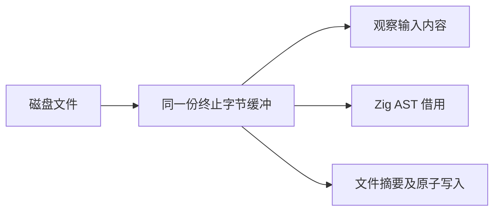

# 原生资源遍历与打包自举

## Intent · 目标

让统一库发布的原生资源闭包、包含目录重定位及文件写出由 RX/ZX 协作。沿 `library/resources.write` 到原生打包入口验收。

## Data · 实现路径

此前 RX 规则已识别访问动作和动态资源要求，首次访问顺序、升级、依赖入队、包含目录查找及发布次序由 Zig 驱动。正式统一库发布现从 `library/resources.write` 进入 `native_sources/bundle/build.rx`。磁盘文件访问、内存中升级、语法扫描及依赖入队由 `collect/item.rx` 排定。

## Edges · 资源与次序

保持配置预检、入口登记、显式资源和传递依赖的访问顺序。普通资源升级为 Zig 源码时借用已有缓冲区。先完成当前文件的 AST 引用分类，再解析相对路径并入队，保持语法错误与资源路径错误的先后顺序。复用解析引用的行表容量，生成入口按值取回最终的状态与标志。

Zig 侧继续提供物理路径、Zig AST 游标、内容读写和 SHA-256。`resources.zig` 仍负责显式目录展开、底层目录文件类型检查与排序。队列和哈希索引沿用原有 Zig 容器，推进顺序、候选选择和升级规则由 Source 决定。通用可变容器可替代这部分存储适配。库清单核验和旧产物回收沿用上一阶段的入口。

## Answer · 验收

统一库发布与消费、库 watch、原生包、ABI 别名、头文件 watch 和原生链接通过 130 个构建步骤及 6 项 Zig 测试。由固定 Source 引导器和初始 seed 生成的 76 个 Zig 文件中，67 个逐字节一致，其余仅有局部变量编号差异。现有原生资源用例另覆盖 ZX 和 Zig 消费、产物摘要、动态资源、目录越界及失败保留产物。

使用两个原生模块、518 个资源的样本验证包含目录重定位。上一提交和候选均搬迁两个包含目录，迁移后的库在四组输入上给出相同的原生运行结果。不完整的包含目录保留 `IncompleteNativeIncludeBundle` 诊断，既有发布清单保持原样。

固定对照为 `dadb1f21a`，直接对照为 `5d5ee7d06`。三套 CLI 均由 `7c9b225c3` 的 Source 引导器构建，执行 Source 分析和生成。平台为 macOS arm64、Zig 0.17.0、ReleaseSmall，关闭 zxc 生成缓存。版本交错，排除首轮后取八轮中位数。重发先恢复同一份发布目录，恢复耗时排除在测量之外。

| 场景                                       | 墙钟 ms（固定 / 直接 / 候选） | CPU ms（固定 / 直接 / 候选） | 峰值 RSS MB（固定 / 直接 / 候选） |
| ------------------------------------------ | ----------------------------: | ---------------------------: | --------------------------------: |
| 普通首次发布                               |         17.33 / 16.71 / 17.15 |        18.54 / 18.09 / 18.58 |             12.64 / 12.30 / 12.34 |
| 大源码首次发布                             |         65.48 / 59.68 / 60.72 |        63.50 / 58.92 / 58.86 |             63.63 / 29.99 / 30.02 |
| 编译库重发                                 |         16.00 / 16.16 / 15.77 |        17.28 / 17.77 / 17.25 |             11.29 / 10.82 / 10.90 |
| 518 个原生文件首次发布                     |      233.60 / 227.07 / 228.71 |     233.74 / 227.99 / 227.52 |             16.33 / 15.01 / 15.08 |
| 518 个原生文件重发                         |      343.01 / 235.95 / 235.33 |     343.36 / 236.30 / 235.90 |             76.91 / 15.09 / 15.11 |
| 重发 518 个原生文件并回收约 11 MB 的旧文件 |      352.08 / 245.66 / 246.24 |     353.02 / 246.56 / 247.16 |             88.33 / 15.14 / 15.17 |

六组共 1,658 个发布文件在三版之间逐字节一致。重发保留用户文件，回收样本中的旧文件已移除。相对直接对照，墙钟最大增加 1.65 ms，CPU 最大增加 0.60 ms，峰值 RSS 最大增加约 0.074 MB。相对固定对照，六组墙钟及峰值 RSS 均较低，普通首次发布 CPU 多约 0.04 ms。测量覆盖上述正式库发布入口。

原始记录位于 `.zig-cache/verification-tmp/native-bundle-traversal/`，包括 `regression.log`、`seed-comparison.log`、`comparison.json`、`consumer.log` 和 `bundle-runtime.log`。
