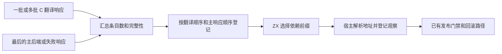
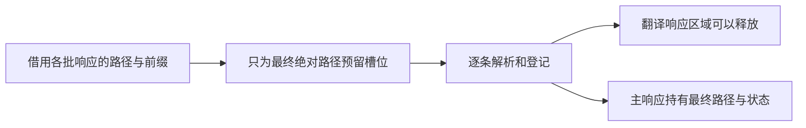

# 后端依赖登记与缓存产物寻址自举

## Intent · 目标

让普通构建和 watch 共用的 C 翻译与 Zig 后端响应在 RX/ZX 中完成依赖批次确认和路径选择。按原顺序登记实际输入，保留失败诊断及发布前的完整性门禁，并避免重复复制相对路径。

## Data · 调用路径

`build.runObserved` 会先执行各个 C 翻译命令，再收集主后端响应。原来 `Translation.execute` 将每条翻译依赖复制到临时列表，`Translation.merge` 再复制一次，最后 `Observed.resolve` 才把依赖解析为绝对路径。普通构建无需将翻译依赖用于 watch，也走了第一次复制。

## Edges · 兼容边界

每份翻译响应保持原来的所有权。watch 在解析完依赖前持有这些响应，普通构建在取得翻译产物地址后即可释放。最终 absolute 路径和诊断由主响应区域持有。缓存目录和目标名沿用 Zig 后端格式。平台路径规范化、目标平台二进制命名以及文件观察使用既有 Zig 接口。

## Answer · 验收

后端发布、真实 Zig 进程、C 头文件恢复、普通 watch、RX watch、Node 绑定、Node 协议和 Wasm 八组回归通过，共 93 个构建步骤、18 项 Zig 测试。真实后端测试覆盖重复响应收敛、依赖前缀、Linux 与 Windows 产物命名、失败后旧产物保留和发布前输入变化。

双 C 模块的实际 watch 先成功生成可执行文件和汇编。根据真实后端命令顺序删除第二次翻译使用的头文件。该次翻译失败后，两个产物摘要和程序结果都保留。恢复头文件并修改计算结果后，两项产物重新发布，执行结果从 16 变为 24。

初始 seed 和 `7c9b225c3` Source 引导器使用同一后端依赖清单生成 22 个 Zig 文件，19 个逐字节一致，另外三个文件归一化生成的局部编号后一致。新 RX/ZX 文件通过格式和 lint。

Zig 宿主仍负责标准库子进程接口、平台路径拼接、观察表的底层存储和目标命名。观察路径登记结束后，旧 `Translation.merge` 及其复制列表已退出调用链。普通输出发布、watch 的文件冲突检查及复制顺序仍由现有宿主管理。

macOS arm64、Zig 0.17.0、ReleaseSmall。固定基线为 `e4cec1dc6`，直接对照为 `ab125f035`。三套 CLI 由 `7c9b225c3` Source 引导器生成，执行 Source 分析和生成。版本按轮轮换，排除预热后取七轮中位数。禁用 zxc 生成缓存，复用同一套 Zig 后端缓存。普通构建墙钟覆盖进程运行至退出，watch 墙钟覆盖启动至首次发布。CPU 与系统峰值 RSS 通过进程退出后的资源记录取得，RSS 使用十进制 MB。

| 场景                     | 墙钟（ms，固定 / 直接 / 候选） | CPU（ms，固定 / 直接 / 候选） | 峰值 RSS（MB，固定 / 直接 / 候选） |
| ------------------------ | -----------------------------: | ----------------------------: | ---------------------------------: |
| 普通应用                 |    1311.94 / 1309.56 / 1312.77 |   1370.53 / 1368.10 / 1370.11 |           180.65 / 181.78 / 180.57 |
| 双 C 模块应用            |    1399.02 / 1396.18 / 1396.05 |   1452.50 / 1449.33 / 1450.42 |           183.52 / 183.42 / 183.50 |
| 双 C 模块 watch 首次发布 |       548.81 / 549.32 / 538.95 |      327.68 / 328.70 / 325.63 |              34.08 / 34.08 / 34.08 |

三组可执行文件和汇编的 SHA-256 一致，执行结果一致。相对直接对照，最大墙钟和 CPU 增量分别为 3.21 ms、2.01 ms。固定基线对照中，墙钟最大累计增量约 0.83 ms，三组 CPU 均低于固定基线。双 C 模块 watch 的墙钟下降约 10.37 ms，峰值 RSS 持平。本轮测量经过正式后端的应用构建路径。自举冷构建沿用此前记录。原始结果、测试及失败恢复日志在 `.zig-cache/verification-tmp/backend-dependencies/`。
