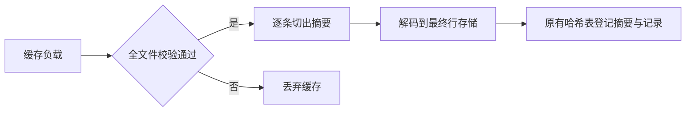

# 唯一性缓存记录读写自举

## Intent · 目标

将生成器唯一性分析缓存的记录遍历、筛选、区段顺序及记录定界迁入 RX/ZX。重新生成的 Zig 与 v18 缓存字节保持一致，正式引导器继续复用已验证的磁盘记录。

## Data · 正式调用链

引导器与库生成都沿 `backends/zig/library.zig` 或常驻生成缓存访问同一份 memo。读取先由 ZX 检查所有区段，Zig 再按固定顺序推进摘要和行位置。写出时 Zig 两次遍历各哈希表，分别求出保留项数及选择保留项，ZX 编码记录本身。

## Edges · 内存与兼容边界

写入借用标准库哈希表的槽位、键与值，按原顺序和使用标记直接写出。读取只在完整校验成功后发布，已解码记录仍由原有的 memo arena 持有。初始 seed 保留独立实现。文件读写、哈希表的插入和扩容继续使用原生能力。

生成器对嵌套记录数组使用引用布局。为保持当前哈希表的原生行布局，写入方借用已有字段视图，子列表直接引用原生数组。新增的是编译器内部通用的整数及切片列读取能力。槽位的占用位由 Zig 根据标准库类型在编译时提取，ZX 使用占用位和使用标记筛选，跳过未初始化的桶。保存之前的 `stale` 判定、读取端哈希登记和磁盘 I/O 仍由 Zig 负责。

## Answer · 验收

初始 seed 通过 14 个构建步骤，本阶段 Source 引导器由上一代引导器生成并通过 25 个构建步骤。两版均使用 Source 分析与生成。87 个专项生成文件及 26,242 字节的 v18 缓存载荷逐字节一致。保持外层缓存长度和标识有效、仅破坏载荷末尾布尔字段后，两版均重建为原始缓存字节，生成结果一致。

常驻引导器在 379 模块样本上执行首次生成、ZX 正文修改、RX 修改和源码恢复。四个阶段各有 709 个 Zig 文件与相同输入的冷生成一致。依赖缺失按预期失败，恢复后无改动请求跳过生成。

函数分析、缓存所有权、模块生成和执行回归通过 158 个构建步骤、222 项 Zig 测试和 3 项应用执行检查。应用检查覆盖空缓存、复用、源码更新、禁用缓存、损坏载荷以及跨键错放缓存载荷。

固定 735 入口、16 个分区，macOS arm64、Zig 0.17.0、ReleaseSmall 下交错运行三轮。候选与上一阶段的 11,758 个文件逐字节一致，排除环境输入戳，完整 v18 载荷 SHA-256 都是 `e9e3d5b2caace901ee98d61440aac25cb252daab17bf2ddd76bace5f25bf61de`。长期基线使用旧版 v17 缓存和相同生成输入，用于性能趋势比较。下表是生成阶段中位数。

| 指标                     |  固定基线 |  上一阶段 |      候选 |
| ------------------------ | --------: | --------: | --------: |
| 冷生成墙钟               |    2.82 s |    2.58 s |    2.55 s |
| 冷生成 CPU               |   12.40 s |   12.24 s |   12.13 s |
| 冷生成进程树采样峰值 RSS | 885.42 MB | 697.04 MB | 696.57 MB |
| 冷生成单进程系统峰值 RSS | 968.61 MB | 794.36 MB | 761.91 MB |
| 热生成墙钟               |    2.20 s |    1.99 s |    1.99 s |
| 热生成 CPU               |    8.43 s |    8.27 s |    8.31 s |
| 热生成系统峰值 RSS       | 934.12 MB | 695.27 MB | 695.12 MB |
| 无变更墙钟               |    0.04 s |    0.04 s |    0.04 s |
