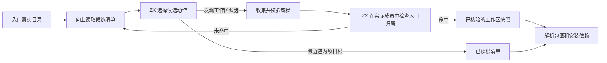
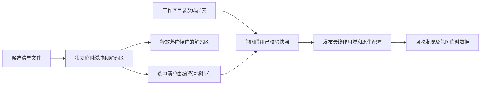

# 工作区发现与清单交接自举

## Intent · 目标

把工作区发现的候选选择、成员归属、路径边界和同名登记接到正式 Source 路径。项目装载接收已完成的发现结果，复用边界已核验的清单和成员列表。保留独立工作区命令、安装包、监听恢复和既有诊断。

## Data · 正式调用链

`package.project.loadWithInputs` 在隐式项目配置下从入口目录向上发现清单。此前发现步骤先解码最近的清单。若需验证一个上层工作区，它会枚举目录并读取成员清单。选中后，包图装载又重复枚举和读取。

现在 ZX 根据是否已找到最近包以及当前候选是否声明工作区，决定保留最近包、选择当前根、检查上层成员或继续向上。工作区归属根据已通过枚举和清单校验的成员路径确定。包图接收通过检查的快照。只发现根时，下游仍执行必要的目录收集，并复用已读根清单。

## Edges · 兼容与所有权

Zig 平台边界继续处理目录遍历、`realpath`、相对路径和 YAML 文件读取。实际文件必须通过工作区边界检查。仅在逻辑路径与物理路径同时匹配时复用已读的根或成员清单。watch 在初次读取时登记文件，并沿用发布前重新核验全部输入的规则。

工作区成员仍按目录路径排序，缺少清单的目录仍被跳过。在相同位置检查重名并保留第一次声明的路径。登记复用已有 Source 索引。成员路径由 ZX 转换为公开格式，普通路径直接借用目录记录。

## Answer · 验收

九组正式回归通过，共 88 个构建步骤、6 项 Zig 测试与 2,044 项命令检查。覆盖工作区排序、排除、重名、符号链接、包导入、安装与离线重放、编译库发布和 watch 恢复。额外核对了六种发现边界，包括忽略未匹配的上层工作区、保留非法候选的诊断、显式项目覆盖和成员清单符号链接指向工作区内外。同上一版的输出及诊断逐字节一致。

初始 seed 和 `7c9b225c3` Source 引导器的 CLI 窄清单各生成 216 份 Zig 文件。35 份只涉及一致的局部重命名，其余字节一致。

macOS arm64、Zig 0.17.0、ReleaseSmall，关闭生成缓存。固定基线为 `dadb1f21a`，直接对照为 `aebc42619`。三版 CLI 均由 `7c9b225c3` Source 引导器构建，运行时执行 Source 分析与生成。版本交错运行，排除首轮后取八轮中位数。十个场景的 328 份产物逐字节一致。

| 场景                               | 墙钟 ms（固定 / 直接 / 候选） | CPU ms（固定 / 直接 / 候选） | 峰值 RSS MB（固定 / 直接 / 候选） |
| ---------------------------------- | ----------------------------: | ---------------------------: | --------------------------------: |
| 源码库，默认配置                   |         18.88 / 18.19 / 18.47 |        20.11 / 19.40 / 19.91 |             12.56 / 12.41 / 12.48 |
| 编译库，显式配置                   |         15.45 / 16.27 / 15.91 |        16.84 / 17.67 / 17.25 |             11.29 / 11.14 / 11.00 |
| 源码库，大量别名                   |         19.84 / 18.04 / 18.33 |        21.26 / 19.41 / 19.73 |             14.43 / 13.80 / 13.90 |
| 编译库，大量别名                   |         19.42 / 17.30 / 18.59 |        20.60 / 18.69 / 19.82 |             13.59 / 12.81 / 12.77 |
| 源码库，52 个模块与 142 条依赖     |         75.82 / 75.69 / 75.59 |        77.29 / 76.73 / 76.82 |             16.21 / 15.94 / 15.94 |
| 编译库，52 个模块与 142 条依赖     |         75.67 / 74.86 / 74.45 |        76.82 / 76.25 / 75.66 |             15.80 / 14.68 / 14.78 |
| 源码装载，32 个原生模块            |            3.02 / 2.80 / 2.78 |           2.82 / 2.54 / 2.57 |                7.48 / 7.52 / 7.47 |
| 源码装载，2,048 个原生模块         |          47.35 / 11.86 / 7.75 |         47.15 / 11.67 / 7.56 |             18.04 / 13.72 / 13.76 |
| 源码装载，从 98 个包的工作区根进入 |            8.91 / 6.40 / 6.32 |           8.97 / 6.36 / 6.38 |               11.24 / 9.19 / 9.22 |
| 源码装载，从同一工作区的成员进入   |           10.70 / 8.39 / 6.22 |          10.69 / 8.19 / 6.08 |               11.26 / 8.90 / 8.87 |

源码装载测到生成 Zig，排除原生后端构建。成员入口样本省掉了已选工作区的第二次遍历和解析，墙钟下降 25.9%，CPU 下降 25.8%。2,048 个原生模块的单包样本复用发现阶段的大清单，墙钟下降 34.6%。编译库大量别名样本相比直接对照墙钟增加约 1.30 ms，CPU 增加约 1.13 ms，两项仍低于固定基线。本轮未重测完整自举冷构建。

原始结果位于 `.zig-cache/verification-tmp/workspace-discovery/`，包括 `final-regression.log`、`check.log`、`generation-parity.log` 和 `comparison.json`。
