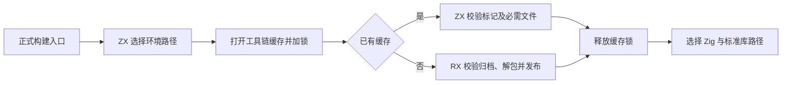
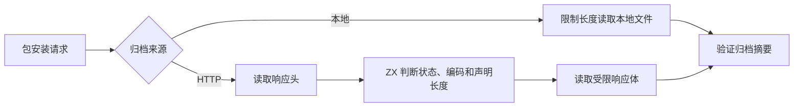

# 工具链缓存与包下载自举

## Intent · 目标

把正式 CLI 的工具链选择、缓存验收与发布，以及包下载响应准入迁到 RX/ZX。保留实际的锁、路径、归档、HTTP 请求及错误约定。

## Data · 正式调用路径

应用、RX 模块、Gateway 和库构建仍从 `cli/toolchain.zig` 取得工具链路径。工具链环境和缓存就绪判断由 ZX 描述，命中、解包、校验与发布顺序由 RX 表达。包安装、锁文件重放和包缓存测试共用 `package_store` 的下载入口。下载按本地归档与 HTTP 路径分流，判断状态、传输编码和声明长度后才读取远端响应体。

## Edges · 原生边界与生命周期

Zig 继续借用标准库的文件、路径、锁、HTTP 和压缩归档操作，以及现有的文件原子发布。标记放在固定栈缓冲，验证时借用该范围。环境回退直接借用环境中的路径，缓存路径拼接只在需要时生成最终路径。解包失败会在锁释放前撤去本次暂存目录。包下载复用原请求和缓冲，拒绝响应在清理前标记关闭连接。工具链宿主仍持有文件和 HTTP 状态。构建 CLI 时取得官方 Zig 归档的路径也仍由原 Zig 构建工具执行。

## Answer · 验收

初始 seed 与 `7c9b225c3` Source 引导器分别生成两份窄清单。工具链每份生成文件逐字节一致。包缓存清单的差异限于局部临时变量编号，归一化后内容一致。实际工具链回归使用仓库记录 SHA-256 的 macOS arm64 Zig 0.17.0 官方归档及文件引用方式。校验覆盖无缓存解包、复用、相对路径拒绝、损坏标记和缺失可执行文件。Windows 的 ZIP 和发布版嵌入归档路径本轮没有执行。

7 组回归通过，共 90 个构建步骤、21 项 Zig 测试和 45 项 Node 检查。覆盖两个进程同时初始化冷工具链缓存、过期暂存目录恢复、真实 HTTP 重定向和并发归档发布、离线重放、响应头拒绝及已有安装行为。无效状态和超限声明会在发送方完成响应体前被拒绝。

在 macOS arm64、Zig 0.17.0、ReleaseSmall 上，对比固定基线 `dadb1f21a`、直接对照 `fdfd921f2` 和候选。三版由 `7c9b225c3` Source 引导器构建，执行 Source 分析及生成。各场景交错运行，每版去掉首轮后取七轮中位数。工具链场景走公开库发布入口，使用同一个外部 Zig 并分别复位或复用标准资源缓存，避免应用的 Zig 后端编译盖过本次路径的开销。HTTP 使用同一个环回服务及归档。

| 场景                             | 墙钟 ms（固定 / 直接 / 候选） | CPU ms（固定 / 直接 / 候选） | 峰值 RSS MB（固定 / 直接 / 候选） |
| -------------------------------- | ----------------------------: | ---------------------------: | --------------------------------: |
| 本地归档首次安装                 |      62.052 / 62.379 / 62.408 |     60.936 / 61.323 / 61.266 |             7.635 / 7.799 / 7.750 |
| HTTP 归档首次安装                |      61.291 / 61.725 / 61.111 |     59.769 / 60.399 / 59.632 |             7.635 / 7.848 / 7.782 |
| 库发布，外部工具链标准资源冷缓存 |      12.487 / 12.603 / 12.585 |     11.657 / 11.661 / 11.841 |             7.487 / 7.537 / 7.537 |
| 库发布，外部工具链标准资源热缓存 |         4.783 / 4.811 / 4.741 |        4.095 / 4.070 / 4.033 |             7.291 / 7.324 / 7.324 |

相对直接对照，表内最大墙钟增量为 0.029 ms，最大 CPU 增量为 0.180 ms，峰值 RSS 持平或下降。小文件缓存命中、离线重放、包图、宽输入命中的最大墙钟差异为 0.278 ms，锁文件、安装映射、收据、归档以及库的六份发布文件在同场景内逐字节一致。完整自举冷构建未在本阶段重新计时。

原始记录位于 `.zig-cache/verification-tmp/toolchain-workflows/`，包括 `regression.log`、`comparison.json`、`package/comparison.json` 和 `seed.log`。
