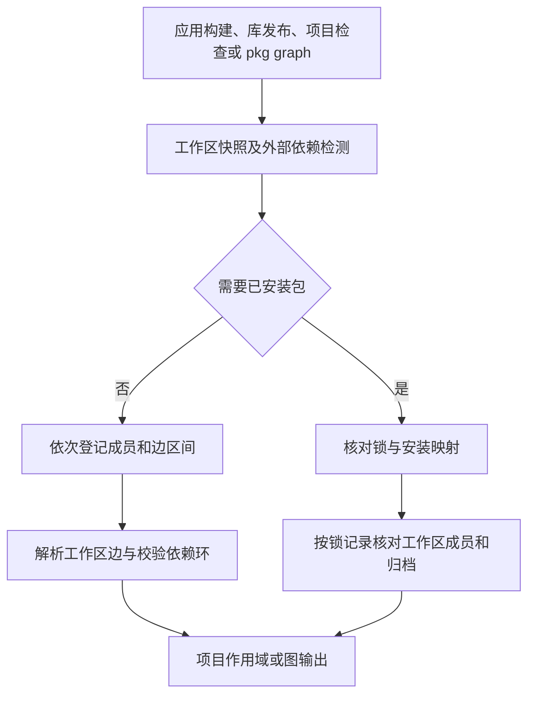
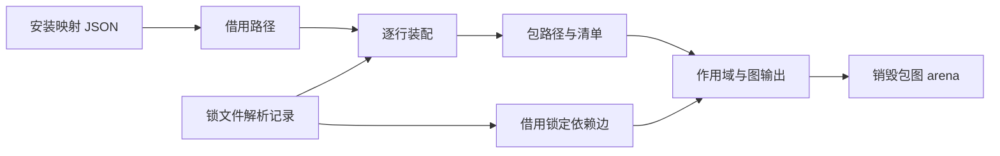

# 已安装包与项目依赖图自举

## Intent · 目标

从编译、库发布和 `pkg graph` 共同使用的入口迁移项目包图编排。覆盖纯工作区装配、外部依赖的锁与安装映射校验、归档验证、成员装配及错误报告。保持监听观测顺序、编译时的借用期限和公开输出。

## Data · 正式路径

编译项目通过 `package/project.zig` 取得工作区快照，再进入 `package/graph.zig`。版本和依赖环规则此前已迁入 Source，这次移除 Zig 中按包遍历安装记录和写入工作区边区间的流程。安装命令和编译的包图共用 CLI 宿主的生成清单。[包安装解析与锁文件重放](包安装解析与锁文件重放自举.md)

## Edges · 语义与生命周期

外部依赖路径依次核对锁文件、工作区匹配、安装映射版本、锁摘要、映射行数和所有路径是否为绝对路径。归档记录先校验目录名和摘要，再核对真实路径、缓存收据和清单。监听输入的登记仍在原来的读取点发生。此前用于已安装图的 Zig 入口已删除。

安装映射的 JSON 解析直接使用包图持有的 arena，未转义的文本可借用 JSON 原文。已安装图把锁包表保留到作用域发布及图输出结束，依赖逻辑直接读取锁文件的边。输出 JSON 沿用原来的字段和顺序。纯工作区仍写入紧凑的边表。

Zig 适配层继续保存现有记录布局和输入观测句柄，执行文件读取、真实路径查询、缓存收据验证与 JSON 编解码。已有 Source 依赖规则仍通过窄接口读取这些表。验证失败时遵守原来的诊断顺序。锁及映射加载失败的宿主错误原样传播。

## Answer · 验收

初始 Zig seed 与 `7c9b225c3` Source 引导器生成相同的 86 份 Zig 文件，其中 79 份逐字节一致，其余仅有局部变量编号差异。生成的包图入口未增加堆分配或锁边复制。

项目清单、包安装、安装监听、原生包、编译包、库发布和语义 lint 七组回归通过。共通过 107 个构建步骤和 2,179 项命令及运行检查。覆盖外部源码与编译库消费、运行结果、缓存破坏、监听缺失映射恢复和发布失败保留旧产物。

三个版本的两份包图输出和两份生成 Zig 逐字节一致。另将同一份映射改为错误版本、错误锁摘要、行数不符、相对路径、错误目录名、错误摘要目录及指向真实缓存的符号链接。再检查缺失映射。八种情况的退出状态和诊断逐字节一致。

在 macOS arm64、Zig 0.17.0、ReleaseSmall 下测量。固定对照为 `dadb1f21a`，直接对照为 `44d110961`。三版都由 `7c9b225c3` 的 Source 引导器构建，使用 Source 分析与生成。按版本轮换，排除预热轮后取九轮中位数。两组编译都关闭生成缓存，生成产物来自同一个工作区入口及其成员。混合项目在生成前验证 96 个已安装归档和完整锁图。可执行外部包消费由回归验收。

| 场景                                | 墙钟 ms（固定 / 直接 / 候选） | CPU ms（固定 / 直接 / 候选） | 峰值 RSS MB（固定 / 直接 / 候选） |
| ----------------------------------- | ----------------------------: | ---------------------------: | --------------------------------: |
| 513 个工作区包，图输出              |      15.714 / 15.181 / 15.118 |     14.972 / 14.290 / 14.350 |             5.915 / 5.423 / 5.325 |
| 513 个工作区包，生成 Zig            |      22.310 / 15.928 / 16.215 |     22.120 / 15.787 / 15.922 |            10.781 / 8.585 / 8.552 |
| 33 个工作区包和 96 个归档，图输出   |      15.579 / 15.415 / 15.440 |     14.575 / 14.540 / 14.662 |             7.045 / 6.930 / 6.717 |
| 33 个工作区包和 96 个归档，生成 Zig |      21.162 / 15.747 / 15.741 |     20.914 / 15.598 / 15.572 |            13.844 / 9.110 / 9.126 |

相对直接对照，墙钟中位数最大增加 0.287 ms，CPU 最大增加 0.135 ms，峰值 RSS 最大增加 0.016 MB。混合包图输出峰值下降 0.213 MB。相对固定基线，四项墙钟和 RSS 均下降，混合包图输出的 CPU 增加 0.087 ms。此次计时覆盖包图读取及受影响的编译入口，完整自举冷构建仍待阶段验收。

归档收据的目录遍历以及项目包图的宿主记录与路径接口仍在 Zig 调用链中。验收记录位于 `.zig-cache/verification-tmp/package-graph-source/`，包括 `regression.log`、`comparison.json` 和 `generation-parity.log`。
