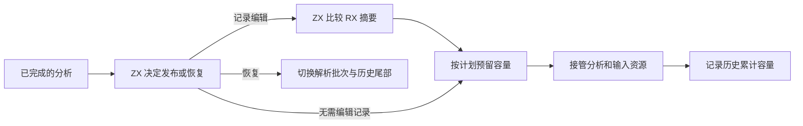
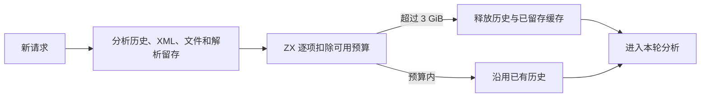

# 常驻分析发布与容量预算自举

## Intent · 目标

让 RX/ZX 决定常驻分析的发布计划、RX 编辑记录及留存预算。保留成功、失败和恢复路径的资源寿命，取消 Zig 侧逐条维护的累计容量计数。

## Data · 正式调用链

引导器完成分析和输出后调用 `resident.keepAnalysis`。此前宿主分别请求发布策略及编辑差异，再计算需要预留的历史槽位。每次添加或弹出历史项还会修改一个单独保存的累计容量。现在 RX 负责判断是否需要编辑记录并产生完整发布计划，ZX 负责槽位与容量规则。

## Edges · 容量与资源边界

每个发布项保存从根到该项的累计容量。恢复和截断直接使用保留项的记录。新发布项计入分析与输入的实际 arena 容量，编辑位置在测量容量前分配。预留失败时保留原先已发布的历史及共享解析状态。Zig 负责预留、实际接管与释放 arena，保留原来的操作顺序。

预算按各分项逐步比较并扣减，可以处理分项相加超出整数表示范围的输入。初始 seed 使用相同判定。预算覆盖与旧版相同的留存类别，实际文件读取与持久生成缓存的管理由宿主处理。

## Answer · 验收

初始 seed 通过 14 个构建步骤，Source 引导器通过 25 个步骤。相邻两代对同一份新规则清单生成的 63 个文件逐字节一致。将预算规则编译成独立程序并执行，核对刚好达到阈值、超过阈值及分项求和会溢出的情况。

常驻夹具逐请求对照交替编辑、混合编辑、依赖切换及失败恢复。两版的生成结果、分析总容量、版本数、活跃及留存的缓存字节均相同。连续失败编辑之后恢复，709 个文件与独立冷生成相同。常驻交替编辑的中位墙钟为 47.86 → 47.64 毫秒，混合编辑为 48.09 → 47.98 毫秒，依赖切换为 51.49 → 51.78 毫秒。

固定 735 个入口，macOS arm64，Zig 0.17.0，ReleaseSmall，16 分区。三个版本均由 Source 引导器生成并执行 Source 分析与生成。三轮交错运行取中位数。排除由工具身份决定的输入戳后，上阶段和候选的 11,758 个输出文件及 v18 唯一性缓存载荷逐字节相同。

| 场景与指标                 | 固定基线 | 上一阶段 |   候选 |
| -------------------------- | -------: | -------: | -----: |
| 冷生成墙钟（秒）           |     2.84 |     2.59 |   2.59 |
| 冷生成 CPU（秒）           |    12.44 |    12.24 |  12.19 |
| 冷生成进程树采样峰值（MB） |   885.37 |   696.80 | 696.86 |
| 冷生成单进程系统峰值（MB） |   944.60 |   787.10 | 732.15 |
| 热重建墙钟（秒）           |     2.19 |     1.97 |   1.98 |
| 热重建 CPU（秒）           |     8.46 |     8.28 |   8.27 |
| 无修改墙钟（秒）           |     0.04 |     0.04 |   0.04 |

相对固定基线，冷生成墙钟和 CPU 均减少 0.25 秒。相对上阶段，常规采样的进程树峰值基本持平，系统记录的单进程峰值减少 54.95 MB。计时范围为分析及 Zig 源码生成，分区对象编译及链接由引导构建另行验证。
