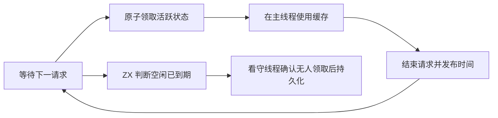

# 常驻引导请求协议自举

## Intent · 目标

将正式引导器的命令判定、常驻请求与应答编解码、复用选择和空闲判断迁入 RX/ZX。保持旧引导器的命令行为、Unix socket 字节协议及逐次回退行为。

## Data · 正式入口

`packages/compiler/build/generate_parser.zig` 负责入口选择，`resident/service.zig` 同时负责一次生成侧的转发和常驻侧的接收。旧实现中的请求字段顺序、应答状态、可执行文件身份和目录比较、空闲计时均在 Zig 中。常驻看守线程原先也可能在生成请求运行期间直接持久化共享缓存。

## Edges · 生命周期与兼容性

保留现有状态编号、宽度、字节序、字段顺序和错误回退顺序。Source 借用标准库缓冲流，路径从请求 arena 读取。进程、socket、超时设置、实际生成和现有诊断输出继续由宿主执行。初始引导器保留独立实现。

双方通过单个原子状态协调。服务线程在访问缓存前领取活跃状态，完成请求后发布空闲时间。看守线程只在比较交换确认空闲状态未改变时才从服务线程接管缓存并持久化。收到新可执行文件身份时仍按原有协议答复并退出。

## Answer · 验收

初始 seed 通过 14 个构建步骤，Source 引导器通过 25 个步骤。独立协议对照观察了两代引导器实际发送的字节，均符合原有布局，两个监听端也接受同一布局的请求。真实 socket 覆盖正常转发、空结果、身份替换、目录不符、残缺请求和清理。命令行保留缺命令、未知命令、参数形状不符、非法数字及溢出错误。专项两版生成的 44 个文件逐字节一致，排除环境输入戳。

使用仅用于核验的时钟和等待探针推进两次空闲期限。上一阶段在只读到请求头时退出。本阶段完成请求并写出正常结果，在请求结束后再次达到空闲期限时写回缓存并退出。常驻模式下，首次生成、ZX 正文修改、RX 修改和恢复各有 709 个文件与冷生成一致。缺失依赖按预期失败，恢复后再次请求跳过生成。

模块生成、生成执行及原生对象 ABI 回归通过 77 个构建步骤、23 项 Zig 测试和 4 项应用执行检查。回归覆盖冷缓存、热缓存、编辑、损坏记录和原生声明重排序。

固定 735 个入口、16 个分区，macOS arm64、Zig 0.17.0、ReleaseSmall。两代候选工具均由前一 Source 引导阶段生成，运行时执行 Source 分析与生成。三轮交错测量，候选和上一阶段的 11,758 个生成文件及 v18 唯一性缓存载荷内容完全一致。长期基线用于累计性能比较。

| 生成阶段指标             |  固定基线 |  上一阶段 |      候选 |
| ------------------------ | --------: | --------: | --------: |
| 冷生成墙钟               |    2.82 s |    2.55 s |    2.55 s |
| 冷生成 CPU               |   12.40 s |   12.16 s |   12.16 s |
| 冷生成进程树采样峰值 RSS | 884.85 MB | 700.48 MB | 696.99 MB |
| 冷生成单进程系统峰值 RSS | 971.96 MB | 782.48 MB | 734.38 MB |
| 热生成墙钟               |    2.20 s |    1.95 s |    1.97 s |
| 热生成 CPU               |    8.48 s |    8.17 s |    8.28 s |
| 热生成系统峰值 RSS       | 934.30 MB | 694.93 MB | 694.81 MB |
| 无变化墙钟               |    0.04 s |    0.04 s |    0.04 s |

在相同固定清单上经实际 CLI 转发到常驻进程，使用三轮启动后稳态各 11 次请求计算中位数。无变化请求从 34.11 ms 到 35.12 ms。该结果包含 CLI 请求编码、socket 往返、常驻输入核对和应答解码。
