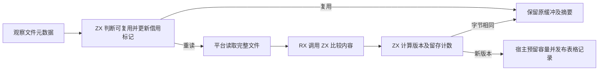

# 常驻文件版本更新与结算自举

## Intent · 目标

把常驻引导器从识别文件版本到结算旧缓冲的规则迁到 RX/ZX。保留现有文本复用、摘要和失败回退语义，让平台宿主负责文件系统、内存和实体表格。

## Data · 正式调用链

`build/resident/files.zig` 的 `read` 先判断元数据缓存是否有效，必要时重新读取。原先 Zig 比较读回的字节、计算活跃及待保留计数，成功或失败时再逐条决定留存。Source 已有文件时间检查和借用版本边界，现将它们接入完整文件更新路径。

## Edges · 留存与所有权

相同字节继续沿用旧缓冲地址与摘要，元数据或读取时间可以更新。新内容先完成容量预留，再登记已替换缓冲和新状态。失败留存容量只为确实需要保留的旧缓冲预留。已替换缓冲留到请求结束，供同一请求中更早取得的视图读取。结算时 ZX 将保留项的引用直接移动到已预留的尾部，清空原记录对应引用。Zig 销毁其余缓存缓冲，保持现有的初始 seed 行为和公开诊断字段。

摘要复用检查依据完整切片的地址与长度。Blake3 计算以及文件打开、读取和实际销毁继续由 Zig 提供。解析缓存继续使用共享的留存边界，本批只迁移文件缓存的读取和结算。

## Answer · 验收

初始 seed 通过 14 个构建步骤，Source 引导器通过 25 个步骤。两代 Source 引导器对同一份新规则清单生成的 82 个文件逐字节一致。改写原文件的相同字节后继续使用旧输出，留存量保持一致。连续三次无效源码修改都保留同一份有效旧版本，恢复后 709 个 Zig 文件与独立冷生成相同。

常驻回归覆盖交替编辑、混合编辑、切换依赖、失败和恢复。逐请求比较生成结果、分析版本、活跃与留存字节、被替换缓冲及 XML 解析统计，均一致。两文件交替编辑的请求中位墙钟为 49.39 → 49.99 毫秒，混合编辑为 50.35 → 49.36 毫秒，依赖切换为 53.03 → 53.05 毫秒。

固定 735 个入口，macOS arm64，Zig 0.17.0，ReleaseSmall，16 分区。三版由对应的 Source 引导器生成并执行 Source 分析与生成。交错执行三轮，取中位数。上一阶段和候选的 11,758 个输出文件及 v18 唯一性缓存载荷逐字节一致，输入戳随工具身份变化。

| 场景与指标                 | 固定基线 | 上一阶段 |   候选 |
| -------------------------- | -------: | -------: | -----: |
| 冷生成墙钟（秒）           |     2.82 |     2.57 |   2.58 |
| 冷生成 CPU（秒）           |    12.41 |    12.21 |  12.20 |
| 冷生成进程树采样峰值（MB） |   889.31 |   697.02 | 697.96 |
| 冷生成单进程系统峰值（MB） |   961.31 |   745.24 | 734.84 |
| 热重建墙钟（秒）           |     2.22 |     1.98 |   1.97 |
| 热重建 CPU（秒）           |     8.53 |     8.30 |   8.25 |
| 无修改墙钟（秒）           |     0.04 |     0.04 |   0.04 |

相对上一阶段，冷生成墙钟增加 0.01 秒，CPU 减少 0.01 秒，进程树采样峰值增加 0.93 MB，单进程系统峰值下降 10.40 MB。相对固定基线，冷生成墙钟和 CPU 分别减少 0.24 秒和 0.21 秒。计时范围为分析及 Zig 源码生成，分区编译和链接由引导构建另行验证。
