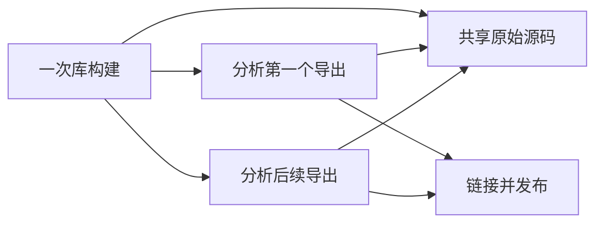

# 库构建共享源码读取

## Intent · 目标

多个库导出共用 ZX 依赖时，一次构建只读取一份原始源码。保留各入口的路径校验、分析和发布语义。

## Data · 根因

公开库构建逐个分析导出入口。已有 ZX 解析缓存跨入口复用，但每个入口重新从磁盘读取共享文件，并在该轮库构建的分配区保留各自的源码。监听模式还会重复计算这些源码的摘要。公开 Gateway 也通过库分析入口收集各路由的服务。

## Edges · 读取与失效边界

成功读取的原文由本次构建持有。各入口照常选择导入路径和校验包边界。监听发布前仍核对磁盘输入，下一轮构建重新读取。模板展开、语义分析和 Zig 后端各自保有原来的入口。

ZX 直接导出、RX 导出和从 ZX 进入 RX 的混合入口共用读取区。RX 收集与依赖遍历借用同一次读取的字节。首次成功读取仍登记输入摘要，读取失败仍按原有路径报告。共享读取区随本轮库构建销毁，常驻的解析缓存继续独立检查实际源码。

## Answer · 验收

库发布、ZX 与 RX 监听和失败恢复、原生头文件变动、安装依赖恢复及两组 Gateway 回归通过。Gateway 应用覆盖 86 项检查。两项模板入口生成在基线和候选均失败，原因相同。正式 CLI 运行该夹具时，无法解析编译器 bootstrap 注入的 `core/const` 包引用。

macOS arm64、Zig 0.17.0、ReleaseSmall。直接对照为 `7741eba37`。两套 CLI 均由 `7c9b225c3` Source 引导器构建，执行 Source 分析和生成。一次性库发布关闭生成缓存，使用 16 个导出与共享的 49 个 ZX 源码。大源码样本为各 ZX 文件添加约 122 KB 的注释。每项分别交错运行，排除首轮后取七轮中位数。

| 单次库发布 |      墙钟，秒 |       CPU，秒 |    峰值 RSS，MB |
| ---------- | ------------: | ------------: | --------------: |
| 原始项目   | 0.876 → 0.858 | 1.019 → 1.003 |   94.72 → 96.60 |
| 大源码项目 | 2.736 → 2.641 | 2.889 → 2.795 | 203.72 → 112.21 |

大源码发布在对照的每轮都占用至少 195.51 MB，候选每轮低于 118.05 MB。原始项目的峰值中位数增加 1.88 MB，两版样本范围重叠。两个项目以及将第一个导出换为 ZX 入口的混合项目，各自的 70 个发布文件在两版间逐字节一致。

监听对照在首次发布后连续四次原子替换同一个 ZX 依赖。墙钟从写入到发布，包括轮询时间。CPU 使用 `proc_pid_rusage` 的进程采样差值，经本机 Mach 时间单位转换。排除首轮后，取每版三轮进程的峰值中位数与每个场景十二次编辑的中位数。

| 监听构建   |  首次墙钟，秒 |  编辑墙钟，秒 |  编辑 CPU，秒 | 进程峰值 RSS，MB |
| ---------- | ------------: | ------------: | ------------: | ---------------: |
| 原始项目   | 0.877 → 0.853 | 1.416 → 1.399 | 1.083 → 1.067 |    70.04 → 69.39 |
| 大源码项目 | 2.734 → 2.640 | 1.725 → 1.632 | 1.385 → 1.293 |   178.50 → 84.54 |

大源码的监听进程峰值下降 52.6%，每次编辑的 CPU 和墙钟分别减少约 92 ms 和 93 ms。各项目在全部监听轮次的最终 70 个发布文件与基线逐字节一致。此次测量覆盖应用库发布和监听进程。完整编译器冷构建、跨编辑语义复用及 Gateway 并发吞吐各需对应的测量。

原始记录保存在 `.zig-cache/verification-tmp/watch-versions/`，包括 `source-text-final-regression.log`、`source-text-template-baseline.log`、`source-text-cold-comparison.json` 和 `source-text-comparison.json`。

编译管线、验证、所有权及 Gateway 的源码核对见 [编译器与应用性能诊断复查](编译器与应用性能诊断复查.md)。跨编辑的解析缓存见 [监听构建复用解析结果](监听构建复用解析结果.md)。
