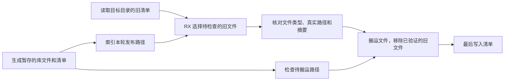
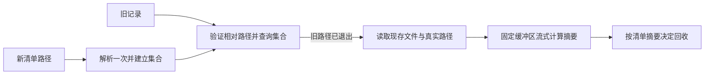

# 库重发与旧产物回收自举

## Intent · 目标

迁移库重发时选择旧产物、核验内容和识别发布清单的规则，减少重发的路径查找和文件内存。保持旧产物回收、用户文件保护和监听恢复的行为。

## Data · 正式路径

首次发布和 watch 都先在临时目录写库，再通过 `watch/library.zig` 检查输入与目标。原路径重新读取这一轮刚生成的清单，并为每个旧文件把新清单的全部路径重新解析一遍。生成清单和校验旧文件都会将文件读入内存，然后计算 SHA-256。

## Edges · 边界与限制

复用本次写出的清单记录，新旧清单继续使用同一大小上限。旧清单从目标读取，按原格式和路径规则验证。只为候选旧文件核对磁盘上的文件类型、真实路径、与构建输入的重叠及摘要。目标文件的真实路径仍在处理候选旧文件时读取，归一化后的目标文字路径复用索引。真实路径解析、目录遍历、SHA-256 和搬运继续调用 Zig 平台库。

## Answer · 验收

`test-library-publish`、`test-watch-library` 和 `test-library-bundle` 共 107 个构建步骤通过。覆盖旧清单兼容、摘要大小写、用户修改保护、父目录符号链接、未管理文件保留、失败后恢复和搬迁后的原生库消费。

初始 seed 和 Source 引导器生成的 CLI 入口文件及类型 ABI 逐字节一致。额外对照了旧清单路径经符号链接父目录指向本次继续发布的文件的情况。上一提交和候选均保留该文件及符号链接，并生成相同清单。

macOS arm64、Zig 0.17.0、ReleaseSmall。三套 CLI 都由 `7c9b225c3` 的 Source 引导器生成，运行时使用 Source 分析与生成，禁用 zxc 生成缓存。固定基线为 `dadb1f21a`，直接对照为 `1e9777a78`。交错执行，排除首轮后取八轮中位数。五组共 1,127 个文件逐字节一致。重发前恢复同一份旧输出，恢复耗时排除在测量之外。

| 场景                                           | 墙钟，固定 / 直接 / 候选（ms） | CPU，固定 / 直接 / 候选（ms） | 峰值 RSS，固定 / 直接 / 候选（MB） |
| ---------------------------------------------- | -----------------------------: | ----------------------------: | ---------------------------------: |
| 普通首次发布                                   |          18.31 / 17.04 / 16.99 |         19.39 / 18.50 / 18.32 |              12.64 / 12.51 / 12.53 |
| 大 Zig 源码首次发布                            |          62.05 / 57.74 / 57.62 |         63.09 / 58.87 / 59.04 |              63.62 / 46.88 / 30.26 |
| 普通重发                                       |          18.38 / 17.65 / 18.17 |         19.58 / 18.78 / 19.46 |              12.74 / 12.58 / 12.53 |
| 重发 518 个原生文件                            |       339.82 / 335.71 / 235.40 |      340.43 / 335.65 / 235.68 |              76.31 / 75.92 / 15.81 |
| 重发 518 个原生文件并回收一个约 11 MB 的旧文件 |       352.93 / 347.03 / 247.71 |      353.85 / 347.77 / 248.80 |              87.71 / 87.26 / 15.78 |

重发 518 个原生文件的墙钟下降 29.9%，峰值 RSS 下降 79.2%。普通重发相对上一提交多约 0.52 ms 墙钟及 0.68 ms CPU，仍低于固定基线。两组重发都核对了用户文件内容，大文件回收样本同时确认旧文件已删除。测量覆盖一次 `zxc build --mode lib`，完整冷自举未重测。原始日志位于 `.zig-cache/verification-tmp/library-republication/`。
