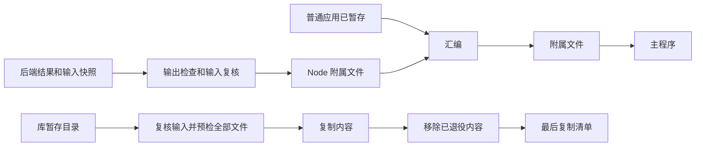

# 应用与库产物发布自举

## Intent · 目标

让一次性构建、watch 以及统一库的正式发布入口由 RX 排定验证和写入顺序。迁移暂存文件分类和库文件预检遍历，保留已有的错误优先级、输出保护、旧文件回收和清单语义。

## Data · 正式调用链

普通应用由 `build.run` 交给 `Staged.publish`。监视应用从 `Observed.publish` 检查输入快照后写入。统一库经由 `watch/library.publish` 预检生成目录，最后写入清单。

## Edges · 边界

Zig 标准库继续提供路径身份、目录句柄、文件复制和原子写入。输入内容核验沿用正式的快照流程。库退役路径的散列和物理别名核对复用已有实现。错误发生时释放快照、文件游标和临时地址。Node 文件所有权标记的检查仍由现有宿主负责。

库预检保留已验证的目标路径，复制时借用其中的相对路径后缀，省去预检时复制相对路径和写出时重新拼接。游标持有当前路径，跨语言边界只返回项目类别与名称是否匹配。macOS arm64 的 ReleaseSmall 窄复现中，内联 `Walker.next` 后，机器码在扩容路径缓冲区之前读出旧指针，随后把文件名复制到旧地址 `0x1`。将该标准库调用保留为独立调用后，游标会从有效缓冲区读取。此项兼容处理仅作用于发布游标。

## Answer · 验收

后端发布及执行、C 头文件监听及恢复、RX 与库监听、统一库发布、NAPI 和 Wasm 共通过 113 个构建步骤及 18 项 Zig 测试。正式 NAPI 运行通过 64 项模块绑定和 33 项 TypeScript 声明检查。独立 Node watch 验证了附属文件发生冲突时保留原产物，恢复后重新发布可运行的插件。初始 seed 和 Source 引导器生成的 49 个 Zig 文件中有 45 个逐字节一致，其余仅有局部变量编号差异。

三套 CLI 均由 `7c9b225c3` Source 引导器构建，运行时使用 Source 分析及生成。macOS arm64、Zig 0.17.0、ReleaseSmall，正式入口关闭 zxc 构建缓存，保留 Zig 工具链缓存。固定对照为 `e4cec1dc6`，直接对照为 `c99bc87e7`。版本交错运行，排除首轮，取七轮中位数。watch 的计时从启动到首份产物发布，CPU 和峰值 RSS 以监听进程回收时的统计为准。

| 样本                      | 墙钟秒（固定 / 直接 / 候选） | CPU 秒（固定 / 直接 / 候选） | 峰值 RSS MB（固定 / 直接 / 候选） |
| ------------------------- | ---------------------------: | ---------------------------: | --------------------------------: |
| 普通应用和汇编            |        1.312 / 1.312 / 1.312 |        1.370 / 1.371 / 1.368 |          180.73 / 180.49 / 180.63 |
| 原生应用 watch 首次发布   |        0.550 / 0.550 / 0.550 |        0.328 / 0.328 / 0.328 |             34.06 / 34.08 / 34.08 |
| 16 个 RX 入口的统一库发布 |        2.633 / 2.651 / 2.717 |        2.782 / 2.802 / 2.865 |          111.59 / 111.21 / 107.22 |

三套应用可执行文件及汇编逐字节一致，运行结果相同。统一库的 70 个发布文件逐字节一致。库发布相对直接对照墙钟增加 0.066 秒，CPU 增加 0.064 秒，RSS 下降 4.00 MB。相对固定对照，墙钟和 CPU 累计分别增加约 0.084 秒和 0.083 秒。完整自举冷构建另有独立基线，本次测量覆盖表中的三个入口。

原始记录位于 `.zig-cache/verification-tmp/output-publication/`，包括 `regression.log`、`seed-comparison.log`、`comparison.json` 和 `node-watch.log`。
