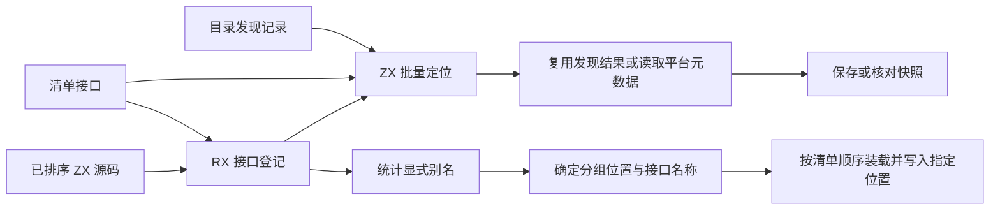

# 引导接口定位与登记自举

## Intent · 目标

把引导输入中原生接口的文本定位、分组与名称生成移到 RX/ZX。快照观察和实际装载共用定位逻辑，同时保留清单读取顺序、缓存键与原有错误行为。

## Data · 正式入口

`generate_parser.zig` 从清单准备输入。保存快照前按逻辑路径在目录发现记录中找接口。装载时再从按路径排序的 ZX 源码中借用接口文本，或者从磁盘读取。旧实现逐条建立列视图，只将单条定位交给 RX/ZX。Zig 另行统计显式别名、排列内部接口并合成内部名称。

## Edges · 数据与兼容边界

快照继续采用发现顺序的首个匹配，仅在候选为 ZX 路径时复用文件观察。装载采用既有的有序路径下界查找，以首个相等行借用文本。显式别名仍排在内部接口之前，组内保留清单顺序。ZX 只将行号和名称写入请求期表格。宿主继续提供文件元数据、内容读取以及保留期分配，保持接口文本与常驻分析历史之间的寿命关系。

初始引导器从等价的宿主实现引导。正式 Source 引导器实际执行生成的接口规则。目录遍历、路径排序、源文件与模板装配仍在 Zig 中。

## Answer · 验收

初始 seed 通过 14 个构建步骤。用上一阶段的 Source 引导器构建候选通过 25 个步骤，主清单生成 839 个入口。两版对同一份新接口规则清单生成的 71 个文件逐字节一致。另用一份清单同时导入从目录发现借用的内部声明、从磁盘装载的外部声明，核对快照记录、未修改复用、接口缺失时的错误及恢复后的 8 个生成文件。常驻生成器在变更内部模块名和声明后与清空产物后的独立生成一致，恢复后能够直接复用。

macOS arm64，Zig 0.17.0，ReleaseSmall，16 分区。固定 735 个入口，三个版本均使用各自的 Source 引导器生成，运行时执行 Source 分析与生成。交错执行三轮，取中位数。排除包含生成器身份的输入戳后，上一阶段与候选的 11,758 个生成文件及 v18 唯一性缓存载荷逐字节一致。

| 场景与指标                 | 固定基线 | 上一阶段 |   候选 |
| -------------------------- | -------: | -------: | -----: |
| 冷生成墙钟（秒）           |     2.83 |     2.55 |   2.56 |
| 冷生成 CPU（秒）           |    12.47 |    12.19 |  12.21 |
| 冷生成进程树采样峰值（MB） |   885.80 |   698.14 | 707.95 |
| 冷生成单进程系统峰值（MB） |   969.34 |   804.11 | 789.54 |
| 热重建墙钟（秒）           |     2.20 |     1.96 |   1.97 |
| 热重建 CPU（秒）           |     8.45 |     8.25 |   8.30 |
| 热重建单进程系统峰值（MB） |   935.17 |   696.94 | 697.06 |
| 无修改墙钟（秒）           |     0.04 |     0.03 |   0.04 |

相对固定基线，冷生成墙钟下降 0.27 秒，CPU 下降 0.26 秒。相对上一阶段，冷生成树采样峰值增加 9.81 MB，系统记录的单进程峰值下降 14.57 MB。对照覆盖引导器分析及 Zig 源码生成，构建校验另外覆盖分区对象和链接。
