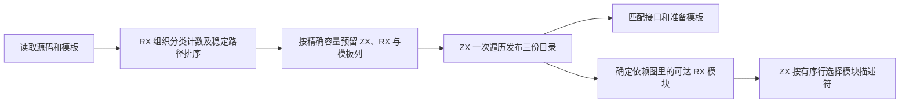
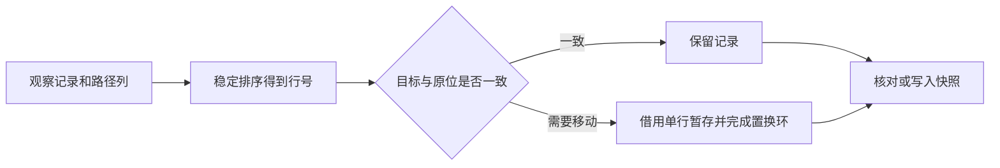

# 引导源码目录发布与行重排自举

## Intent · 目标

从生成器的清单和 lexer 入口迁移源码目录的实际发布、依赖图结果的行选择，以及快照观察记录的原地重排。保留稳定路径顺序、模板和包的引用方式及快照兼容性。

## Data · 正式调用链

`source_collection.publish` 已使用 RX/ZX 计算源码和资源顺序，Zig 仍按分组索引分别遍历并构建三份目录。快照路径排序也由 Source 完成，排序后的记录搬移仍由 Zig 按置换环处理。可达 RX 模块由依赖图返回有序行号，Zig 逐项挑出模块描述符。

## Edges · 描述符与快照

目录发布直接消费有序行号，省去原先按类别分组的第二份索引数组。路径和文本仍借用读取缓冲，多个 ZX 来源共享同一模板表，RX 来源共享包表。lexer 保留原来的空模板和包配置。写列转移的是固定大小的记录或引用描述符，由宿主绑定并核对目标宽度，源码、模板和包内容留在原来的存储。

Zig 继续提供文件系统、目录并发、分配器及内存列绑定。原生接口加载中的 I/O 和常驻文本保留也沿用当前路径。初始 seed 保留等价的排序和目录发布规则。

## Answer · 验收

上一阶段构建候选、候选构建下一代均通过 25 个步骤。两代引导器独立生成的 86 个分区文件逐字节一致，输入戳除外。初始 seed 的 lexer 构建通过 14 个步骤，模块生成及解析缓存回归通过 39 个步骤和 37 项 Zig 测试。

既有多根目录样本覆盖跨根包别名、模板编辑和恢复、重复模板路径失败、无变化复用。两个引导器的 8 个输出文件逐字节一致，lexer 单独生成的源码也完全一致。常驻热启动及模板修改后的生成结果等于同输入冷生成。另用混合接口样本验证发现目录里的接口和独立物理接口，覆盖文件缺失、恢复及同一物理路径的两项快照记录。其 8 个输出文件一致。以上输出对照排除随生成器身份变化的输入戳。

固定 735 个入口、16 个分区，macOS arm64、Zig 0.17.0、ReleaseSmall。三套工具均由 Source 引导器构建，使用 Source 分析与生成。交错运行三轮取中位数。相邻两版的 11,758 个生成文件和 v18 唯一性缓存载荷逐字节一致，输入戳除外。与固定基线的历史产物差异未增加。

| 生成器指标               |  固定基线 |  上一阶段 |      候选 |
| ------------------------ | --------: | --------: | --------: |
| 冷生成墙钟               |    2.83 s |    2.59 s |    2.60 s |
| 冷生成 CPU               |   12.44 s |   12.21 s |   12.23 s |
| 冷生成进程树采样峰值 RSS | 884.95 MB | 695.24 MB | 695.19 MB |
| 冷生成单进程系统峰值 RSS | 946.62 MB | 784.83 MB | 750.50 MB |
| 热重建墙钟               |    2.21 s |    1.97 s |    1.97 s |
| 热重建 CPU               |    8.46 s |    8.28 s |    8.24 s |
| 热重建单进程系统峰值 RSS | 934.02 MB | 693.53 MB | 693.27 MB |
| 无变化墙钟               |    0.03 s |    0.04 s |    0.04 s |

冷生成相对上一阶段的墙钟增加 0.01 秒，CPU 增加 0.02 秒，进程树采样峰值基本持平。相对固定基线，冷生成墙钟减少 0.23 秒，CPU 减少 0.21 秒。测量覆盖生成器，Zig 编译与链接由引导构建另行核验。
