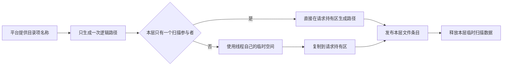

# 引导目录队列与文件缓存探测自举

## Intent · 目标

让 RX/ZX 构造引导目录的下一层队列，决定每个输入的路径及文件缓存探测。复用上一阶段的源码清单排序和装配，保持层序遍历、缓存身份及错误顺序。

## Data · 正式入口

`source_collection.zig` 同时服务于正式清单、输入快照和 lexer。旧代码逐个合成子目录路径，读文件时先用固定缓冲合成缓存键，稍后再合成同一个逻辑路径。每个扫描线程的目录名和临时记录留到整棵目录树扫描结束。

## Edges · 路径寿命与错误顺序

RX 调用 ZX 统计本层文件和子目录，再按父目录及发现顺序准备下一层。文件的逻辑路径复用于查缓存、快照索引和源码装载。逻辑路径超过平台原有的探测上限时，走已有的文件读取路径。ZX 保留 XML 与其他文件各自的文本保留规则。Zig 提供目录迭代、元数据、线程执行及缓存读写。

同层目录保持原顺序。如有多个错误，报告该顺序中最先失败的目录。只有线程全部结束并发布本层结果后才回收线程临时数据。下一层路径有独立的分配空间，使用完上一层路径后再复用其空间。初始 seed 仍使用等价的 Zig 规则。

## Answer · 验收

初始 seed 通过 14 个步骤，Source 引导构建通过 25 个步骤。两代引导器生成的 lexer 与目录规则清单中的 72 个文件逐字节一致。多根、多层清单覆盖跨根包别名、忽略文件、悬空符号链接、未引用模板和重复模板诊断。正常、编辑、恢复与失败阶段的生成结果及发布状态均与上一版相同。常驻引导器走多线程可用的分析预热路径，完成模板编辑后与独立冷生成一致，恢复后复用结果。

固定 735 个入口，macOS arm64，Zig 0.17.0，ReleaseSmall，16 分区。三版均由对应的 Source 引导器生成并运行 Source 分析与生成，交错执行三轮取中位数。上一阶段和候选的 11,758 个生成文件及 v18 唯一性缓存载荷逐字节一致，输入戳随工具身份变化。

| 场景与指标                 | 固定基线 | 上一阶段 |   候选 |
| -------------------------- | -------: | -------: | -----: |
| 冷生成墙钟（秒）           |     2.83 |     2.62 |   2.56 |
| 冷生成 CPU（秒）           |    12.46 |    12.16 |  12.16 |
| 冷生成进程树采样峰值（MB） |   884.46 |   696.73 | 696.03 |
| 冷生成单进程系统峰值（MB） |   975.77 |   803.03 | 735.41 |
| 热重建墙钟（秒）           |     2.19 |     1.96 |   1.96 |
| 热重建 CPU（秒）           |     8.43 |     8.24 |   8.22 |
| 无修改墙钟（秒）           |     0.04 |     0.04 |   0.04 |

相对上一阶段，冷生成墙钟减少 0.06 秒，单进程系统峰值下降 67.62 MB，进程树采样峰值基本持平。相对固定基线，冷生成墙钟减少 0.27 秒，CPU 减少 0.30 秒。对照计时覆盖分析与 Zig 源码生成。分区对象编译及链接在引导构建中验证。
