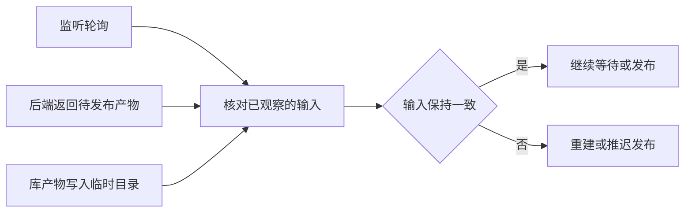
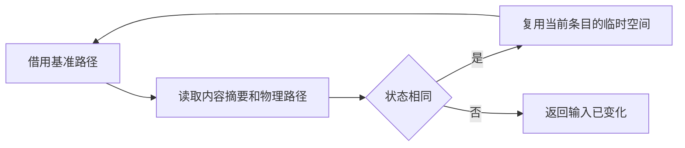

# 性能复查与监听输入扫描

## Intent · 目标

根据正式构建、验证和生成程序的调用路径复核外部性能诊断。消除监听期间输入核对做的重复工作，保留发布前的内容与路径检查。上一轮已确认并修复的解析和 JSON 开销见[编译与运行时性能核查](../2026-11-18/编译与运行时性能核查.md)。

## Data · 调用路径

| 问题                        | 当前实现                                                                                                                                                                                                                  |
| --------------------------- | ------------------------------------------------------------------------------------------------------------------------------------------------------------------------------------------------------------------------- |
| 依赖闭包与后端增量          | 正式构建生成入口、类型和按函数内容复用的 Zig 文件。普通 ZX 可读取语义缓存，RX 构建在同一轮内共用解析和依赖遍历。公开 RX watch 每轮重新装载和推导，后端重新启动 Zig 子进程并读取磁盘缓存。进程间的声明级分析复用仍有空间。 |
| 跨模块的重复推导与 SMT 展开 | 常驻自举入口支持模块分析重放。验证器共用等价的符号调用和中间表达式，并限制符号求值步数。实参不同仍会重新分析被调函数，尚无模块级契约摘要。Z3 求解本身的耗时取决于具体查询。                                               |
| 隐式复制、集合与 `$ctx`     | 生成器已有只读借用和唯一性复用，RX 结果引用在编译时解析为局部绑定。连续集合变换仍可能产生中间数组，借用的复合对象也可能随请求 arena 延长存活。实际开销取决于生成程序中的分配和最后使用点。                                |
| JSON 与请求内存             | Gateway 的每个请求都有自己的 arena。连续的未转义文本借用请求体，解码时才分配。Store 保留请求数据时，仍需跟踪被持有的区域及其回收时机。                                                                                    |
| 并发与取消                  | Gateway 在 accept 循环里同步完成一次连接。此前已复现半开的请求头阻塞另一条正常连接。当前这条路径上无法将排队归因为 Store 锁竞争。ZX 任务使用 Zig I/O Future，普通 loop 路径没有通用的逐次原子取消检查。                   |

Zig 的磁盘缓存与常驻声明级增量是两层机制。LLVM 文档中的聚合类型及别名建议可以用于检查特定生成函数，实际拷贝量需要由生成物和运行数据确认。[Zig 增量实现](https://mlugg.co.uk/posts/incremental-compilation-internals/) · [LLVM 前端性能指南](https://llvm.org/docs/Frontend/PerformanceTips.html)

## Edges · 实现和兼容边界

监听成功或失败后保留一份按路径排序的基准。每次检查借用基准条目并读取当前状态，复用单条记录的临时空间。发现首个不一致即可确认重建或拒绝发布，随后一次构建负责重新收集依赖和报错。发布前继续检查完整内容摘要、物理路径、文件类型和目录条目，并保留输出重叠检查。文件摘要直接消费读取器缓冲，使用原有 SHA-256。无变化的轮询仍会访问全部依赖。

Gateway 的慢连接隔离涉及连接 I/O 与 Store 快照提交的边界。此阶段保持既有服务调度与 Store 生命周期。SMT 摘要、集合融合和常驻 Zig 后端都需要各自的代表性输入与独立验收。

## Answer · 验收

使用上一阶段的 Source 引导器构建正式 CLI。后端协议发布、真实 Zig 后端、ZX/RX 监听、库监听、C 头文件恢复、包安装监听共通过 79 个构建步骤及 18 项 Zig 测试。Gateway、Gateway JSON、实际 Z3 验证及验证资源回归也通过，其中 Gateway 包含 86 项行为检查。

在 macOS arm64 上使用 Zig 0.17.0、ReleaseSmall，对照 `c3ab25386` 的扫描实现和候选。两个程序调用各自版本的真实输入观察和状态比较函数，使用同一批 1,000 个文件。每轮先构造基准，再比较 24 次。两版交错执行，排除首轮后取五轮中位数。

| 扫描场景                              | 对照墙钟（秒） | 候选墙钟（秒） | 对照 CPU（秒） | 候选 CPU（秒） |
| ------------------------------------- | -------------: | -------------: | -------------: | -------------: |
| 无变化，每个文件约 3 KiB              |           0.44 |           0.43 |           0.44 |           0.43 |
| 无变化，每个文件约 32 KiB             |           0.72 |           0.73 |           0.71 |           0.72 |
| 第一个文件发生变化，每个文件约 32 KiB |           0.71 |           0.03 |           0.70 |           0.02 |

三组扫描进程的系统峰值 RSS 均由 3.28 MB 降至 3.01 MB。计时范围包含初始快照，排除监听轮询等待、ZX/RX 分析、Zig 编译和链接。首个变化越靠近末尾，提前退出节省的扫描越少。
