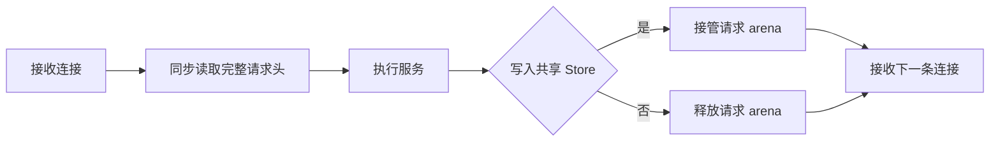
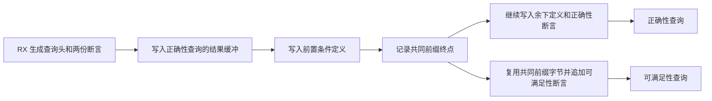

# 性能实测与验证查询直接写入

## Intent · 目标

核对外部诊断在正式 `zxc` 和生成应用中的适用范围。修复已确认的 SMT 查询缓冲重复分配和复制，保留验证行为、证据字节和默认输出路径。用可重复的本地输入确认 Gateway 的排队和 Store 内存增长。

## Data · 源码与复现

| 外部诊断                    | 源码核对结果                                                                                                                                                                                                         |
| --------------------------- | -------------------------------------------------------------------------------------------------------------------------------------------------------------------------------------------------------------------- |
| 全闭包重编与巨大 Zig 单文件 | 冷构建从入口装载可达依赖。应用将入口、类型和函数拆成 Zig 单元，按内容复用文件。公开 watch 复用未变化的 ZX 解析结果，RX 语义仍按轮分析。后端每轮启动 Zig 子进程并使用磁盘缓存。自举另有常驻前端和对象分区缓存。       |
| 多个调用方重复推导共同模块  | 同轮 RX 分析共享 ZX 依赖装载、解析缓存和已推导的模块结果。重复发生在公开 RX watch 的跨轮语义分析，以及多入口库各做其入口推导的范围内。                                                                               |
| SMT 展开与求解成本          | 符号图合并等价表达式，缓存相同函数和符号实参的调用，并有求值步数上限。不同实参仍可能展开函数体。本次确认生成器把同一批 SMT 定义先写到临时区，再整段复制进正确性查询。                                                |
| 隐式深拷贝与 `$ctx` 膨胀    | 只读聚合值已有借用，确定独占的更新可复用存储。`$ctx` 编译成对局部结果的静态引用。各自需要实体数组的集合链仍可能分配中间结果。结果所引用的内存由请求区域的生命周期决定。                                              |
| JSON 和请求内存             | Gateway 已有按请求释放的 arena，连续未转义字符串可以借用请求体，定长请求体一次分配，响应缓冲在发送后释放。写入包含借用引用的共享 Store 时，原实现保留接管的整个请求区域。                                            |
| 线程、Store 锁与取消        | Gateway 的接收循环同步处理一条连接。RX 部分纯计算 `Parallel` 路径生成系统线程，ZX Future 使用 `std.Io`。普通 `loop` 无通用逐轮原子取消检查。已观测到的 Gateway 排队发生在串行接收路径，尚无并发 Store 锁争用的测量。 |

公开解析复用和请求分配器已有独立验收。Zig 的声明级增量、磁盘缓存和 zray 前端复用各自有独立的失效边界。 [监听构建复用解析结果](监听构建复用解析结果.md) · [Gateway 请求底层分配器](Gateway请求底层分配器.md) · [Zig 增量编译实现](https://mlugg.co.uk/posts/incremental-compilation-internals/) · [LLVM 前端性能指南](https://llvm.org/docs/Frontend/PerformanceTips.html)

用 `e4cec1dc6` 的 Source CLI 生成 ReleaseSmall Gateway，先发送不完整的请求头，再发一个正常请求。后者在 252.3 ms 超时，关闭慢连接后相同请求恢复。该测试给出等待时间下界。使用同一个程序，分别从新服务进程发送 50,000 次纯文本回显和携带共享字段的 Store 更新，并校验每次响应。RSS 使用 `ps` 按请求次数采样，单位为十进制 MB。

| 请求操作       | 第 1 次 | 第 10,000 次 | 第 25,000 次 | 第 50,000 次 |
| -------------- | ------: | -----------: | -----------: | -----------: |
| 文本回显       |    1.93 |         1.97 |         1.97 |         1.97 |
| 更新共享 Store |    1.93 |         5.05 |         9.65 |        17.30 |

Store 写入样本复用上一份状态的字符串并替换数组。现有独占回收只处理已经证明不借用旧状态的写入。该样本走共享策略，旧请求内存随接管列表增长。准确回收需要跨请求区分实际上仍被字段引用的存储，闭包和集合的通用所有权约束仍适用。

## Edges · 改动与兼容边界

RX/ZX 继续编排信号声明、契约条件和断言。宿主把符号图定义直接顺序写入正确性查询的结果缓冲区。前置条件定义写完后记下字节边界，可满足性查询复制这一段共同前缀，再拼上自己的断言。定义行预留按名字、表达式和最长格式开销计算。缓冲区由结果 arena 持有，缩短切片时复用原存储。源证据、两次求解、异常与反例协议沿用原路径。初始 seed 的布局从同一 RX/ZX 源码重新生成。

## Answer · 验收

验证入口、分配失败及无效 IR、FPGA 资源和统一库发布共通过 92 个构建步骤及 8 项 Zig 测试。真实 Z3 回归覆盖普通验证、库公开 ZX/RX 入口、反例、枚举域和不可满足的前置条件。单独编译并执行初始 seed 的查询布局，核对查询头和两份断言的精确内容。

macOS arm64、Zig 0.17.0、ReleaseSmall、Z3 5.3.3。固定对照为 `f15130d6c`，直接对照为 `e4cec1dc6`。三套 CLI 由 `7c9b225c3` Source 引导器构建并执行 Source 分析和生成。版本交错执行，第一轮预热后取九轮中位数。RSS 按十进制 MB 记录系统峰值。固定响应的求解器替身只用于隔离编译器生成开销，其他三组使用实际 Z3。

| 输入                              | 墙钟 ms（固定 / 直接 / 候选） | CPU ms（固定 / 直接 / 候选） | 峰值 RSS MB（固定 / 直接 / 候选） |
| --------------------------------- | ----------------------------: | ---------------------------: | --------------------------------: |
| 3 次符号调用，实际 Z3             |         11.37 / 11.44 / 11.29 |        10.49 / 10.50 / 10.44 |             25.21 / 25.21 / 25.21 |
| 192 次符号调用，实际 Z3           |      247.78 / 248.21 / 246.69 |     246.03 / 246.40 / 245.02 |             89.64 / 89.62 / 89.64 |
| 192 次符号调用和前置条件，实际 Z3 |      247.87 / 248.30 / 246.90 |     246.25 / 246.74 / 245.32 |             89.64 / 89.62 / 89.62 |
| 192 次符号调用，隔离求解          |      172.29 / 172.66 / 171.54 |     170.99 / 171.37 / 170.16 |             41.70 / 41.76 / 38.80 |

大样本正确性查询为 2,977,877 字节，SHA-256 为 `d2ffddd7537681d1f0f076e90b7639f0a5028804106bc892131cea96e2e5e7e0`。每个场景的两份查询、源证据、求解器输出、验证结果和模型共七份产物，在三版工具间逐字节一致。带前置条件的样本同时核对了基于证据和查询摘要计算的默认输出路径。

隔离求解时编译器进程峰值下降 2.97 MB，约为 7.1%。实际 Z3 场景的峰值由求解阶段主导，整体峰值接近，三组墙钟与 CPU 的中位数均略降。结论仅覆盖表中验证入口。冷构建、公开 watch 的语义重放、不同实参的契约摘要和集合融合仍需对应场景验收。Gateway 接入排队和共享 Store 退役区域是已复现的运行时问题。

本地记录位于 `.zig-cache/verification-tmp/verification-output/`，包括 `regression.log`、`measurement.json`、`gateway-probe.log` 和 `seed-check.log`。
