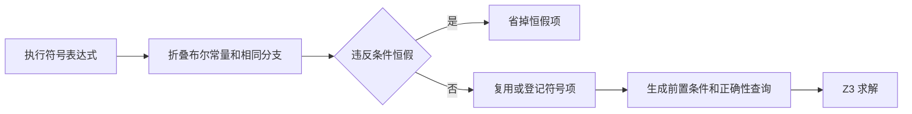
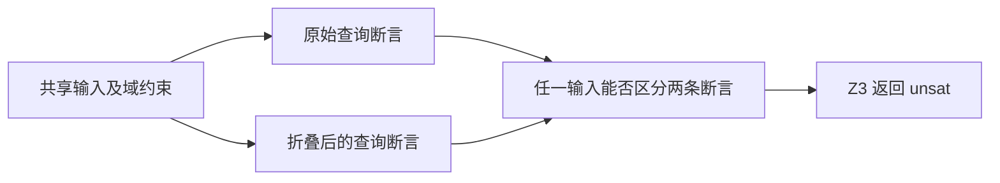

# 性能诊断与验证条件折叠

## Intent · 目标

沿正式编译、验证和生成应用的入口核对外部性能诊断。优先消除一项已在现有样本上观察到的开销，并使用相同输入核实收益和契约语义。

## Data · 实现核查

| 外部假设                    | 正式实现与证据                                                                                                                                                                                                                      |
| --------------------------- | ----------------------------------------------------------------------------------------------------------------------------------------------------------------------------------------------------------------------------------- |
| 每次汇成一个巨大的 Zig 文件 | 应用生成入口、类型和函数单元，按内容复用生成文件。自举另有对象分区缓存。公开 watch 仍为后端每轮启动 Zig，使用磁盘缓存。                                                                                                             |
| 相同依赖反复解析和推导      | RX 同轮共享 ZX 装载、解析与模块结果。公开 watch 跨轮复用 ZX 解析和已核验输入。RX 语义分析仍按轮执行，多入口库按入口组装推导结果。常驻 Source 引导器有单独的分析历史。                                                               |
| SMT 分支和调用过度展开      | 已按函数及符号实参复用结果，符号图合并相同表达式并限制步数。不同实参仍可触发函数体展开。旧实现也为安全恒真的语句生成否定项，再将这些项逐层拼入调用安全条件。                                                                        |
| 多处读取触发隐式深拷贝      | 只读聚合可借用，确定独占的更新可复用底层存储。RX 的 `$ctx` 在编译期绑定到局部结果。未融合的集合操作仍可能物化中间数组，区域分配也可能使临时结果存活到请求结束。                                                                     |
| JSON 使用逐对象通用分配     | Gateway 已使用按请求释放的 arena，连续未转义字符串借用请求体。较大的标量请求体和发送完毕的响应缓冲已能提前释放。共享 Store 写入仍可接管整个请求区域。                                                                               |
| 并发由全局 Store 锁拖慢     | 正式 Gateway 在 accept 循环内读头、执行并发送。既有复现中，慢请求头使正常连接在 250 ms 内得不到响应。共享 Store 的旧区域可随更新累积。部分 RX Parallel 会启动系统线程，ZX Future 使用 Zig I/O，普通 loop 无统一的逐轮原子取消轮询。 |

实现位置包括 `packages/compiler/src/backends/zig/function_sources.zig`、`packages/cli/src/cli/watch.zig`、`packages/compiler/src/rx/analysis/project/history.zig`、`packages/genz/src/analysis/gateway/host/accept.zx` 和 `packages/genz/src/analysis/parallel/emit/spawn_item.zx`。既有运行时样本及回收边界见 [Gateway 请求体与共享 Store 生命周期](Gateway请求体与共享Store生命周期.md) 和 [监听重建复用已核验输入](监听重建复用已核验输入.md)。Zig 的磁盘和声明级增量缓存各有失效边界，LLVM 对聚合和内存访问的建议用于核对生成形态。 [Zig 增量编译实现](https://mlugg.co.uk/posts/incremental-compilation-internals/) · [LLVM 前端性能指南](https://llvm.org/docs/Frontend/PerformanceTips.html)

## Edges · 求值与证据边界

ZX 规则简化 `or`、条件选择和 `path && !safe`。短路运算先根据左操作数选取右操作数的安全条件，再合并左侧安全条件。验证驱动仍按原顺序访问表达式及分支，执行定宽算术检查、IR 验证和诊断。确定恒假的违反条件不进入图的违反列表。初始 seed 使用等价规则。

查询证据依然包括源程序、IR、两份 SMT 查询、求解状态和模型。更小的查询改变 SMT 定义标识和查询摘要，因此默认的内容寻址目录也随证据更新。查询等价性通过共享相同输入声明与域约束、对两版断言异或求解核实。

## Answer · 验收

验证、资源分配与 FPGA 资源回归通过 76 个构建步骤及 8 项 Zig 测试。正式 Z3 回归覆盖公开 ZX/RX 入口、枚举域、有效证明、反例和不可满足的前置条件。额外在六种输入上检查两类查询的差异，共十二次异或求解均为 unsat。除零样本仍给出输入 0 的反例，被短路条件保护的除法仍可证明，恒假前置条件仍报告不可满足。

macOS arm64、Zig 0.17.0、ReleaseSmall、Z3 5.3.3。固定对照为 `f15130d6c`，直接对照为 `fdfd921f2`，三套 CLI 均由 `7c9b225c3` 的 Source 引导器构建并执行 Source 分析和生成。版本交错运行，每版去掉预热后取九轮中位数。RSS 为 `wait4` 返回的峰值，按十进制 MB 计。固定响应仅用来隔离符号生成与证据写出。

| 输入                          | 墙钟 ms（固定 / 直接 / 候选） | CPU ms（固定 / 直接 / 候选） | 峰值 RSS MB（固定 / 直接 / 候选） |
| ----------------------------- | ----------------------------: | ---------------------------: | --------------------------------: |
| 3 次符号调用，真实 Z3         |         11.37 / 11.29 / 11.21 |        10.49 / 10.44 / 10.33 |             25.20 / 25.21 / 25.12 |
| 192 次不同实参调用，真实 Z3   |      246.55 / 246.21 / 160.60 |     245.14 / 244.37 / 159.57 |             89.64 / 89.64 / 31.92 |
| 192 次调用和前置条件，真实 Z3 |      246.93 / 245.92 / 160.94 |     245.45 / 244.42 / 159.86 |             89.64 / 89.62 / 31.93 |
| 192 次调用，替换求解过程      |      172.18 / 171.14 / 151.51 |     170.91 / 169.89 / 150.18 |             41.70 / 38.81 / 22.48 |

192 次调用的正确性查询由 2,977,877 字节降到 325,788 字节，SMT 定义由 46,667 项降到 5,768 项。所有计时组的源证据和求解状态逐字节相同。实测覆盖验证入口，编译器全量冷构建沿用已有测量。仍有实现空间的路径包括公开 RX watch 的语义重放、不同实参的契约摘要、集合链融合、Gateway 接入调度和共享 Store 退役区域的有界回收。

原始记录位于 `.zig-cache/verification-tmp/predicate-folding/`，包括 `measurement.log`、`regression.log`、`equivalence.log` 和 `behavior.log`。
