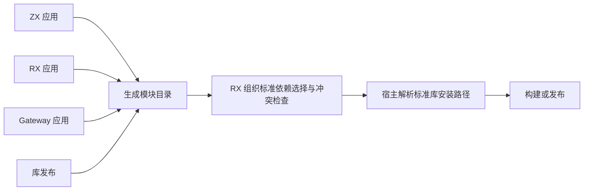
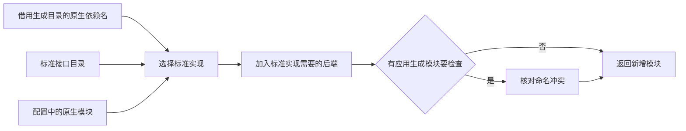

# 标准库链接计划自举

## Intent · 目标

把应用与统一库链接时的标准模块选择、辅助模块接入和应用命名冲突检查迁入 RX/ZX。ZX、RX 和 Gateway 应用以及库发布共用同一计划，从已经生成的模块目录借用依赖名。

## Data · 正式调用路径

ZX、RX、Gateway 及库发布原先通过 `CompileOptions.dependencies` 收集依赖。每次检查都另外复制所有原生模块名。统一库的公开入口视图共用一张模块表，逐入口检查会重复复制同一张表。仅输出 Zig 源码的调用也传入这份列表，但后续没有消费。

四条入口的生成结果已携带包的原生模块名。生成前的内联改写保留原生模块表，库公开视图共享链接后的表。普通应用、RX 应用和 Gateway 拿到的生成模块表已包含各自需要检查的生成模块集合。此前，三个应用入口各自执行一次 Zig 的原生命名冲突检查。

## Edges · 边界与限制

标准模块按已有目录顺序加入。已配置的模块优先，重复的接口声明共用同一实现。需要根标准库时，同时接入 SHA-256 和字节后端，先检查保留名称。三个应用入口检查原生模块与生成模块命名冲突。库的公开入口及生成产物继续沿原有库发布规则检查。

RX 显式先执行选择，再根据选择结果与生成模块范围执行命名检查。ZX 的规则借用配置和产物的名字列，通过现有模块名查找共享匹配语义。计划为空时直接返回原配置。计划需要补充模块时，宿主分配一份最终配置、解析安装路径，再使用已有 Zig 后端和库发布流程。公开编译器选项的依赖收集行为保持兼容。

## Answer · 验收

标准库运行与文件系统、Gateway、原生库发布、ABI 别名、编译库导入、RX I/O 库和独立 Zig 库消费八组回归通过，共 1,127 个构建步骤、19,636 项 Zig 检查。Gateway 的 86 项行为检查通过。独立 Zig 消费者通过 6,193 个 URL 用例。

初始 seed 和 Source 引导器生成的 CLI 入口、类型 ABI 和链接计划导出逐字节一致。函数实现中的差异经一致的局部变量重命名归一化后相同，产物清单的散列随生成字节变化。两套生成结果分别编译运行，验证了目录重名去重、显式配置优先、辅助模块保留名、只使用字符串库及应用命名冲突。

macOS arm64、Zig 0.17.0。固定基线为 `dadb1f21a`，直接对照为 `9c88e234d`。三套 CLI 均由 `7c9b225c3` 的 Source 引导器生成，且运行 Source 分析和生成。关闭 zxc 生成缓存，复用同一 Zig 工具链与后端缓存。应用产物使用 ReleaseSmall。三版交错运行，首轮预热后取七轮中位数。RSS 采用系统记录的峰值，单位为十进制 MB。

| 场景                    |  墙钟 ms（固定 / 直接 / 候选） |   CPU ms（固定 / 直接 / 候选） | 峰值 RSS MB（固定 / 直接 / 候选） |
| ----------------------- | -----------------------------: | -----------------------------: | --------------------------------: |
| 普通 ZX 应用            |       851.47 / 851.72 / 851.74 |       906.25 / 906.87 / 906.84 |          179.63 / 179.54 / 179.47 |
| 52 个原生模块           |       887.96 / 886.01 / 887.14 |       959.82 / 960.86 / 961.20 |          182.26 / 182.14 / 182.16 |
| 混合标准库 ZX 应用      |       929.42 / 930.12 / 928.77 |     997.85 / 1,006.23 / 996.61 |          188.33 / 188.71 / 188.74 |
| 混合标准库 RX 应用      |       931.84 / 933.48 / 930.95 |   1,000.23 / 1,000.44 / 997.76 |          188.50 / 188.28 / 188.35 |
| 混合标准库 Gateway      | 1,135.07 / 1,136.63 / 1,137.80 | 1,200.93 / 1,203.77 / 1,202.61 |          199.13 / 199.59 / 199.28 |
| 24 个公开入口共用标准库 |       231.21 / 218.55 / 217.52 |       245.58 / 232.87 / 231.55 |             53.62 / 45.69 / 45.71 |

五份应用和库发布的 118 份文件在三版工具及所有采样中逐字节一致，保留模块名与应用冲突分别得到 `ReservedNativeModule`、`ConflictingModuleName`。相对上一提交，墙钟最大增幅为 1.18 ms，CPU 最大增幅为 0.34 ms，峰值 RSS 最大增幅为 0.07 MB。相对固定基线，三个指标的最大增幅分别为 2.73 ms、1.68 ms 和 0.41 MB。24 入口库发布较上一提交减少约 1.03 ms 墙钟和 1.31 ms CPU。这些结果覆盖受影响的应用构建与库发布，完整冷自举时间未重测。

本地原始记录位于 `.zig-cache/verification-tmp/standard-linkage/`，包括 `regression.log`、`generation-parity.json`、`comparison.json` 和两套引导器产物的执行日志。
