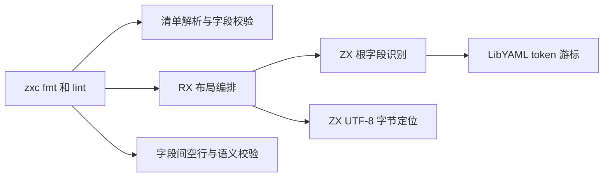
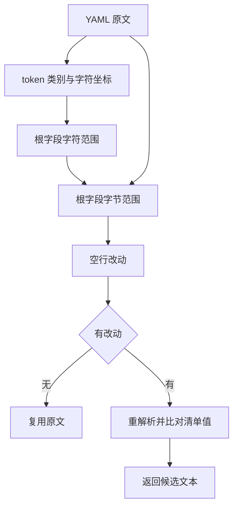

# 清单格式化字段范围自举

## Intent · 目标

让 `zxc fmt pkg.yaml` 和 `zxc lint pkg.yaml` 使用 RX/ZX 决定根字段的文本范围。保留格式化输出、诊断位置和写回行为，降低大清单的分配和解析开销。

## Data · 实现证据

此前 CLI 在校验入口解析原清单，格式化后又分别解析原文和结果。字段提取为每个 UTF-8 字符建立一个字节偏移，字段极少且注释很长时也需要维护整张表。

现在 CLI 持有已校验的原清单。RX 调用 ZX 扫描 YAML token 的根层字段，再将实际使用的字符范围映射到字节。ZX 记录已关闭字段的最后一个有效 token，并决定块标量尾部的换行是否需要保护。字节定位借用源文件，用一个游标前进和回溯。布局阶段的临时内存随根字段数量增长。没有空行改动时直接借用原文，避免再次解析或分配一份输出。发生改动时解析候选文本并对照已校验的原清单。

## Edges · 边界

LibYAML 继续负责 YAML 词法与文档解析。Zig 仅在扫描接口读取 C token、暴露标记，并管理其生命周期。空行规则沿用现有的 Source 实现。宿主将字节范围转换为 lint 的标量记录，并负责应用文本改动和对照清单值。`pkg init` 与库发布的 YAML 写入、清单类型化装配仍由 Zig 执行。

初版使用通用的 `{ start, end }` 结构表示字节范围。生成器把它和工作区路径片段的同形结构归入同一类型，连带改变了工作区函数的返回形态。现用 `byte_start`、`byte_end` 标明坐标单位，原有工作区函数恢复各自的生成布局。生成器的跨入口类型表示仍需独立处理。

## Answer · 验收

配置格式化、包清单、清单资源以及原生库发布回归全部通过，共 79 个构建步骤、8 项 Zig 用例与 2,167 项 CLI 用例。额外核对 55 份输入的 `fmt`、`fmt --check` 和 `lint`，与上一提交的输出、诊断和退出状态一致。用初始 Zig seed 和 Source 引导器生成同一份 CLI 清单，244 个 Zig 文件的清单一致。205 个文件逐字节一致，其余差异只有局部变量编号。上一阶段的 127 个生成函数文件逐字节一致。

三版 CLI 都由 `7c9b225c3` Source 引导器生成，并执行 Source 分析与生成。实测为 macOS arm64、Zig 0.17.0、ReleaseSmall。固定基线为 `dadb1f21a`，上一提交为 `bee882280`，以下按固定基线、上一提交和本阶段的顺序列出。每个输入交错执行三版 CLI 的 `zxc fmt`，首轮预热后取十轮中位数。六个样本的输出、诊断及退出状态均一致。

| 输入               |               墙钟 ms |                CPU ms |           峰值 RSS MB |
| ------------------ | --------------------: | --------------------: | --------------------: |
| 已排版的小清单     |    1.17 / 1.18 / 1.17 |    0.92 / 0.93 / 0.91 |    3.60 / 3.75 / 3.64 |
| 需要排版的小清单   |    1.17 / 1.18 / 1.17 |    0.92 / 0.93 / 0.92 |    3.62 / 3.75 / 3.70 |
| 2,048 个原生模块   | 18.73 / 17.53 / 13.10 | 18.17 / 16.93 / 12.61 | 14.73 / 13.45 / 10.55 |
| 2.62 MB ASCII 清单 | 38.28 / 38.16 / 15.12 | 37.28 / 37.35 / 14.51 |  48.59 / 48.73 / 6.26 |
| 2.20 MB UTF-8 清单 | 24.83 / 24.80 / 12.31 | 24.00 / 23.93 / 11.76 |  16.52 / 16.63 / 5.85 |
| 24,000 项内联数组  | 22.30 / 22.47 / 16.35 | 21.54 / 21.66 / 15.72 | 16.55 / 16.66 / 11.98 |

小清单与前两版的差异低于 0.02 ms。四个较大输入的墙钟、CPU 和峰值内存均下降。完整自举冷构建需要独立验收，本轮性能对照覆盖清单格式化。

原始结果位于 `.zig-cache/verification-tmp/manifest-formatting/`，包括 `final-regression.log`、`generation-parity.log` 和 `comparison.json`。
