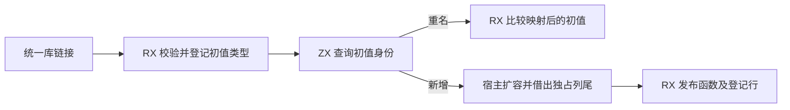
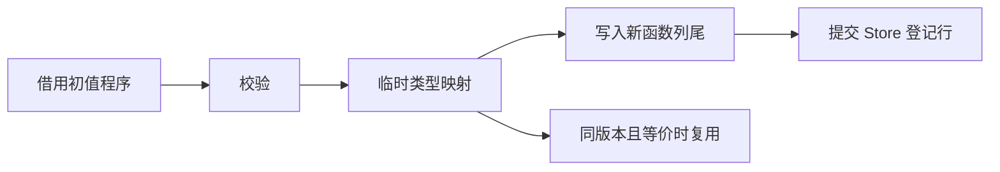

# 源码 Store 初值发布自举

## Intent · 目标

将统一库的源码 Store 初值校验、类型登记、重复决策、函数和登记行发布连入 RX/ZX。拥有初值和借用初值沿用同一语义，分别保留工作内存和最终产物的生命周期。

## Data · 正式调用路径

`library/link.zig` 先合并分析结果里的已链接初值，再交付拥有或借用的源码初值。旧源码入口在 Zig 中串联程序校验、类型映射、同名检查和函数发布。新增初值在发布函数后还会进入批量登记，重新查找同一身份。

## Edges · 所有权与错误顺序

校验和类型映射使用临时区。重复初值直接比较原有函数与借用的源码程序。发布在库的持久区构造函数，再登记已决定的身份。保留版本冲突、非等价函数、无效程序、容量上限和分配错误的处理顺序。

准备阶段沿用原程序校验和类型合并规则，校验通过后才登记类型。新初值的类型映射随本次临时区回收。重名时直接借用已发布函数的列和原始程序，省掉完整函数描述的重组。新增时沿用准备阶段选出的槽位，索引增长后按原探测规则重新定位。函数列写入成功后才登记身份。

Zig 边界负责提供列视图、执行两种分配周期的入口，以及在扩容后借出独占尾段。seed 仍保留初始引导所需的兼容实现。

## Answer · 验收

初始 Zig seed 和 `7c9b225c3` Source 引导器均生成准备及发布入口。正式 Source 回归通过 94 个构建步骤和 239 项 Zig 测试，覆盖库链接、Store 初值去重和版本冲突、分配失败、编解码、库重放、独立导入、原生链接、语义缓存与 RX 推导。

公开 CLI 的 Store 发布、迁址消费、重新发布和编译库 Store 边界回归通过 62 个构建步骤及 10 项集成测试。两种公开发布场景覆盖四个导出的原始 Store 夹具，以及在原项目上添加 32 个同一服务的导出别名。关闭生成缓存，版本交错运行，排除首轮后取七轮中位数。两套 CLI 均由 `7c9b225c3` Source 引导器生成编译模块，运行时使用 Source 分析与生成。CLI 对照为 `05765ff39`。

| 源码库发布      |        墙钟，秒 |         CPU，秒 |  峰值 RSS，MB |
| --------------- | --------------: | --------------: | ------------: |
| 原始 Store 项目 | 0.0340 → 0.0338 | 0.0373 → 0.0369 | 16.43 → 16.43 |
| 多导出别名      | 0.9216 → 0.9217 | 0.9666 → 0.9661 | 43.86 → 43.86 |

两组分别有 14 个和 46 个发布文件逐字节一致。档案生成的固定基线为 `4f06eeba7`，直接对照为 `40c6d017d`。在 macOS arm64、Zig 0.17.0、ReleaseSmall 下，三套由同一 Source 引导器生成编译模块的档案程序按轮换序运行。去掉预热后取九轮中位数。八组库档案逐字节一致。相对直接对照，最大墙钟、CPU 和峰值 RSS 增量分别为 0.037 ms、0.038 ms 和 0 MB。相对固定基线，最大增量为 0.098 ms、0.030 ms 和 0.049 MB。完整编译器冷构建需要独立测量。

回归、生成和性能原始记录位于 `.zig-cache/verification-tmp/initializer-registry/`，包括 `source-link-regression.log`、`source-link-publication.log`、`source-link-generate.log`、`source-link-seed.log` 和 `source-link-performance.json`。
