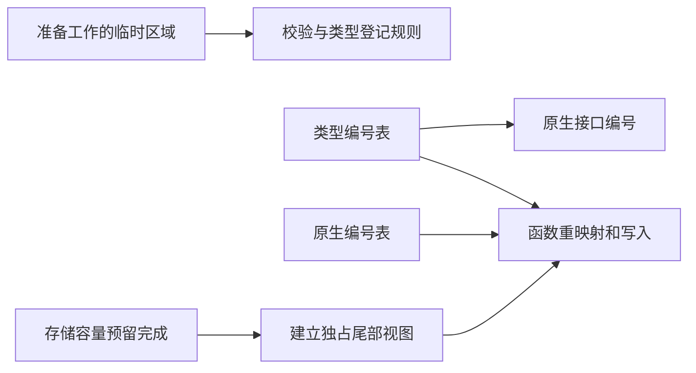

# 源码链接共享表准备自举

## Intent · 目标

让源码库与已分析 RX 模块共用 RX 的共享表准备流程。把程序校验、名义类型登记、函数编号、原生模块绑定和函数容量预留接到同一条可执行调用链。

## Data · 正式入口

`program.append` 服务于直接链接的程序，`program.appendAnalyzed` 服务于已分析的 RX 和 ZX 结果。之前的 RX 入口只返回阶段枚举，Zig 根据枚举逐项调用。当前已有的 IR、类型、原生绑定与函数写入规则可以在相同的数据表示上继续使用。

## Edges · 存储与失败顺序

程序 IR 仍先校验，类型先于原生模块写入，函数列最后预留。已经写入的类型文本继续归结果表持有。函数写入入口复用已预留的尾部，并按成功前缀更新列长度。

类型写入器在发布列长度后清除待释放文本标记。源码准备、编译库重载和独立类型登记共用这一完成动作。准备 RX 只返回状态，已校验的编号区间直接从输入构造。原生和类型编号继续使用各自原有的分配归属。校验、类型登记和原生查找共用一次准备工作区，该区域在函数写入前释放。

现有字节列布局及分配器由宿主提供。函数行的批量重映射和写入仍在 ZX。容量可能改变列地址，宿主在准备返回后才把最新尾部标为独占。把两个生成入口接到同一 RX 调用链仍需保留这次重新借用的语义。

## Answer · 验收

从当前源码构建初始 Zig seed，共 14 个构建步骤通过。以初始 seed 和 `7c9b225c3` 的 Source 引导器分别生成源码与编译库准备入口。正式清单生成的源码准备入口返回标量状态，类型和原生编号表通过缓冲写入。

源码和编译库的链接、导入、重放、公开发布、原生模块、RX 项目、语义缓存、类型校验和名义来源回归共通过 164 个构建步骤与 189 项 Zig 测试。发布回归覆盖独立 ZX 和 Zig 消费者、Store、公开契约失败，以及失败后保留原产物。

macOS arm64、Zig 0.17.0、ReleaseSmall。对照与候选均由 `7c9b225c3` 的 Source 引导器构建，执行 Source 分析和生成。直接对照为 `70c9f8cca`。沿用源码库固定对照 `6e0cf529f`，编译库重发沿用 `fe2b69bd9`。发布缓存关闭，版本交错运行并排除首轮。源码库取八轮中位数，115 份发布文件逐字节一致。

| 源码库             | 墙钟（ms，固定 / 直接 / 候选） | CPU（ms，固定 / 直接 / 候选） | 峰值 RSS（MB，固定 / 直接 / 候选） |
| ------------------ | -----------------------------: | ----------------------------: | ---------------------------------: |
| 混合库             |          40.04 / 39.75 / 40.11 |         37.60 / 37.33 / 37.65 |              25.03 / 25.03 / 25.03 |
| 具名转导出         |             6.72 / 6.83 / 6.88 |            6.29 / 6.33 / 6.49 |                 8.76 / 8.77 / 8.80 |
| 公开常量           |             4.67 / 4.63 / 4.67 |            4.02 / 4.04 / 4.04 |                 7.32 / 7.27 / 7.27 |
| RX 入口共享依赖    |       994.99 / 869.20 / 869.73 |   1208.14 / 1011.24 / 1011.82 |             101.61 / 93.86 / 95.67 |
| 含原生绑定的源码库 |          18.84 / 17.95 / 17.17 |         20.29 / 19.08 / 18.51 |              12.66 / 12.57 / 12.62 |

编译库重发的普通库和原生库取七轮中位数，多别名取五轮。三组的 272 份发布文件逐字节一致。

| 编译库重发 | 墙钟（秒，固定 / 直接 / 候选） | CPU（秒，固定 / 直接 / 候选） | 峰值 RSS（MB，固定 / 直接 / 候选） |
| ---------- | -----------------------------: | ----------------------------: | ---------------------------------: |
| 普通库     |       0.8034 / 0.8002 / 0.7986 |      0.8603 / 0.8581 / 0.8561 |              89.98 / 77.10 / 77.12 |
| 原生库     |       0.0173 / 0.0172 / 0.0179 |      0.0185 / 0.0181 / 0.0187 |              11.44 / 11.27 / 11.17 |
| 多别名     |          4.912 / 4.890 / 4.897 |         4.979 / 4.957 / 4.964 |              85.16 / 77.37 / 81.02 |

共享依赖的 RX 样本峰值 RSS 中位数较上批增加 1.81 MB，直接对照与候选的采样范围分别为 91.26～96.27 MB、84.85～100.17 MB。多别名重发的峰值中位数增加 3.65 MB，采样范围分别为 73.70～84.80 MB、77.20～84.79 MB。两组的中位数均低于固定对照。编译库多别名重发 CPU 较上批增加约 7 ms，较固定对照减少约 15 ms。

本轮测量覆盖库发布和编译库重发，未重跑完整编译器冷构建。回归、生成和性能数据位于 `.zig-cache/verification-tmp/compiled-install/` 的 `source-prepare-*` 记录中。
