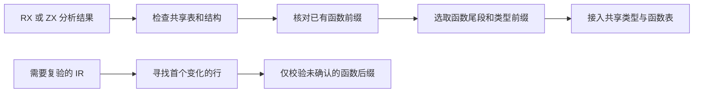
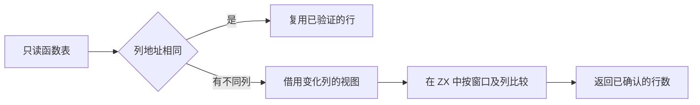

# 源码链接函数前缀与尾段自举

## Intent · 目标

把函数 IR 前缀的比对、增长窗口和源码模块尾段的选取迁入 RX 与 ZX。覆盖 RX 项目混合分析的函数表扩展，以及 IR 校验复用已验证前缀的路径。

## Data · 正式调用链

RX 项目的模块和函数都通过 `appendBody` 接入共享函数表。调度先检查当前输入能否扩展共享表，再选择当前表内的尾段或单独提供的尾段。完整 IR 校验可以从两份函数表中寻找可复用的前缀。旧实现每个窗口在 Zig 中按列推进，再逐列调用 ZX 比对。

## Edges · 成本与边界

同地址的列借用原存储，可直接确认其公共长度内的数据一致。需要检查不同存储时，借用列的切片，由 ZX 逐窗口寻找首个变化，或者在验证覆盖时于首列差异处退出。比较只读列地址、标签有效位、可空编号和嵌套切片描述，保留现有的信任边界。

源码链接与 RX 程序构建器共用 `extension/select.rx`。RX 检查共享函数表与原生模块表、基表和尾部结构，再选择附在当前表内或单独交付的尾段。ZX 用原有边界计算合并后的函数数量及类型前缀。函数表对外接口继续返回原来的切片结果。Zig 依据原生列布局构造只读视图，并持有实际表存储。类型登记和随后函数写入的衔接仍由外层链接流程负责。

## Answer · 验收

初始 Zig seed 和 `7c9b225c3` 的 Source 引导器都生成了两条入口。正式清单生成的 `executeValue` 上运行复用探针，覆盖不同列的首个变化、空窗口、跨窗口推进、覆盖比较的早停、独立尾段，以及同一窗口存在多个差异时找最早的变化。探针在无可用分配空间的情况下通过。

统一库的链接、重放、导入与发布，RX 正式项目，以及语义缓存回归通过 141 个构建步骤和 53 项 Zig 测试。发布覆盖独立 ZX 和 Zig 消费者、Store 状态权限、公共接口、原生模块和发布失败后保留产物。

macOS arm64、Zig 0.17.0、ReleaseSmall。直接对照为 `a03822c99`，固定对照为 `6e0cf529f`。三套 CLI 均由 Source 引导器构建并使用 Source 分析和生成。沿用源码发布的四组夹具及 `--no-cache`，版本交错运行，去掉首轮后取八轮中位数。95 份发布文件逐字节一致。

| 发布样本         | 墙钟（ms，固定 / 直接 / 候选） | CPU（ms，固定 / 直接 / 候选） | 峰值 RSS（MB，固定 / 直接 / 候选） |
| ---------------- | -----------------------------: | ----------------------------: | ---------------------------------: |
| 混合库           |          40.14 / 40.07 / 40.15 |         37.76 / 37.62 / 37.71 |              25.03 / 25.03 / 25.03 |
| 具名转导出       |             6.68 / 6.73 / 6.81 |            6.21 / 6.23 / 6.37 |                 8.77 / 8.73 / 8.78 |
| 公开常量         |             4.72 / 4.87 / 4.80 |            4.10 / 4.17 / 4.13 |                 7.32 / 7.24 / 7.27 |
| 共享依赖的 RX 库 |       995.87 / 871.63 / 868.99 |   1208.39 / 1018.46 / 1012.09 |             103.69 / 95.78 / 93.69 |

大样本相对直接对照减少 2.64 ms 墙钟、6.37 ms CPU 和 2.09 MB 峰值 RSS，相对固定对照也保持较低开销。具名转导出的 CPU 中位数较直接对照增加约 0.14 ms。本次回测覆盖实际受影响的源码发布路径，未重跑完整编译器冷构建。回归、探针和测量数据位于 `.zig-cache/verification-tmp/compiled-install/` 的 `prefix-*` 记录中。
