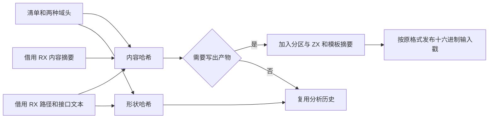

# 生成输入指纹与产物发布自举

## Intent · 目标

从引导器的正式生成入口迁移源文件身份计算、生成入口登记和发布记录。沿用输入变化与失败时的原有失效规则，减少重复读取字段和无写出请求的哈希工作。

## Data · 正式调用路径

`build/generate_parser.zig` 先尝试用输入快照识别现有产物，再装载源文件和接口。生成器需要两种输入身份。内容身份包含 RX 文件摘要，形状身份只包含 RX 路径。两者都包含生成器身份、清单和接口源码。此前宿主发起两次遍历，同一个字段会被分别从两列读取。

## Edges · 数据和失败约定

内容身份和形状身份分别使用原有 SHA-256 域、字节顺序和长度前缀。RX 文件路径和接口文本在一次遍历内分别写入两个哈希，RX 摘要只写入内容哈希。无写出的热启动保留分析需要的两种身份，跳过仅用于产物戳的 ZX 和模板内容摘要。

入口路径和导出名称借用清单中的字符串，ZX 直接填充宿主预留的列。输入戳用固定缓冲读取，并检查完整长度。缺失、截断或过长的记录仍触发重建。发布失败仍会留下无有效输入戳的输出，下一次调用可以重试。报告在固定缓冲内写完，再交付一份给调用方。

Zig 宿主仍负责文件系统、SHA-256 与 BLAKE3 实例、已有缓存中的文件摘要提取、分配与分析及生成入口的生命周期。生成总流程的宿主调度仍需继续迁移。

## Answer · 验收

初始 seed 通过 14 个构建步骤，候选 Source 引导器由上阶段 Source 引导器构建，通过 25 个步骤。以最小清单独立计算 SHA-256 和 BLAKE3，对照及候选的输入戳均与独立计算一致。缺失、截断、内容损坏和过长的戳都会重建，恢复有效戳后无变更请求继续跳过生成。热启动不写出产物，首次正式发布复用热启动的分析和生成缓存。

模块生成、生成产物执行及原生对象 ABI 回归通过 77 个构建步骤、23 项 Zig 测试及 4 项应用执行检查。覆盖冷暖缓存、编辑、禁用缓存、损坏记录、缓存键校验与原生声明重排序。

实际常驻生成覆盖首次发布、ZX 正文修改、RX 修改、缺失依赖及恢复。四个成功版本分别有 709 个 Zig 文件与同输入的冷生成逐字节一致，恢复后再次请求跳过生成。

固定 735 个入口、16 个分区，macOS arm64、Zig 0.17.0、ReleaseSmall。固定基线与两代相邻工具均为 Source 引导器所构建，运行时采用 Source 分析及生成。三轮交错运行取中位数，以下时间仅覆盖生成器。候选和上一阶段的 11,758 个文件逐字节一致，排除随生成器身份变化的输入戳，v18 唯一性缓存载荷哈希也一致。固定基线的 135 个历史产物差异与上一阶段完全一致。

| 生成阶段指标             |  固定基线 |  上一阶段 |      候选 |
| ------------------------ | --------: | --------: | --------: |
| 冷生成墙钟               |    2.83 s |    2.57 s |    2.59 s |
| 冷生成 CPU               |   12.50 s |   12.13 s |   12.25 s |
| 冷生成进程树采样峰值 RSS | 890.34 MB | 697.78 MB | 696.45 MB |
| 冷生成单进程系统峰值 RSS | 922.03 MB | 794.89 MB | 793.44 MB |
| 热生成墙钟               |    2.23 s |    2.01 s |    1.99 s |
| 热生成 CPU               |    8.56 s |    8.28 s |    8.29 s |
| 热生成单进程系统峰值 RSS | 934.26 MB | 695.29 MB | 694.89 MB |
| 无变化墙钟               |    0.04 s |    0.04 s |    0.04 s |

相对上一阶段，冷生成 CPU 增加 0.12 秒，墙钟增加 0.02 秒，进程树和单进程峰值 RSS 均下降约 1.3 至 1.5 MB。相对固定基线，冷生成墙钟减少 0.24 秒，CPU 减少 0.25 秒，进程树峰值 RSS 下降约 194 MB。这组数据未计入 Zig 编译和链接。
