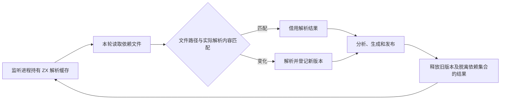
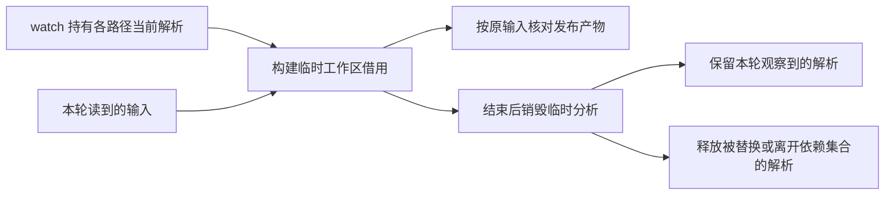

# 监听构建复用解析结果

## Intent · 目标

让公开 `zxc build --watch` 在一次源码编辑后复用未变 ZX 文件的解析结果，降低前端成本。重新核对外部诊断列出的编译、验证和运行时瓶颈。

## Data · 源码核查

| 外部诊断                       | 当前实现                                                                                                                                                                            |
| ------------------------------ | ----------------------------------------------------------------------------------------------------------------------------------------------------------------------------------- |
| 全闭包反复编译，生成巨大单文件 | 冷启动装载入口依赖，正式构建将入口、类型、函数分开生成，按内容复用 Zig 文件。自举另有分区对象缓存。公开 watch 每次启动 Zig 子进程并复用磁盘缓存，仍有跨轮前端和进程内后端增量空间。 |
| 共用模块被重复推导             | 同一构建已共享 ZX 装载和解析，普通 ZX 使用语义缓存，常驻 Source 引导器另有语义分析重放。公开 RX watch 每轮创建新的解析缓存，本批复用这部分结果。                                    |
| SMT 展开导致路径膨胀           | 已有求值上限、等价表达式复用和相同符号实参的调用缓存。符号图先于证据写出和 Z3 求解释放。不同实参仍展开，求解成本随输入而异。                                                        |
| 不可变值与 `$ctx` 导致复制     | 生成器已有只读借用和独占更新复用，`$ctx` 在生成时解析成静态结果绑定。部分数组链仍物化中间结果，局部结果可能随请求区域延长存活。                                                     |
| JSON 解析逐对象分配            | Gateway 已有请求 arena，未转义的 JSON 文本可以借用请求体。固定长度请求体只分配一次，响应缓冲发送后释放。共享 Store 仍可能保留请求区域。                                             |
| 慢请求、线程和 Store 锁竞争    | Gateway 串行处理连接，已复现慢请求阻塞后续连接。ZX Future 使用 Zig I/O，部分语句型 Parallel 生成系统线程。现有测量只能确认连接排队，Store 锁竞争尚无实测依据。                      |
| 普通循环频繁轮询取消           | 普通 `loop` 生成路径没有通用的逐次原子取消轮询。I/O 路径保留既有协作式取消。                                                                                                        |

此前诊断和测量见[编译与运行时性能核查](../2026-11-18/编译与运行时性能核查.md)、[编译器与应用性能诊断复查](编译器与应用性能诊断复查.md)和 [Gateway 响应缓冲生命周期](Gateway响应缓冲生命周期.md)。Zig 的磁盘缓存与常驻声明级增量各自有失效边界。LLVM 的聚合与别名建议可用于定位生成代码的实拷贝。[Zig 增量编译实现](https://mlugg.co.uk/posts/incremental-compilation-internals/) · [LLVM 前端性能指南](https://llvm.org/docs/Frontend/PerformanceTips.html)

## Edges · 所有权与失效边界

监听命令持有独立于单轮构建 arena 的解析缓存。ZX、RX、Gateway 和库发布共用该生命周期。当前源码、模板准备和依赖路径仍从本轮输入得到，缓存以路径和实际解析内容验证命中。一次构建内可能同时借用同一路径的不同版本，等本轮执行退出后才释放旧版本。随后根据本轮已观察到的路径回收失效依赖，正常完成和可恢复失败共用这一过程。关闭缓存时延续单轮行为。

## Answer · 验收

九组回归共通过 90 个构建步骤及 69 项 Zig 测试。覆盖解析和语义缓存、ZX 和 RX 监听、库发布、原生头文件、安装依赖恢复和 Gateway。Gateway 的 86 项行为检查通过。保留 mtime 的原地编辑和同 mtime 的原子替换均生成了符合预期的新程序。移除依赖后编辑旧文件，未触发重建；重新加入该依赖后，编译出的程序读取到了新内容。

macOS arm64，Zig 0.17.0、ReleaseSmall。对照为 `34040a967`。两套 CLI 均由 `7c9b225c3` 的 Source 引导器构建，运行时使用 Source 分析和生成。项目有 16 个公开 RX 入口，共用 49 个 ZX 文件。大源码样本在各 ZX 文件前增加约 122 KiB 注释，业务逻辑相同。两版每轮交错，去掉首轮后各执行五轮。每轮首次发布后连续四次改变同一依赖的函数体。墙钟从编辑写入到发布完成，包含监听轮询。CPU 取 CLI 两次采样的差值，按本机 Mach 时间单位转换。峰值 RSS 取每轮进程的系统峰值，常驻 RSS 取第四次编辑发布后立即采样的读数。

| 样本       |  首次墙钟，秒 |  编辑墙钟，秒 |  编辑 CPU，秒 | 进程峰值 RSS，MB | 末次发布 RSS，MB |
| ---------- | ------------: | ------------: | ------------: | ---------------: | ---------------: |
| 原样本     | 0.867 → 0.873 | 1.418 → 1.417 | 1.080 → 1.080 |    66.68 → 69.68 |    22.92 → 25.46 |
| 大源码样本 | 2.811 → 2.747 | 3.361 → 1.730 | 3.023 → 1.391 |  174.59 → 178.21 |    22.20 → 34.90 |

大源码样本的编辑墙钟下降 48.5%，CPU 下降 54.0%。峰值增加 3.62 MB，末次发布采样多保留 12.70 MB。普通样本的编辑用时接近，进程峰值增加 3.00 MB。留存仅覆盖最后一轮仍被观察的路径，被替换版本在当轮结束时释放。两种输入各自的 70 个末次发布文件，在所有轮次及两版工具上逐字节一致。对应文件摘要清单的 SHA-256 分别为 `73f524ea899815a5ea10d1ed38fd85760ef69dcec47344f1a62647b48f098ed2`、`431ae8cf6bdcb0ce9d260130821c31b01328cffa8393c991c1f9d910733225bf`。

实际 CPU 收益集中于跨轮复用 ZX 解析。公开 RX 语义重放、常驻 Zig 后端、不同符号实参的契约摘要、集合链融合、Gateway 并发和一般共享 Store 区域回收仍各有独立的实现和验收边界。原始测量和回归日志位于 `.zig-cache/verification-tmp/watch-versions/`，分别为 `parse-reuse-results.json` 和 `parse-reuse-regression.log`。
