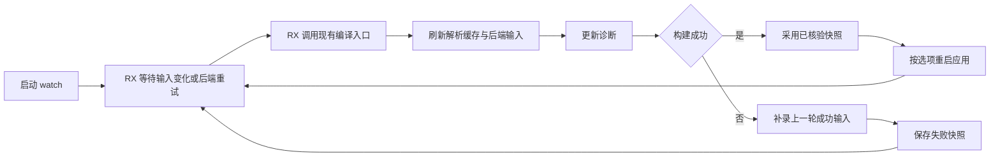

# 监听构建调度与后端输入移交自举

## Intent · 目标

将正式 `zxc build --watch` 及 `--watch --run` 的运行顺序、重试和输入发布决策迁入 RX/ZX。保留成功产物、失败诊断、缺失依赖恢复、等待间隔和应用重启的既有行为。

## Data · 正式路径与迁移范围

此前 `cli/watch.zig` 在 Zig 中驱动一整轮执行并完成下一轮的等待。从该入口退出的职责包括等待与轮询状态机、阶段顺序、错误去重触发点、成功和失败后的处理分支、保留旧输入的遍历，以及何时重启应用和退出。RX 的 `cycle.rx` 编排构建，`wait.rx` 和 `poll.rx` 编排等待，ZX 驱动循环和后台错误重试计数。临时 Zig 后端诊断路径的归一化算法也由 ZX 执行。

## Edges · 数据和宿主边界

Zig 继续持有 OS 信号、I/O、子进程、区域分配器和当前文件快照。已有快照扫描、版本证明以及发布前核验实现继续执行。工具链缓存目录选择使用同一个 Zig 适配模块供 CLI 和后端发布测试调用。前者的运行时决策依旧来自上一批的 ZX。

Zig 后端返回的依赖路径随响应销毁。此前在 `Attempt.finishBackend` 复制到本轮缓冲，再由驱动复制到下一轮。现在直接存到本轮待移交的区域。所有入参准备成功后，驱动替换整个区域。若失败过早而后端未返回，仍使用上次保存的路径。输出诊断有真实的临时目录替换时才填充归一化缓冲，否则借用原文。

## Answer · 验收

八组正式回归通过。覆盖 ZX 与 RX 监听、库发布、缺失头文件恢复、包安装监听、后端协议、产物发布和真实 Zig 后端。独立后端发布测试原先缺少上一批新增的工具链缓存依赖。修复后，后端发布与运行回归通过 76 个构建步骤和 18 项 Zig 测试，最终 CLI 的安装监听也通过。使用最终 CLI 启动 `--watch --run`，执行结果由 41 更新为 42，随后以 SIGINT 正常退出并清理运行副本。

以初始 seed 和 `7c9b225c3` 的 Source 引导器分别生成监听与 CLI 清单。监听清单的 38 份产物中有 35 份逐字节一致。CLI 清单的 314 份产物中有 256 份逐字节一致。其余差异均为局部临时变量编号。生成的监听驱动未增加堆分配，归一化缓冲只在实际替换诊断路径时写入。

对照沿用已验证过的库监听样本。16 个公开 RX 入口共享 49 个 ZX 依赖。大源码组为每个 ZX 文件增加约 122 KiB 注释。macOS arm64、Zig 0.17.0、ReleaseSmall，三套正式 CLI 均由 `7c9b225c3` 的 Source 引导器构建并执行 Source 分析和生成。固定对照为 `689d854f8`，直接对照为 `833a29b55`。版本交错运行，预热后每版取四轮，每轮连续编辑同一文件三次。墙钟包含轮询等待，CPU 为单次编辑窗口内监听进程的采样差，峰值 RSS 覆盖整轮。每轮最终发布的 70 份文件在同一场景下逐字节一致。

| 场景     | 首次发布墙钟秒（固定 / 直接 / 候选） | 单次编辑墙钟秒（固定 / 直接 / 候选） | 单次编辑 CPU ms（固定 / 直接 / 候选） | 峰值 RSS MB（固定 / 直接 / 候选） |
| -------- | -----------------------------------: | -----------------------------------: | ------------------------------------: | --------------------------------: |
| 常规源码 |                0.904 / 0.853 / 0.856 |                1.414 / 1.363 / 1.364 |                 25.89 / 24.69 / 24.82 |             68.12 / 65.92 / 65.89 |
| 大源码   |                2.776 / 2.675 / 2.689 |                1.730 / 1.596 / 1.597 |                 33.38 / 30.13 / 30.11 |            175.66 / 82.34 / 81.76 |

与直接对照相比，最大首次发布增量为 14 ms，单次编辑墙钟增量约 1 ms，CPU 最大增量为 0.13 ms。两组峰值 RSS 均略降。该对照覆盖公开库监听，原生后端输入区域的移交另由应用、RX、缺失 C 头文件恢复及真实后端回归验证。未重测完整自举冷构建。

核验记录保存在 `.zig-cache/verification-tmp/watch-driver/`，包括 `regression.log`、`backend-regression.log`、`final-regression.log`、`restart.log`、`generation-parity.log` 和 `parse-reuse-comparison.json`。
