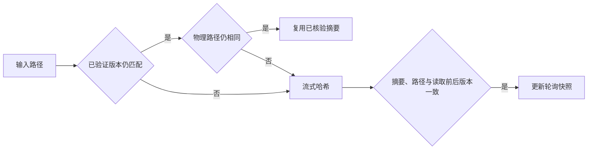

# 监听空闲扫描复用文件版本

## Intent · 目标

降低公开 `zxc build --watch` 空闲时重复读取和哈希输入文件的开销，保留有效编辑的发现机制与产物发布前的完整校验。

## Data · 根因

公开 watch 每 500 毫秒扫描一次输入。此前每轮都会重新打开所有普通文件并计算 SHA-256，连长期无变化的文件也重复付出这笔成本。Source 常驻引导器已经使用 inode、大小、mtime、ctime 和时间分辨率判断文件版本是否可复用，公开 watch 可以复用同一规则。

## Edges · 验证边界

只有普通文件的内容摘要和物理路径都与基准一致，且同一打开文件在哈希前后的元数据匹配，轮询快照才可复用该版本。使用现有 Source 规则处理读取时刻与状态修改时间过近的情况。之后仍检查实际物理路径，识别指向不同硬链接路径的符号链接变更。目录、错误和缺失路径仍按原有逻辑确认。应用和库发布前保留 SHA-256、物理路径和输出边界检查。

基于元数据的空闲轮询依赖文件系统提供可靠的状态修改时间。当前验收环境为 macOS arm64 本地文件系统。这项优化针对空闲扫描成本，编辑后的分析与生成仍沿用现有构建管线。

## Answer · 验收

ZX、RX、C 头文件、库发布和安装依赖恢复五组 watch 回归通过，共 68 个构建步骤。候选 CLI 由 `7c9b225c3` 的 Source 引导器生成，并使用 Source 分析和生成，工具链为 Zig 0.17.0、ReleaseSmall。

正式 CLI 验证了保留 mtime 的原地编辑和原子替换，两次都重新生成了符合预期的可执行程序。快照入口另验证了符号链接切换到同一 inode、同一组时间戳但物理路径不同的硬链接，轮询与严格扫描均报告变化。

复用上次的扫描夹具。每组 1,000 个文件，在同一程序中调用原有严格扫描入口与新的生产轮询入口。每轮构造基准后扫描 24 次，交错执行，去掉首轮后取七轮中位数。计时包含初始快照，排除等待间隔和重新编译。

| 输入              | 墙钟（原方式 → 候选） | CPU（原方式 → 候选） | 峰值 RSS（原方式 → 候选） |
| ----------------- | --------------------: | -------------------: | ------------------------: |
| 每个文件约 3 KiB  |        0.41 → 0.20 秒 |       0.40 → 0.19 秒 |            3.15 → 3.15 MB |
| 每个文件约 32 KiB |        0.69 → 0.23 秒 |       0.68 → 0.22 秒 |            3.15 → 3.15 MB |

正式库监听复用 16 个公开 RX 入口共享 ZX 依赖的样本，在 ZX 文件前加约 120 KiB 注释。对照 CLI 为 `7c9b225c3`，同样由 Source 引导器生成并执行 Source 分析和生成。等待首轮发布和快照预热后，测量同一 CLI 进程在 5 秒空闲窗口消耗的 CPU。交错执行，排除首轮后三轮中位数为 157 → 28 ms，窗口末尾采样 RSS 为 16.35 → 16.33 MB。70 个发布文件逐字节一致。此处 RSS 是窗口末尾的进程采样值。

本次核对沿用已验收的[编译器与应用性能诊断复查](编译器与应用性能诊断复查.md)、[Gateway 定长请求体分配](Gateway定长请求体分配.md)与[符号验证临时内存优化](符号验证临时内存优化.md)。Gateway 的连接排队、Store 退役区域、不同实参的验证契约摘要，以及集合链中间结果仍各有独立的成本与验收场景。
