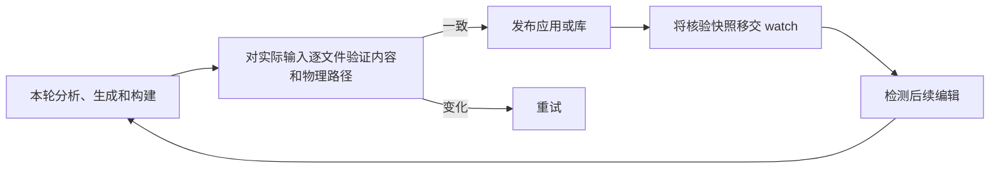
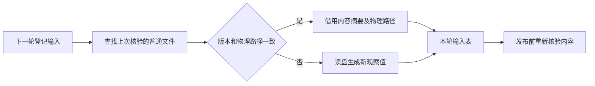

# 监听重建复用已核验输入

## Intent · 目标

结合本地编译器和生成应用核对外部性能诊断。减少 `zxc build --watch` 编辑后重建时重复读取和哈希输入的成本，并核对发布产物与失效行为。

## Data · 源码与实测

| 外部诊断                             | 源码和实测结论                                                                                                                                                                                                                                                                                                                                                    |
| ------------------------------------ | ----------------------------------------------------------------------------------------------------------------------------------------------------------------------------------------------------------------------------------------------------------------------------------------------------------------------------------------------------------------- |
| 反复编译整个闭包并生成巨型 Zig 文件  | 冷构建加载入口的依赖闭包。入口、类型和函数分成 Zig 编译单元，生成结果按内容缓存。自举有对象分区缓存，公开 watch 每轮启动 Zig 子进程。当前可复用的磁盘缓存与 Zig 常驻声明级增量有不同的生命周期。                                                                                                                                                                  |
| 同一依赖反复分析                     | 同一轮 RX 已共享 ZX 装载和解析。公开 watch 也复用未变 ZX 解析，RX 的语义分析仍按轮执行，多入口库仍按入口推导。发现的一项可直接消除的工作发生在输入登记时，当时每轮重新读盘、哈希，发布前又重新核对整套输入。                                                                                                                                                      |
| Z3 路径膨胀                          | 符号图合并等价表达式，缓存相同函数与符号实参的调用，设有求值步数上限。未命中时仍展开函数体。已有验收发现，真实 Z3 主导复杂样本的峰值，查询直接写入改善的是求解前的编译器峰值。                                                                                                                                                                                    |
| 不可变对象、集合链和 `$ctx` 触发复制 | 只读聚合值可借用，独占更新可复用存储，`$ctx` 编译成对局部结果的静态引用。集合链可能分配实际的中间数组。融合必须保留回调顺序、错误与副作用。                                                                                                                                                                                                                       |
| 请求逐对象分配                       | Gateway 使用每请求 arena，未转义的连续 JSON 字符串可借用请求体，定长请求体一次分配，响应缓冲在发送后释放。此前 50,000 次回显探测的服务 RSS 约为 1.97 MB。                                                                                                                                                                                                         |
| 连接调度、Store 和取消               | Gateway 串行处理连接，未完成的请求头能阻塞后续连接至少 250 ms。同次探测中，50,000 次共享 Store 更新使 RSS 从 1.93 MB 升到 17.30 MB。生成的 `Request.deinit` 将整个请求 arena 交给保留区域，`Shared` 策略下 `releaseRetired` 为空。该增长来自内存留存。部分纯计算 `Parallel` 生成系统线程，Future 使用 Zig I/O。普通 `loop` 的生成路径没有通用的逐轮原子取消检查。 |

证据见[编译与运行时性能核查](../2026-11-18/编译与运行时性能核查.md)、[监听构建复用解析结果](监听构建复用解析结果.md)和[性能实测与验证查询直接写入](性能实测与验证查询直接写入.md)。外部技术资料见[Zig 增量编译实现](https://mlugg.co.uk/posts/incremental-compilation-internals/)与[LLVM 前端性能指南](https://llvm.org/docs/Frontend/PerformanceTips.html)。

## Edges · 一致性与寿命

发布前对所有输入重新计算内容摘要并比对物理路径。对于启用缓存的 watch，在这次读取中额外记录打开的普通文件前后两次文件状态。文件通过稳定版本判断后，摘要、物理路径和版本作为同一条证据保留。发布成功时直接移交这份快照，避免再对全部条目排序和深拷贝路径。

空闲轮询和下一轮登记均可从快照验证 inode、大小、mtime、ctime 和物理路径。目录、缺失和版本不匹配仍从磁盘读取。实际消耗的源码字节仍登记其内容摘要。应用和库只有通过发布前内容校验后才可以发布，文件出现变化时按原有入口重试。

Gateway 并发接入涉及 Store 快照的借用期及退役区域回收。共享区域必须等最后一个引用结束后才能释放。当前改动覆盖监听输入工作量，运行时数据使用前述已有实验记录。

## Answer · 验收

四组正式 watch 回归与后端协议、发布行为回归通过，共 77 个构建步骤及 18 项 Zig 测试。覆盖构建失败时保留现有产物、缺失原生头文件恢复、RX 传递导入变化、库消费及发布前输入变化。

在 macOS arm64、Zig 0.17.0、ReleaseSmall 下，用同一个由 Source 引导的程序隔离输入登记。每组 1,000 个稳定文件，对照重新读盘和计算 SHA-256，候选复用发布核验的快照。逐一核对两条路径的输入摘要和物理路径。每轮登记 24 次，交错执行，去掉首轮后取七轮中位数。墙钟只计登记及结果核对。CPU 和进程峰值包含准备与核验快照。

| 输入            | 墙钟（原方式 → 候选） | CPU（原方式 → 候选） | 峰值 RSS（原方式 → 候选） |
| --------------- | --------------------: | -------------------: | ------------------------: |
| 每个文件 3 KiB  |      0.414 → 0.203 秒 |       0.43 → 0.23 秒 |            3.95 → 3.83 MB |
| 每个文件 32 KiB |      0.675 → 0.202 秒 |       0.73 → 0.25 秒 |            3.95 → 3.83 MB |

整条库监听链路使用 16 个公开 RX 入口，共用 49 个 ZX 文件。大源码样本为每个 ZX 文件增加约 122 KiB 注释。固定对照为 `689d854f8`，直接对照为 `503350be2`。三版 CLI 均由 `7c9b225c3` Source 引导器构建，运行时执行 Source 分析和生成。版本交错执行，排除首轮后每版采四轮，每轮首次发布后连续三次改变一个依赖的函数体。编辑墙钟含轮询，CPU 为编辑期间 CLI 进程的采样差值，峰值 RSS 覆盖监听进程整轮。

| 样本       | 首次发布墙钟（固定 / 直接 / 候选） | 编辑墙钟（固定 / 直接 / 候选） | 编辑 CPU（固定 / 直接 / 候选） | 峰值 RSS（固定 / 直接 / 候选） |
| ---------- | ---------------------------------: | -----------------------------: | -----------------------------: | -----------------------------: |
| 原样本     |           0.903 / 0.855 / 0.857 秒 |       1.415 / 1.362 / 1.365 秒 |       1.079 / 1.028 / 1.033 秒 |       68.87 / 66.85 / 68.03 MB |
| 大源码样本 |           2.780 / 2.674 / 2.696 秒 |       1.730 / 1.604 / 1.615 秒 |       1.390 / 1.263 / 1.273 秒 |      176.73 / 80.91 / 79.41 MB |

整条链路的收益有限。大源码样本相对直接对照的编辑墙钟增加约 11 ms，CPU 增加约 10 ms，峰值 RSS 降低 1.50 MB。原样本的峰值 RSS 增加 1.18 MB。两个样本相对固定对照的编辑墙钟、CPU 和峰值 RSS 均较低，单阶段耗时差异在 1 秒容差以内。合并后的发布依然逐文件校验内容，额外的早期版本检查省掉的是输入登记中的重复读盘。

两种样本各自的 70 个发布文件在三版及各轮逐字节一致。摘要清单的 SHA-256 分别为 `968f5c1401c73006158cdc582b1e315435fed8bdaaa90f9696c1556d8effc0f4` 和 `345eb9aabbf9037d8de0fa54cbf8db0a13d82a46ec64247d7c0fa6ec3014bdfa`。原生应用在保留 mtime 的原地修改与原子替换后均重新构建，执行结果正确。

原始记录位于 `.zig-cache/verification-tmp/watch-rebuild-versions/`，包括 `final-regression.log`、`edited-tests.log`、`registration.json` 与 `parse-reuse-comparison.json`。完整自举冷构建、公开 RX 语义重放、Gateway 接入调度、共享 Store 区域回收与集合链融合仍需各自的实现和验收。
