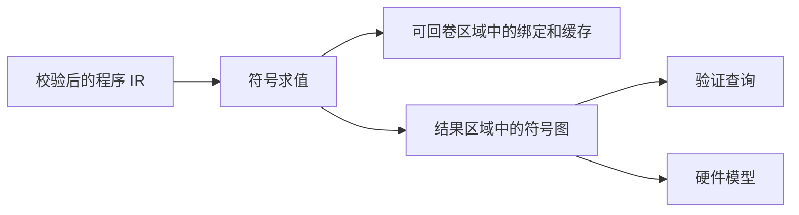
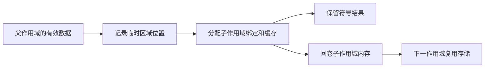

# 符号验证临时内存优化

## Intent · 目标

降低 `zxc verify` 符号求值阶段的峰值内存，保留 SMT 查询、验证结论和求值次序。

## Data · 根因

正式验证和 FPGA 降低共用符号求值。每个分支的表达式缓存、函数和契约的绑定表只在当前求值作用域内有效。它们原先和符号表达式一起分配。求值完成的分支仍占用内存，直到整份验证或硬件模型释放。多次调用同一函数而符号实参不同，会重复产生这些临时表。

## Edges · 生命周期

进入分支、函数或契约时记录临时区域位置，结束时回卷，后续求值复用该区域。父分支的缓存和环境保留。符号值、复合结果、查询及硬件模型继续由结果区域持有。表达式访问次数、调用缓存键、错误传播顺序和 Z3 查询保持一致。

## Answer · 验收

两版 CLI 均使用 Source 分析和生成，macOS arm64、Zig 0.17.0、ReleaseSmall。对照为 `5c5ee03db`。使用三次和 192 次不同实参的 ZX 函数调用作为输入，每个场景预热后交错测量九轮。实际 Z3 两组均证明成功，可满足性和正确性查询在每轮中均逐字节一致。

| 场景                         | 墙钟（对照 → 候选） | CPU（对照 → 候选） | 峰值 RSS（对照 → 候选） |
| ---------------------------- | ------------------: | -----------------: | ----------------------: |
| 小输入，实际 Z3              |    11.41 → 11.39 ms |   10.53 → 10.53 ms |        25.21 → 25.20 MB |
| 192 次符号调用，实际 Z3      |  318.83 → 317.12 ms | 316.77 → 314.96 ms |        89.64 → 89.62 MB |
| 192 次符号调用，排除实际求解 |  174.41 → 172.85 ms | 173.09 → 171.54 ms |        63.65 → 47.17 MB |

第三组用固定响应的求解器替身，CLI 仍生成并落盘完整查询，峰值下降 25.9%。该组用于隔离编译器开销，正确性由实际 Z3 的结果和产物对照验收。实际 Z3 的端到端峰值基本持平。

实际 Z3 的 74 项普通验证检查全部通过，验证和硬件的 8 项 Zig 检查通过。公开库验证的 8 项中有 7 项通过。另 1 项会在 `0d1aa887a`、`5c5ee03db` 和候选同样报告 `InvalidIr`。缩小到只公开一个 RX 模块仍失败，删除被调用 ZX 的 `ensures` 也会失败。同一 RX 入口直接验证成功，库构建在同一路径失败。问题位于库发布或链接阶段，在符号求值之前。

此次减少了重复符号求值中的临时内存。不同符号实参仍会展开函数体，未引入契约摘要。此前的架构核查和其他已验收修复见[编译器与应用性能诊断复查](编译器与应用性能诊断复查.md)和[Gateway 定长请求体分配](Gateway定长请求体分配.md)。
