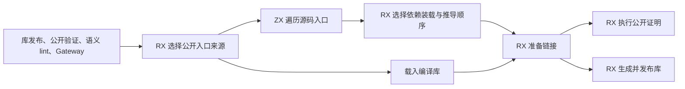

# 统一库分析与公开验证自举

## Intent · 目标

把库发布、公开接口验证、语义 lint 和 Gateway 共用的库入口分析与链接流程迁入 RX/ZX。统一诊断源文和 Store 初值的收集，保持错误顺序和借用生命周期。

## Data · 调用路径

`library/analyze.zig` 先前在 Zig 中选择源码或编译产物，并遍历公开入口。每个源码入口先解析路径，按直接 RX、经 ZX 导入 RX、纯 ZX 三种情况选择分析。链接先选择编译产物的直接转交或源码链接。发布、验证与 Gateway 各自收集诊断源文。公开验证在 Zig 中按声明顺序选择类型接口或执行 Z3 证明，再汇总结果。库构建在 Zig 中编排生成、缓存、原生模块解析和暂存发布，后半段调用前阶段迁入 Source 的发布实现。

`library/workflow/build.rx` 选择入口、调用分析和链接、生成并发布。发布前核对发现输入变化时，RX 决定监听重试或命令失败。每个源码公开入口由 `analysis/discover.rx` 先确定是否需要 RX 推导，再由 `analysis/entry.rx` 选择分析路径及诊断登记。编译库继续执行前阶段的导出选择和 ABI 兼容判断。

公开验证由 `proof/entries.zx` 遍历联结后的公开条目，`proof/entry.rx` 表达类型接口与可执行证明的分流。证明路径的 SHA-256 和后缀在 ZX 计算。发布、验证与 Gateway 共用同一收集规则，继续传递原来的正文切片。

## Edges · 数据与所有权

源码分析保有一份批内文件文本缓存和解析缓存。每条分析写入预留的结果表，部分失败只销毁已初始化行。链接输入借用已分析的 IR、公开条目和 Store 定义。诊断源文按现有顺序组合描述符，继承原字节的生命周期。某条证明失败仍继续验证后续公开入口，系统错误按原有路径中断。

本阶段保留 Zig 所有权适配，包括分析、链接和暂存的结果容器、释放已初始化前缀、操作系统路径与文件操作。CLI 依赖装载还由 `sources.zig` 进行广度遍历。语义 lint 的源码检查、公开验证的顶层状态接线以及 Gateway 的路由和宿主生成也仍在原有入口。阶段验收覆盖这里已经迁移的调用链。

## Answer · 验收

库发布、公开验证、库与 RX 监听、原生包和别名、语义 lint 与 Gateway 共八组正式回归通过。构建执行 114 个步骤，48 项 Zig 测试和 150 项 Node 集成检查通过。Gateway 另通过 86 项 HTTP 和 Store 检查。窄清单比较初始 seed 和 Source 引导的 265 个生成文件。其中 237 份逐字节一致，另 28 份仅存在临时标识编号差异。

对照在 macOS arm64、Zig 0.17.0、ReleaseSmall 下执行。各版 CLI 均由 `7c9b225c3` 的 Source 引导器构建，并运行 Source 分析和生成。关闭生成缓存，交错运行。发布取预热后八轮中位数，公开验证取预热后九轮中位数。RSS 采用被测命令的系统峰值，按十进制 MB 记。

### 库发布

固定对照为 `dadb1f21a`，相邻对照为 `b9e7fba16`。九组发布场景每轮均核对完整文件集合、内容和旧清单清退行为。发布文件逐字节一致。

| 场景                   | 墙钟 ms（固定 / 上阶段 / 候选） | CPU ms（固定 / 上阶段 / 候选） | 峰值 RSS MB（固定 / 上阶段 / 候选） |
| ---------------------- | ------------------------------: | -----------------------------: | ----------------------------------: |
| 普通首次发布           |           17.36 / 16.95 / 16.73 |          18.50 / 18.11 / 18.12 |               12.67 / 12.27 / 12.35 |
| 16 个入口共享 RX       |        801.93 / 767.01 / 765.01 |       961.60 / 925.93 / 924.42 |               70.17 / 54.82 / 54.67 |
| 4.20 MB IR 文件        |  1,145.37 / 1,153.66 / 1,158.86 | 1,144.05 / 1,152.23 / 1,157.60 |               50.63 / 42.84 / 42.88 |
| 大型原生资源首次发布   |           62.40 / 58.02 / 58.34 |          63.77 / 59.13 / 59.43 |               63.62 / 29.97 / 30.06 |
| 编译库重发             |           16.69 / 16.51 / 15.62 |          17.77 / 17.61 / 16.79 |               11.26 / 10.85 / 10.82 |
| 518 项原生资源首次发布 |        231.88 / 225.52 / 225.36 |       232.82 / 227.21 / 226.45 |               16.34 / 15.01 / 15.04 |
| 518 项原生资源重发     |        342.33 / 234.97 / 234.98 |       342.24 / 235.97 / 235.83 |               76.53 / 14.97 / 15.08 |
| 清退 32 个旧资源       |        532.51 / 414.54 / 415.02 |       532.94 / 415.27 / 415.32 |               87.22 / 15.03 / 15.09 |
| 清退大型旧资源         |        353.71 / 246.33 / 245.34 |       354.62 / 246.69 / 245.84 |               87.98 / 15.06 / 15.12 |

库发布较上阶段墙钟和 CPU 的最大增加分别为 5.20、5.37 ms，最大峰值 RSS 增加 0.11 MB。相对固定对照分别为 13.49、13.55 ms，九组峰值 RSS 均下降，最小降幅为 0.33 MB。

### 公开验证

固定对照为 `e65d12cb2`，相邻对照为 `b9e7fba16`。实测使用真实 Z3，类型接口样本使用不存在的求解器路径。退出状态、stderr、指纹命名的查询文件、证明结果和模型产物一致。包含反例的样本继续为随后公开入口生成证据。

| 场景             | 墙钟 ms（固定 / 上阶段 / 候选） | CPU ms（固定 / 上阶段 / 候选） | 峰值 RSS MB（固定 / 上阶段 / 候选） |
| ---------------- | ------------------------------: | -----------------------------: | ----------------------------------: |
| 两个公开 ZX 证明 |           16.69 / 16.71 / 16.82 |          14.70 / 14.75 / 14.78 |               25.00 / 25.00 / 25.02 |
| 仅类型接口       |              2.02 / 2.06 / 2.05 |             1.31 / 1.31 / 1.31 |                  5.24 / 5.37 / 5.24 |
| 混合 RX 和 ZX    |           17.37 / 17.33 / 17.53 |          15.28 / 15.36 / 15.43 |               25.02 / 25.02 / 25.00 |
| 反例后继续证明   |           21.49 / 21.84 / 21.31 |          19.22 / 19.42 / 19.04 |               34.57 / 34.57 / 34.59 |

公开验证较上阶段墙钟和 CPU 的最大增加分别为 0.19、0.07 ms，最大峰值 RSS 增加 0.02 MB。相对固定对照分别为 0.16、0.15 ms，最大峰值 RSS 增加 0.02 MB。阶段回测覆盖公开验证和库发布，完整自举冷构建仍沿用独立验收。

各组完整文件摘要排序后的 SHA-256，发布为 `8dbaff98ab167c5a7f68d58f61b1650e5debb84433e98650712754c7a19a38ac`，验证为 `e7be75bf1e2a5a72674faddf5db7141c642685523290dea475d8bab10485fe52`。原始数据保存于 `.zig-cache/verification-tmp/library-entry-workflow/`。
