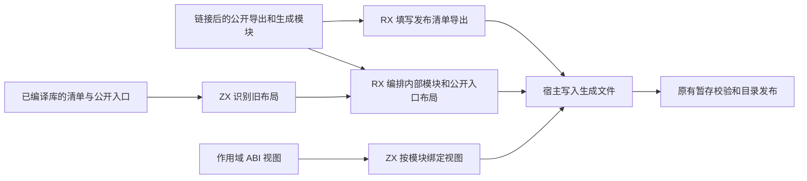
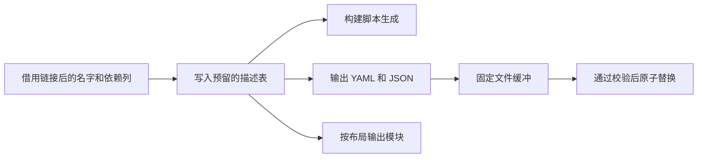

# 统一库发布布局自举

## Intent · 目标

把统一库的发布布局迁入 RX/ZX。首次发布、监听更新和从已编译库重发共用清单导出、入口文件命名和 ABI 视图绑定规则，保持可搬迁的 Zig 库和编译库格式兼容。

## Data · 正式路径

`zxc build --mode lib` 生成链接后的库和 Zig 模块，再写入暂存目录。此前手写 Zig 临时累积导出、生成模块和公开入口的描述，用同一组列表生成 `build.zig` 和 `library.json`。旧布局重发由另一段 Zig 对比公开入口名称和路径。原生模块的 ABI 视图也由 Zig 逐项挑选。发布前的输入稳定性、旧产物校验与最后替换已经有独立验收。 [库重发与旧产物回收](库重发与旧产物回收自举.md)

## Edges · 兼容与生命周期

生成文件路径、公开名称、单入口 `root.zig` 兼容约定和同名诊断来自 RX/ZX。显式的默认导出仍保留独立公开入口布局。生成模块与公开入口借用链接后的名称和依赖列，直接填写调用方精确预留的描述表。路径字节只构造一次，文件写出、构建脚本和 JSON 清单复用同一结果。原生 ABI 视图按最后一次匹配选择，使用已有内存列接口。

发布宿主保留 OS 文件操作、原生资源读取、包清单编码和 JSON 编码。资源适配路径已移除无法到达的原生接口文件写入。发布的编译库依旧不携带源码接口或源码链接配置。YAML 和 JSON 从 4 KiB 文件缓冲直接写入原子临时文件，JSON 仍按既有长度上限决定提交。旧产物的摘要、校验和发布顺序沿用原路径。

## Answer · 验收

统一库发布、库监听、编译库导入、RX I/O 库和独立 Zig 消费五组回归通过，共 892 个构建步骤。覆盖普通和单入口发布、显式默认导出、已编译库重发、Store、原生模块、契约拒绝、旧产物保护和监听恢复。独立 Zig 消费者通过 6,193 个 URL 用例。

初始 seed 和 Source 引导器各自生成 CLI 模块。入口及类型 ABI 一致，传递导入的生成函数只存在局部变量编号差异。按首次出现顺序一致重命名这些变量后，所有传递导入文件相同。

macOS arm64、Zig 0.17.0、ReleaseSmall。固定基线为 `dadb1f21a`，直接对照为 `738d93ac0`。三套 CLI 都由 `7c9b225c3` 的 Source 引导器生成，执行 Source 分析与生成。关闭 zxc 生成缓存，交错运行三版，排除首轮后取七轮中位数。已有输出恢复和文件摘要对照排除在计时外。峰值 RSS 按十进制 MB 记录。

| 场景                 | 墙钟 ms（固定 / 直接 / 候选） | CPU ms（固定 / 直接 / 候选） | 峰值 RSS MB（固定 / 直接 / 候选） |
| -------------------- | ----------------------------: | ---------------------------: | --------------------------------: |
| 兼容布局首次发布     |         12.54 / 12.41 / 12.42 |        11.13 / 11.09 / 11.00 |             25.02 / 25.00 / 25.00 |
| 兼容布局编译库重发   |         12.94 / 12.79 / 12.77 |        11.51 / 11.22 / 11.29 |             25.02 / 25.00 / 25.00 |
| 带作用域原生 ABI     |         17.53 / 18.01 / 17.52 |        18.95 / 19.09 / 18.95 |             12.58 / 12.47 / 12.48 |
| 24 个公开入口        |      226.21 / 214.45 / 215.99 |     240.64 / 228.66 / 230.34 |             51.22 / 45.88 / 45.81 |
| 带大量原生资源的重发 |      341.21 / 239.36 / 239.07 |     341.27 / 237.49 / 237.58 |             76.43 / 15.94 / 15.50 |

五组的 683 份输出文件在三版工具和所有采样中逐字节一致。两组兼容布局都产出 `root.zig`，原生资源重发保留了目标内的非管理文件。相对上一提交，墙钟和 CPU 最大增幅分别为 1.54 ms、1.69 ms，峰值 RSS 最大增幅为 0.02 MB。相对固定基线，三项中位数均无增加。多资源重发的峰值 RSS 比上一版减少约 0.44 MB。测量覆盖库发布和重发，完整冷自举未重测。

本地原始日志和文件摘要见 `.zig-cache/verification-tmp/library-output-layout/` 下的 `regression.log`、`comparison.json` 和 `host-binding.log`。
