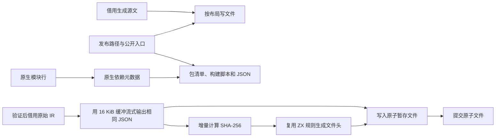

# 统一库暂存写出自举

## Intent · 目标

将统一库暂存写出和原生构建依赖归集迁入 RX/ZX。统一源码发布、编译库重发以及 watch 的暂存路径。把编译库产物直接写到暂存文件，降低大 IR 发布的峰值内存。

## Data · 正式路径

`library.build` 链接并生成库后交给 `library.publish.write`。本批迁移 ABI 与原生资源准备、布局登记、文件写出、包清单与 Zig 构建脚本输出、管理清单及其依赖收集。

### 外部性能诊断核对

| 假设                            | 正式路径与证据                                                                                                                                                                                                                                  |
| ------------------------------- | ----------------------------------------------------------------------------------------------------------------------------------------------------------------------------------------------------------------------------------------------- |
| 全闭包编译、生成巨大 Zig 单文件 | 冷启动仍要装载入口闭包。普通原生构建按入口、类型、函数拆分 Zig 产物，并按内容复用。公开 RX watch 已跨轮复用解析及文件版本，但语义仍重新推导，Zig 后端每轮启动子进程并使用磁盘缓存。常驻 Source 引导器的语义历史已生效于自举路径。               |
| 多个上层模块重复分析公共依赖    | 同次 RX 收集已去重 ZX 依赖，库的多个入口复用 RX 和 ZX 解析。不同入口的类型约束和分析仍分别执行。跨轮公开 RX 语义历史的接线需要覆盖编译库依赖、包作用域和输入版本失效。                                                                          |
| SMT 路径爆炸                    | 验证器按符号实参和目标复用调用，符号图合并等价项，执行有步数上限。不同实参仍展开函数体。已有条件折叠将 192 次不同实参样本的查询从 2.98 MB 减至 0.33 MB，真实 Z3 总耗时从 246.21 ms 降至 160.60 ms。                                             |
| 不可变值、集合链、`$ctx`        | 生成器已有复合值只读借用、独占更新和投影复用。`$ctx` 降为静态结果绑定。需要新结果的集合操作仍可能分配中间数组，绑定引用的分配也可能持续到请求区释放。尚无所有集合链都应融合的依据。                                                             |
| HTTP 请求分配                   | Gateway 已使用独立请求 arena，定长请求体一次分配，连续且无转义的 JSON 字符串可借用。已有标量输入优化把 600 次 256 KiB Store 写入的 RSS 从 170.10 MB 降至 2.54 MB。含借用的聚合和共享 Store 的区域保留仍有独立生命周期。                         |
| 并行线程、Store 锁和取消        | `Parallel` 的分支确实可启动系统线程，文档公开约定每分支一个线程。ZX Future 走 Zig I/O 调度。Gateway 串行接入已复现约 252 ms 队首等待。旧共享区域会随写入累积，尚无证据表明全局 Store 锁是该路径的吞吐瓶颈。普通 loop 无逐迭代通用原子取消轮询。 |

源文件包括 `backends/zig/function_sources.zig`、`cli/rx/analyze.zig`、`rx/analysis/project/history.zig`、`verification/call_cache.zig`、`analysis/gateway/host/accept.zx` 和 `analysis/parallel/emit/spawn_item.zx`。历史同口径数据见[编译器与应用性能诊断复查](编译器与应用性能诊断复查.md)、[性能诊断与验证条件折叠](性能诊断与验证条件折叠.md)、[Gateway 请求体与共享 Store 生命周期](Gateway请求体与共享Store生命周期.md)和[性能实测与验证查询直接写入](性能实测与验证查询直接写入.md)。Zig 磁盘缓存与声明级常驻增量有不同的失效边界。[Zig 增量编译实现](https://mlugg.co.uk/posts/incremental-compilation-internals/) · [LLVM 前端性能指南](https://llvm.org/docs/Frontend/PerformanceTips.html)

本次确认的新增热点在 `compiler.library.codec.encode`。正式库写出先验证 IR，再把整份 JSON 追加到动态缓冲，扫一遍全部字节计算摘要。暂存写盘后，该缓冲还由构建调用方的区域持有。IR 越大，缓冲扩容和存活时间的成本越高。

## Edges · 数据与次序

借用已有的链接结果和生成内容。有明确行数的原生依赖一次预留。保持 ABI、原生资源、布局与文件写出的诊断顺序。YAML 和 JSON 继续使用原子文件，管理清单保留原有上限、字段次序和输出字节。

流式写出在同一暂存文件预留头部位置，JSON 写出及哈希计算完成后回填头部。失败仍由临时文件清理，已发布的库保持原有回滚行为。Source 继续负责写出顺序、文件头和文件清点。Zig 保留原生文件访问、清单结构映射、标准 JSON 序列化及 SHA-256；初始引导器的兼容路径沿用现有编码器。内存编码 API 继续服务需要字节切片的调用。

## Answer · 验收

统一库发布、编译库重发、原生包与别名、原生链接、库和 RX watch 回归通过 130 个构建步骤、6 项 Zig 测试和 83 项集成检查。专门的库编解码回归通过 24 个构建步骤和 42 项 Zig 测试。窄清单使用初始 seed 和 Source 引导器各生成一次，199 份 Zig 产物中 176 份逐字节一致，另 23 份仅有临时标识编号差异。

三个版本在 macOS arm64、Zig 0.17.0、ReleaseSmall 下使用同一工具链和夹具，关闭生成缓存。固定对照为 `dadb1f21a`，直接对照为 `6d728023b`。三套 CLI 均由 `7c9b225c3` 的 Source 引导器构建并运行 Source 分析和生成。版本交错，每版首轮预热后取八轮中位数。RSS 为发布 CLI 进程的系统峰值，按十进制 MB 记。

| 样本                   |  墙钟 ms（固定 / 直接 / 候选） |   CPU ms（固定 / 直接 / 候选） | 峰值 RSS MB（固定 / 直接 / 候选） |
| ---------------------- | -----------------------------: | -----------------------------: | --------------------------------: |
| 普通首次发布           |          17.25 / 17.92 / 18.24 |          18.95 / 19.08 / 19.43 |             12.55 / 12.35 / 12.29 |
| 16 个入口共享 RX       |       802.50 / 771.29 / 767.67 |       961.08 / 927.25 / 925.97 |             70.75 / 58.63 / 54.50 |
| 4.20 MB IR 文件        | 1,147.45 / 1,154.32 / 1,156.09 | 1,144.70 / 1,150.60 / 1,152.93 |             50.68 / 42.93 / 42.84 |
| 大型原生资源首次发布   |          62.48 / 58.23 / 58.44 |          63.59 / 59.10 / 59.24 |             63.63 / 30.04 / 29.98 |
| 编译库重发             |          16.32 / 15.80 / 15.43 |          17.61 / 16.85 / 16.57 |             11.28 / 10.82 / 10.87 |
| 518 项原生资源首次发布 |       231.61 / 228.27 / 226.30 |       232.62 / 228.39 / 227.04 |             16.36 / 15.00 / 14.96 |
| 518 项原生资源重发     |       338.03 / 235.25 / 235.31 |       338.36 / 235.59 / 236.02 |             74.67 / 15.17 / 15.11 |
| 清退 32 个旧资源       |       528.38 / 416.26 / 416.59 |       528.89 / 417.06 / 417.26 |             84.91 / 15.16 / 15.02 |
| 清退大型旧资源         |       348.81 / 247.52 / 246.01 |       349.73 / 248.31 / 246.82 |             85.88 / 15.14 / 15.08 |

九种输入在三个版本间逐次核对完整输出文件集合和 SHA-256。4,201,181 字节的编译库另验证了原格式标记及正文摘要。共享 RX 样本相对直接对照少占 4.13 MB，相对固定对照少占 16.24 MB。4.20 MB 单文件样本的整轮峰值基本持平，流式编码消除了完整序列化副本，但这组数据未显示整轮峰值下降。九组相对直接对照的墙钟和 CPU 最大增加分别约 1.77 ms 和 2.34 ms，较固定对照最大增加分别约 8.64 ms 和 8.24 ms。已测路径保持在性能容差内。此次测量覆盖库发布，未重测完整自举冷构建。

后续仍有公开 RX watch 的语义分析复用、Gateway 的连接调度及 Store 借用快照与区域回收、集合链的中间分配，以及不同符号实参的求解开销。Gateway 并发应以请求读取、状态借用与提交时序能分别验收为边界。共享 Store 的后续测量应同时观察稳定写入下的内存曲线和历史数据仍被引用的正确性。

原始记录位于 `.zig-cache/verification-tmp/library-staging/`，包括正式回归、编解码回归、每轮性能数据和文件摘要。以场景名和相对文件名排序的 SHA-256 清单摘要为 `b390a8ef235a2fb0418066f9ac852806dad8b8369737d0dc73ebdfb638ae41aa`。
