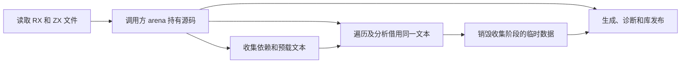
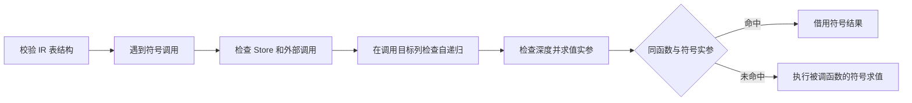
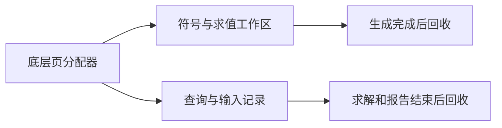
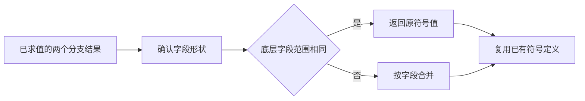

# 编译器与应用性能诊断复查

## Intent · 目标

沿 `zxc` 正式入口核对外部诊断中的编译、验证、内存与并发假设。消除已证实的重复源码复制和符号调用扫描，保持 Zig 产物、SMT 查询、错误顺序与生命周期一致。

## Data · 诊断结论

| 诊断                   | 源码与验证结论                                                                                                                                                                                                                                                                       |
| ---------------------- | ------------------------------------------------------------------------------------------------------------------------------------------------------------------------------------------------------------------------------------------------------------------------------------ |
| 一次生成巨大单文件     | 应用已生成入口、类型和函数单元，按内容复用 Zig 文件。自举另有对象分区缓存，只有摘要发生变化的分区重建。公开 `build --watch` 仍为每轮启动新的 Zig 进程，使用磁盘缓存。常驻 Source 引导器的分析缓存属于另一条入口。                                                                    |
| 跨模块重复装载和推导   | 一轮 RX 构建已共用 ZX 解析缓存和依赖遍历，公开 RX watch 的前端分析仍按轮执行。装载曾把已读的 ZX 文本在收集、依赖遍历之间再复制一遍，RX 源文也在交付给调用方前另复制一份。                                                                                                            |
| 验证器完全内联         | 等价符号表达式和相同实参的函数调用已有缓存，也有求值步数上限。不同实参仍展开函数体。调用是否直接递归与实参无关，之前每次先扫描被调函数的整个表达式表。                                                                                                                               |
| 不可变值与 `$ctx`      | 只读参数已有借用路径，集合独占更新可复用原存储。`$ctx` 解析为静态结果绑定。数组链仍可能物化中间结果，请求 arena 仍可能延长局部结果指向的存储寿命。                                                                                                                                   |
| JSON 和 Store 请求内存 | Gateway 已用请求 arena，未转义的连续 JSON 字符串可借用请求体。写入独占 Store 区域后已有过期回收。部分共享状态仍会保留已提交请求的整个 arena 到应用退出。                                                                                                                             |
| 并发和取消             | Gateway 在接收循环内同步完成当前连接，慢请求头造成队首阻塞，已有复现。ZX Future 使用 `std.Io.async` 或 `std.Io.concurrent`。语句型并行降低确实可生成 `std.Thread.spawn`，与 Future 是两条路径。Gateway 排队尚无 Store 锁竞争的实测证据，普通 `loop` 路径无通用的逐迭代原子取消轮询。 |

既有源码和实测见[编译与运行时性能核查](../2026-11-18/编译与运行时性能核查.md)和[性能复查与监听输入扫描](性能复查与监听输入扫描.md)。Zig 的磁盘缓存与常驻声明级增量有独立的失效边界，LLVM 对聚合和内存访问的建议用于指导检查生成形态。[Zig 增量编译](https://mlugg.co.uk/posts/incremental-compilation-internals/) · [LLVM 前端性能指南](https://llvm.org/docs/Frontend/PerformanceTips.html)

## Edges · 本次改动的边界

RX 收集阶段把随后要交给分析、生成和证据输出的源码直接读入调用方的 arena。依赖遍历借用已读取的 ZX 文本，同一段文本可以继续作为模板展开前的原文。收集阶段自己的解析和路径元数据仍可独立释放。Gateway 和 Store 声明保持原有收集阶段的生命周期。

验证器在已经校验的 IR 上直接借用调用目标列，复用编译器已有的递归检查。结构校验确认每个调用列条目对应一个调用表达式。Store 调用、外部调用、自递归和深度限制的诊断顺序不变，符号调用缓存的键与 Z3 查询保持原样。

监听文件摘要仍使用 SHA-256。用原始扫描程序替换为 BLAKE3 的单项试验，在 1,000 个约 32 KiB 文件、24 次无变更扫描的 macOS arm64 样本中，墙钟从 0.68 秒升到 1.06 秒，CPU 从 0.68 秒升到 1.05 秒，因此未纳入改动。文件摘要和发布前输入检查继续采用同一口径。

## Answer · 验收

正式 RX 项目、watch 恢复、库发布、Gateway、实际 Z3 验证和验证资源检查通过 99 个构建步骤、51 项 Zig 测试。Gateway 另通过 86 项运行检查。并行、嵌套、对象、元组和结果汇合五组验证输入生成的 11 份 SMT 查询逐字节一致，Z3 返回状态一致。

库发布使用 16 个 RX 入口，共享 49 个 ZX 文件，生成缓存关闭。两套 CLI 均由 Source 引导器构建并执行 Source 分析及生成。macOS arm64、Zig 0.17.0、ReleaseSmall 下交错采样，去掉首轮后取七轮中位数。两个样本分别有 70 个发布文件逐字节一致。大源码样本在每个 ZX 文件前加 64 KiB 注释，保持原有语义，放大文本装载的成本。

| 样本       | 墙钟（对照 → 候选） | CPU（对照 → 候选） | 峰值 RSS（对照 → 候选） |
| ---------- | ------------------: | -----------------: | ----------------------: |
| 原样本     |    0.900 → 0.902 秒 |   1.041 → 1.042 秒 |        94.57 → 97.81 MB |
| 大源码样本 |    1.874 → 1.861 秒 |   2.020 → 2.006 秒 |      208.88 → 152.09 MB |

原样本 RSS 中位数增加 3.24 MB，两套工具的样本范围重叠（对照 90.0～102.2 MB，候选 86.8～98.8 MB）。大源码样本每一轮峰值均下降，中位数下降 56.79 MB。该测量覆盖库发布进程，从装载到生成和写出发布文件。

单独测量调用检查时，直接执行两代 Source 规则。50,000 次查询面对同一份 8,192 条表达式、其中 16 条真实调用的输入，命中结果一致，八轮交错运行的墙钟中位数由 156.93 ms 降至 0.226 ms。这个样本隔离了递归判定，整体 `verify` 仍包含 IR 校验、符号表达式计算、证据写出以及 Z3 求解。

Gateway 连接调度与 Store 借用快照和回收仍需联合处理。公开应用 watch 的常驻分析、数组链融合和不同符号实参的契约摘要也尚未实现。生成缓存调度自举作为单独阶段验收，见[生成缓存调度与缓冲留存自举](生成缓存调度与缓冲留存自举.md)。

## 复查 · 查询生成后释放符号图

### Intent · 目标

让符号图、调用缓存和工作表在 SMT 查询生成后释放，避免它们与证据序列化和外部 Z3 求解同时占用内存。

### Data · 正式调用路径

此前验证用同一个 arena 持有符号图、查询和输入字段记录。CLI 在生成查询后序列化证据、写入原子文件，再顺序调用 Z3 检查前置条件和程序行为。此时符号图与调用缓存已结束使用，但要等验证返回才会释放。公开 ZX、RX、库验证、带契约生成和 FPGA 验证走同一验证入口。

### Edges · 所有权边界

输入字段名与路径、交给 Z3 的查询直接分配到验证结果区域。符号求值产生的图和缓存由各自的临时区域持有。CLI 使用 Zig 的页分配器作为验证区域的底层分配器，让释放能归还页面。编译器库接收调用方提供的分配器，分配失败行为继续由现有回归覆盖。Z3 输入、命名、证据文件布局与诊断顺序保持一致。

### Answer · 验收

`test-verification`、`test-verification-resources` 和 `test-hardware-resources` 通过，共 72 个构建步骤及 8 项 Zig 测试。实际 Z3 的 74 项普通检查和公共接口、枚举验证回归均通过。两套工具均由 `7c9b225c3` 的 Source 引导器构建，使用 Source 分析和生成。直接对照为 `849056660`。两版在 macOS arm64、Zig 0.17.0、ReleaseSmall 下各预热一次，随后交错运行九轮。查询、前置条件查询、源证据、结果和模型文件逐字节一致。

| 样本                              | 墙钟中位数（ms） | CPU 中位数（ms） | 峰值 RSS（MB） |
| --------------------------------- | ---------------: | ---------------: | -------------: |
| 小规模，实际 Z3                   |    11.40 → 11.37 |    10.53 → 10.52 |  25.21 → 25.20 |
| 192 次不同符号实参的调用，实际 Z3 |  316.80 → 318.02 |  314.81 → 316.09 |  89.64 → 89.62 |
| 同一大样本，以固定响应替代求解    |  172.95 → 174.63 |  171.66 → 173.33 |  47.12 → 44.74 |

单独在真实 Z3 的版本查询开始前采样，七轮的编译器进程 RSS 中位数从 46.99 MB 降到 26.44 MB，降幅 43.7%。仅拆分 arena 并使用进程通用分配器的试验在同一点测得 47.84 MB，因此 CLI 使用能归还页面的分配器。真实 Z3 的端到端峰值仍由求解阶段主导。与同一夹具此前 `5c5ee03db` 的记录相比，排除求解后的进程峰值由 63.65 MB 降至 44.74 MB。此次修改只影响验证入口，未重新测量编译器完整冷构建。

本地原始记录位于 `.zig-cache/verification-tmp/verification-scratch/`，包括 `page-lifetime-regression.log`、`page-lifetime-measurement.log`、`query-lifetime-comparison.json` 和两份求解器启动时的 RSS 样本。

## 复查 · 共享符号结果的分支合并

### Intent · 目标

当 `verify` 合并的两个复合结果已经借用同一份字段时，直接沿用该值，减少符号执行阶段的遍历和分配。

### Data · 源码与根因

`verification/conditions.zig` 合并同一函数的多个返回结果，`verification/expressions.zig` 也在条件和 match 表达式中合并结果。两者都调用 `verification/graph.zig` 的 `select`。例如两个分支都返回传入对象时，符号值直接引用同一份参数字段。合并此前仍创建新字段数组并递归检查每一项，即使每个叶子都折叠成原值。该开销随对象的展开字段数和调用次数增长。

### Edges · 正确性与生命周期

两个结果形状检查通过，且字段范围的指针及长度相同，就可以复用同一个不可变符号值。字段仍由本次验证的符号区持有。两个分支的值、安全条件和调用行为照常求值。不同字段范围继续逐字段合并，保留原来的约束和定义顺序。修改也覆盖使用同一符号图的 FPGA 分析路径。

RX 的 `Parallel` 文档明确规定每个分支的线程行为。现有回归还用分配器观测线程 ID。把一个分支移到调用线程需要改变这个约定，当前保留现有语义。Gateway 的串行接入及一般共享 Store 的区域回收各有独立的生命周期约束和验证范围。详见[并行执行参考](../2026-10-05/RX并行调用参考.md)及[Gateway 请求体与共享 Store 生命周期](Gateway请求体与共享Store生命周期.md)。

### Answer · 验收

`test-verification`、`test-public-verification`、`test-enum-verification`、`test-verification-resources` 和 `test-hardware-resources` 全部通过，共 84 个构建步骤、8 项 Zig 测试。覆盖实际 Z3、公共库入口、枚举域、无效 IR、分配失败和 FPGA 符号图。

在 macOS arm64、Zig 0.17.0、ReleaseSmall 上对比 `197f2dda1` 和候选。两套 CLI 由 `7c9b225c3` Source 引导器构建，运行时使用 Source 分析和生成。每组版本交错，首轮预热后取十一轮中位数。样本调用同一个函数 32 次，实参的标量不同，分支返回共同的输入对象。表中的对象宽度按嵌套后展开的载荷字段计算。小样本为三次标量符号调用。峰值 RSS 按十进制 MB 计。

| 输入                       |     墙钟（ms） |      CPU（ms） | 峰值 RSS（MB） |
| -------------------------- | -------------: | -------------: | -------------: |
| 小规模，真实 Z3            |  11.33 → 11.23 |  10.40 → 10.37 |  25.12 → 25.12 |
| 16 个载荷字段，真实 Z3     |  20.28 → 19.67 |  19.43 → 18.84 |  25.41 → 25.41 |
| 256 个载荷字段，真实 Z3    |  28.87 → 20.20 |  27.96 → 19.35 |  25.46 → 25.46 |
| 4,096 个载荷字段，真实 Z3  | 162.35 → 26.74 | 161.30 → 25.85 |  26.49 → 26.51 |
| 4,096 个载荷字段，隔离求解 | 156.96 → 21.72 | 155.72 → 20.52 |  22.97 → 16.24 |

同一个样本的前置条件、正确性查询、源码证据及结论文件逐字节一致。较大样本用固定求解器响应隔离了符号分析与查询生成的成本，峰值 RSS 下降 29.3%。真实 Z3 的大对象样本峰值基本持平，整个验证的墙钟下降 83.5%。源程序仍按原有方法产生符号查询，不同实参的通用函数摘要、普通应用的集合融合及自举冷构建不在本次测量范围。原始数据及回归见 `.zig-cache/verification-tmp/symbolic-value-sharing/`。
