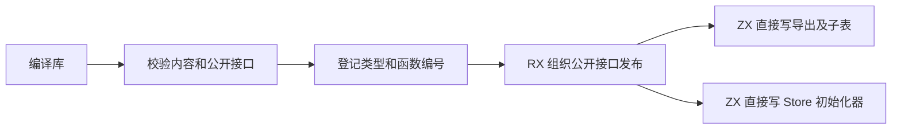
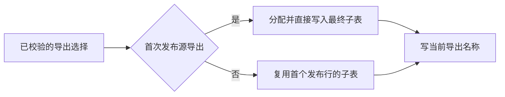

# 编译库公开接口直接发布自举

## Intent · 目标

将编译库加载后的公开接口发布完整迁入 RX/ZX。ZX 直接将导出、类型、成员、常量和 Store 初始化器写入最终表，同一源导出的多个发布名称复用同一份接口数据。

## Data · 正式路径

正式入口 `compiled.load` 和 `compiled.loadInto` 在载入并校验编译库之后进入 `host/publish.zig`。该路径当前由 ZX 构造中间记录和别名关系，再由 `host/interface.zig` 遍历这些记录并分配最终数组。RX 调用签名专用加载共用库图校验，只要求函数和类型。

## Edges · 数据所有权与错误边界

复用统一的原生行分配、列投影和标量写入。常量只复制需要独立持有的字符串，非字符串值沿用已有已校验的标量表示。别名借用首个已发布导出持有的同一份类型、常量和成员切片。导出顺序、名称规则、调用签名专用加载以及外部缓存和库的入边校验沿用既有约定。

公开常量的结构和类型校验也改为借用同一份原始常量列，移除对整库预先组装常量值数组的步骤。共享类型、原生模块和函数的写回调度仍在 `host/publish.zig`。

CLI 用独立的内存分配器接收原始库文件和解码图。文件字节在解码返回后释放，解码图在链接生成最终表后释放。监听记录在读取时计算摘要，发布前仍会重新核对输入内容与路径。

## Answer · 验收

编解码、独立进程重载及导入、Store 初始化器、别名重发、契约重验和原生链接共通过 118 个构建步骤和 74 项 Zig 测试。调整 CLI 输入生命周期后，重跑受影响的编译库清单、契约、RX 和监听发布，共通过 66 个构建步骤及 25 项应用检查。候选重新构建 16 分区引导器，与原 Source 引导器独立生成同一专项清单，排除输入戳后的 949 个文件逐字节一致。

macOS arm64、Zig 0.17.0、ReleaseSmall。各 CLI 均由 Source 引导器构建，并执行 Source 分析和生成。候选使用 `5c5ee03db` 的 Source 引导器。固定可运行对照为 `fe2b69bd9`，直接对照为 `e33b361d5`。各版本用相同的预编译库关闭生成缓存重发，交错运行，排除预热后取七轮中位数。固定基线来自首次对照，加入输入生命周期调整后，直接对照和最终版重新配对测量。

| 重发样本                    | 墙钟秒（固定 / 直接 / 候选） | CPU 秒（固定 / 直接 / 候选） | 峰值 RSS MB（固定 / 直接 / 候选） |
| --------------------------- | ---------------------------: | ---------------------------: | --------------------------------: |
| 16 个公开 RX 入口           |        0.802 / 0.809 / 0.798 |        0.859 / 0.866 / 0.855 |             89.98 / 86.26 / 69.71 |
| 同一批入口的 128 个公开名称 |        4.914 / 4.958 / 4.894 |        4.981 / 5.026 / 4.960 |             85.18 / 85.25 / 83.59 |
| 1,152 条公开常量            |     0.0123 / 0.0138 / 0.0136 |     0.0142 / 0.0153 / 0.0154 |              10.17 / 10.31 / 9.57 |

三个场景分别有 70、182 和 21 个发布文件逐字节一致。首次对照的别名样本峰值 RSS 增加约 4.87 MB，系统内存占用复测也观察到上升。缩短 CLI 原始文件和解码图的生命周期后，别名样本的峰值 RSS 降低 1.65 MB，系统峰值内存占用由 80.69 MB 降至 79.07 MB。常规样本的峰值 RSS 降低 16.55 MB。三个最终样本的墙钟均未超过直接对照。
