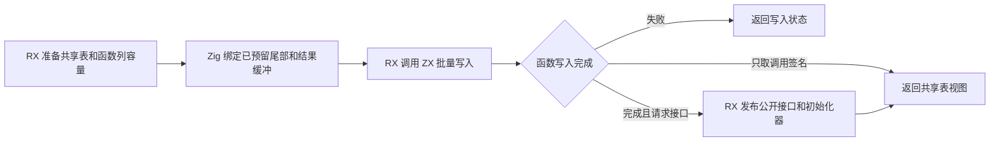

# 编译库共享表写回自举

## Intent · 目标

将编译库重载的类型、名义来源和原生模块写回与函数容量预留交给同一份 RX 编排。复用 ZX 的列写入和重映射逻辑，同时保留函数表原地写入和只取调用签名时的工作区分配。源码 Store 初始化器也使用已有 Source 函数表发布入口。

## Data · 正式路径

`compiled.load`、`loadInto` 和 `loadCalls` 在库图验证及编号规划完成后共用 `host/publish.zig`，三者都进入 `loading/install/prepare.rx`。RX 依次提交类型增量和名义来源、登记原生模块并为函数列预留容量。旧的独立原生追加宿主入口退出调用链。Zig 绑定表地址和分配器，在预留之后把尾部独占交给已有 ZX 批量写入入口。

## Edges · 生命周期与失败边界

类型、名义来源及原生模块使用结果分配器。调用签名专用加载仍使用独立的函数分配器，并跳过公开接口。函数写入保留按已完成前缀推进长度的约定。类型写入完成之后将文本清理标记归零，随后步骤失败时保留已发布的文本。函数容量预留复用既有的列存储接口。

专项生成证明，将函数写入直接接到准备 RX 入口后，普通调用 ABI 会把独占列降低为只读切片，`.with` 随后生成复制操作。当前让 Zig 只在分配和独占 ABI 的边界衔接两个生成入口，函数内容仍由 ZX 写入。下一步需要生成器能跨这条静态调用边界传递独占列，据此移除宿主入口间的调度。

## Answer · 集中验收

统一库链接、编解码、Store 初始化器、独立进程重放、编译库导入、公开契约重验、RX 调用及原生库重发和链接全部通过，共 141 个构建步骤、120 项 Zig 测试。既有分配失败检查覆盖源码和已编译的 Store 初始化器。窄清单生成的函数写入仍导出 `executeState`，准备入口直接调用列容量原语。

macOS arm64、Zig 0.17.0、ReleaseSmall。候选由 `7c9b225c3` 的 Source 引导器生成。固定基线 `fe2b69bd9`、直接对照 `7c9b225c3` 和候选均执行 Source 分析与生成。使用同一批冻结的编译库，在关闭生成缓存时重发。各版本交错运行，并用 SHA-256 核对所有发布文件。

| 场景                        | 墙钟秒（固定 / 直接 / 候选） | CPU 秒（固定 / 直接 / 候选） | 峰值 RSS MB（固定 / 直接 / 候选） |
| --------------------------- | ---------------------------: | ---------------------------: | --------------------------------: |
| 16 个公开 RX 入口           |        0.802 / 0.798 / 0.804 |        0.859 / 0.855 / 0.862 |             90.01 / 73.43 / 77.22 |
| 同一批入口的 128 个公开名称 |        4.913 / 4.883 / 4.928 |        4.980 / 4.951 / 4.995 |             85.18 / 81.00 / 77.33 |
| 带资源的原生库              |     0.0178 / 0.0179 / 0.0177 |     0.0189 / 0.0190 / 0.0191 |             11.45 / 11.29 / 11.30 |

排除首轮后，普通和原生样本取七轮中位数，别名样本取五轮中位数。各场景分别有 70、182 和 20 个发布文件逐字节一致。相对固定基线，最大 CPU 增加约 15 毫秒。普通样本的峰值 RSS 较直接对照增加 3.79 MB，两版样本范围重叠，分别为 65.98～81.07 MB 和 69.57～80.97 MB。别名样本峰值较直接对照下降 3.67 MB，原生样本变化约 0.02 MB。测量覆盖编译库重发路径。

## 发布阶段由 RX 调用独占入口

### Intent · 目标

将函数批量写入、写入失败返回、公开接口及初始化器发布交给一个 RX 入口。主入口及调用签名专用加载继续共享容量准备。

### Data · 生成证据

实际生成的 `install/publish.rx` 提供 `executeState`。其 `callValue` 直接将函数批次传给写入器，保留目标列的存储标记。公开接口只需要普通视图，在同一 RX 内使用普通调用。窄清单中的类型编号映射以指针表示，完整清单可使用内联的状态列。宿主在编译时按生成的参数类型选择借用表示。

### Edges · 存储与错误顺序

容量准备完成后才绑定独占尾部，避免持有可能因扩容而失效的切片。函数批处理失败时沿用已写前缀，公开接口仅在函数批次成功后写入。只取调用签名时省去公开接口请求，函数体继续写入独立工作区。公开接口请求存在时，函数和接口使用同一个结果分配器。两个生成入口之间仍由 Zig 绑定分配器和内存视图。上一阶段尝试将准备操作纳入同一个状态入口时，生成的普通视图会触发函数列复制。

### Answer · 验收

统一库链接、编解码、Store 初始化器、独立进程重放、编译库导入、公开契约重验、RX 调用及原生库重发和链接通过 141 个构建步骤和 120 项 Zig 测试。完整清单和窄清单都生成直接传递函数状态的 `callValue`。公开接口的调用保留在写入成功分支。类型库和没有可执行入口的编译库也通过此前的验收用例。

沿用上一阶段的冻结库、交错顺序和采样轮次。候选由 `7c9b225c3` 的 Source 引导器生成。固定基线 `fe2b69bd9`、直接对照 `821a1985b` 和候选均使用 Source 分析与生成。运行环境为 macOS arm64、Zig 0.17.0、ReleaseSmall。

| 场景                        | 墙钟秒（固定 / 直接 / 候选） | CPU 秒（固定 / 直接 / 候选） | 峰值 RSS MB（固定 / 直接 / 候选） |
| --------------------------- | ---------------------------: | ---------------------------: | --------------------------------: |
| 16 个公开 RX 入口           |        0.805 / 0.806 / 0.805 |        0.863 / 0.863 / 0.861 |             86.29 / 77.05 / 76.86 |
| 同一批入口的 128 个公开名称 |        4.917 / 4.923 / 4.920 |        4.981 / 4.990 / 4.987 |             88.74 / 81.25 / 81.15 |
| 带资源的原生库              |     0.0169 / 0.0185 / 0.0170 |     0.0180 / 0.0198 / 0.0182 |             11.42 / 11.26 / 11.06 |

三个场景的 70、182 和 20 个发布文件分别逐字节一致。相对直接对照，三个场景的 CPU、墙钟和峰值 RSS 中位数均下降。相对固定基线，最大的 CPU 增量约 6.1 毫秒，出现在高别名场景。计时覆盖编译库重发。
