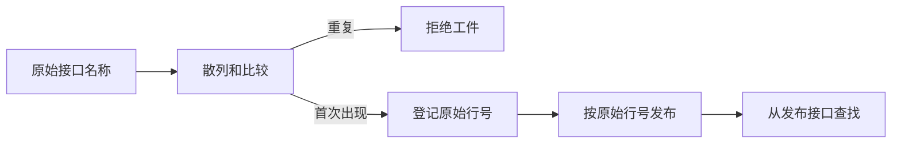

# 编译库名称校验复用索引

## Intent · 目标

让编译库导入时用于拒绝重复公开名称的索引，直接供本次导入与后续缓存命中查找使用。去掉名称临时数组、排序和发布后的重复建索引。

## Data · 原有路径

首次导入先预留持久索引桶，再校验工件。校验会复制名称切片到临时数组并排序查重。链接发布后，Source 再遍历已发布的名称为同一库建立持久索引。走普通项目导入时，公开接口按原行号与名称发布。

## Edges · 权限与错误边界

索引继续借用公开接口名称。校验写入的桶仅记录原始行号，发布复制名称但保留顺序和内容。独立校验、带导出选择的加载以及 RX 签名预检查继续按各自原有入口运行。遇到重复名称或随后的校验及链接失败时，索引不进入缓存，预留桶按原分配器释放。

## Answer · 验收

从正式 ZX 与 RX 导入退出了发布后的构造入口，缓存命中只调用生成的查找。索引生成时仍会拒绝重复名称。库链接、编解码、重放、导入、原生链接、语义缓存、RX 推导、公开 Store 库和 RX 边界九组回归通过，共 138 个构建步骤、239 项 Zig 测试和 10 项公开 CLI 检查。

macOS arm64、Zig 0.17.0、ReleaseSmall。沿用上一阶段的两个工件，固定对照为 `dadb1f21a`，直接对照为 `e2d27f45e`。三套 CLI 均由 `7c9b225c3` 的 Source 引导器生成，执行 Source 分析和生成。交错执行十二轮，关闭生成缓存，去掉前两轮后取十轮中位数。

| 导入样本  | 墙钟，ms（固定 / 直接 / 候选） | CPU，ms（固定 / 直接 / 候选） | 峰值 RSS，MB（固定 / 直接 / 候选） |
| --------- | -----------------------------: | ----------------------------: | ---------------------------------: |
| 普通 ZX   |             9.21 / 9.24 / 9.22 |          10.16 / 10.00 / 9.99 |              9.593 / 9.519 / 9.617 |
| 普通 RX   |          12.83 / 12.87 / 12.89 |         13.84 / 13.78 / 13.81 |           10.732 / 10.682 / 10.699 |
| 多导出 ZX |          68.35 / 65.42 / 65.33 |         88.08 / 85.85 / 85.72 |           27.845 / 27.918 / 27.910 |
| 多导出 RX |         100.60 / 95.08 / 94.64 |      120.86 / 112.77 / 112.32 |           30.360 / 30.204 / 30.228 |

所有场景生成的文件逐字节一致。与直接对照相比，最大墙钟、CPU 和峰值 RSS 增量分别为 0.020 ms、0.033 ms 和 0.098 MB。与固定对照相比，最大峰值 RSS 增量为 0.066 MB。本次测量覆盖编译库消费到 Zig 生成，完整冷构建未纳入测量。原始记录位于 `.zig-cache/verification-tmp/compiled-export-index/`。
