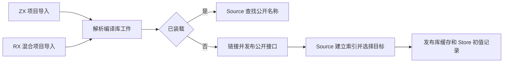

# 编译库导入名称索引自举

## Intent · 目标

让 ZX 项目导入和 RX 混合项目导入共用 Source 的公开名称索引构造与查找。索引直接读取已发布的名称列，去掉单独保存的名称切片数组和逐行宿主调用。

## Data · 正式路径

## Edges · 存储与错误边界

同一库第一次装载前预留缓存、Store 初值和索引容量。Source 借用发布产物的名称列，桶只存行号。单导出直接比较名称。请求的名称缺失时，仍保留已经链接的库，后续导入可以复用。旧的 Zig 路径作为 seed 保留。

## Answer · 验收

正式导入退出了 Zig 的公开名称逐行登记和 `Unit.find`。发布结果的名称直接用于比较，缓存只增加桶，不再单独保存一组名称切片。缓存容器、容量分配、路径规范化和装载调用仍由 Zig 宿主管理。原始库在受信任的发布路径前继续校验名称唯一性。

库链接、编解码、重放、导入、原生链接、语义缓存、RX 推导、公开 Store 库和 RX 边界九组回归通过，共 138 个构建步骤、239 项 Zig 测试及 10 项公开 CLI 检查。生成入口使用空分配器，覆盖 ZX 缓存复用与 RX 公开模块导入。

macOS arm64、Zig 0.17.0、ReleaseSmall。固定比较为 `dadb1f21a`，直接比较为 `37d071d10`。三套 CLI 由同一 `7c9b225c3` Source 引导器生成，执行 Source 分析和生成。固定已发布库，关闭生成缓存，交错执行十二轮，去掉前两轮，取十轮中位数。普通库有四个导出，多导出库增加 256 个公开别名，ZX 样本从同一个库装载多个名称。

| 导入样本  | 墙钟，ms（固定 / 直接 / 候选） | CPU，ms（固定 / 直接 / 候选） | 峰值 RSS，MB（固定 / 直接 / 候选） |
| --------- | -----------------------------: | ----------------------------: | ---------------------------------: |
| 普通 ZX   |             9.25 / 9.24 / 9.23 |          10.17 / 10.05 / 9.99 |                 9.71 / 9.58 / 9.63 |
| 普通 RX   |          12.88 / 12.83 / 12.80 |         13.83 / 13.77 / 13.78 |              10.75 / 10.67 / 10.69 |
| 多导出 ZX |          68.64 / 65.76 / 65.98 |         89.17 / 86.05 / 86.27 |              27.84 / 27.94 / 27.93 |
| 多导出 RX |         100.66 / 95.58 / 95.94 |      119.61 / 113.59 / 115.90 |              30.28 / 30.23 / 30.20 |

各场景三套工具生成的文件逐字节一致。相对固定比较，峰值 RSS 的最大增量为 0.10 MB。相对直接比较，墙钟、CPU 与峰值 RSS 的最大增量分别为 0.36 ms、2.31 ms 与 0.05 MB。测量覆盖已编译库消费到 Zig 产物生成，独立的编译器冷构建未纳入对照。原始记录位于 `.zig-cache/verification-tmp/compiled-import-index/`。
