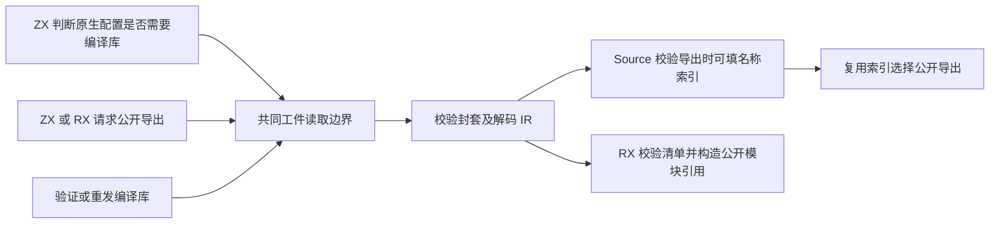
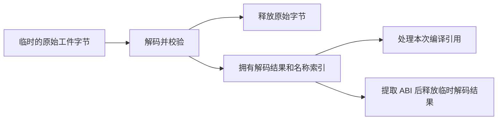

# 编译库消费准入与索引复用自举

## Intent · 目标

迁移编译库消费时的清单导出、旧布局候选判定及原生配置的工件选择。ZX 导入、RX 调用、原生 ABI 接入和编译库重发共用读取边界，复用已有 Source 校验的结果。

## Data · 正式路径

编译库重发、传递导入和原生 ABI 绑定原先分别实现物理路径校验、读取上限和监听输入记录。传递导入解码后按导出列表线性查名，RX 又重新遍历库和导出。原始字节与解码数据取自同一命令 arena 时，释放原始字节可能无法归还内存。原生 ABI 绑定只在包处理期间使用完整 IR。

## Edges · 生命周期与兼容

RX 先填写公开选择表，再判断是否检查旧版兼容入口。ZX 借用清单现有名字，不复制字符串。请求导出缺失、非可执行模块和实例工件冲突沿用原有诊断。首次解码期间，Source 原有的唯一性校验直接填写索引。桶只包含导出行号，和解码的库共用生命周期。普通解码仍提供原有接口。

路径校验、观察输入及读取顺序由 Zig 宿主保持。原始字节使用可独立释放的页分配器，解码器一直拥有自己的结果数据。原生 ABI 绑定只在当前包处理期间保留解码结果。监听仍在发布前重新核对文件内容和物理路径。

## Answer · 验收

库编解码、统一库链接、编译库导入、库发布、库监听、原生 ABI 别名和 RX I/O 库七组回归通过，共 920 个构建步骤及 748 项 Zig 测试。覆盖损坏工件、缺失导出、旧布局重发、显式默认导出、RX 调用类型入口及原生模块跨包消费。初始 seed 与 Source 引导器生成的 CLI 在一致重命名生成函数的局部变量后相同。

macOS arm64、Zig 0.17.0、ReleaseSmall。固定基线为 `dadb1f21a`，直接对照为 `875719f4e`。三套 CLI 均由 `7c9b225c3` 的 Source 引导器生成，运行时执行 Source 分析与生成。关闭生成缓存，冻结输入编译库，交错执行三版。排除前两轮后取九轮中位数，峰值 RSS 以十进制 MB 记录。多导出样本的库工件约 1.5 MiB。

| 场景           | 墙钟 ms（固定 / 直接 / 候选） | CPU ms（固定 / 直接 / 候选） | 峰值 RSS MB（固定 / 直接 / 候选） |
| -------------- | ----------------------------: | ---------------------------: | --------------------------------: |
| 普通 ZX 导入   |            9.19 / 9.17 / 9.24 |        10.28 / 10.19 / 10.25 |                9.68 / 9.72 / 9.63 |
| 普通 RX 调用   |         12.84 / 12.83 / 12.69 |        13.85 / 13.76 / 13.76 |             10.72 / 10.81 / 10.50 |
| 多导出 ZX 导入 |         68.60 / 65.72 / 64.65 |        89.40 / 84.72 / 85.04 |             27.80 / 28.10 / 22.56 |
| 多导出 RX 调用 |        100.41 / 95.95 / 94.84 |     118.52 / 115.54 / 114.88 |             30.43 / 30.79 / 26.02 |
| 原生 ABI 消费  |            6.27 / 6.18 / 6.25 |           6.69 / 6.50 / 6.70 |                9.72 / 9.72 / 9.63 |
| 编译库重发     |         12.76 / 12.77 / 12.63 |        11.26 / 11.51 / 11.14 |             25.03 / 25.00 / 25.00 |

六组的 12 份输出文件在三版工具及所有采样中逐字节一致。多导出库的 ZX 和 RX 峰值分别下降 5.54 MB、4.77 MB。相对直接对照，墙钟和 CPU 最大增幅分别为 0.07 ms、0.32 ms，各组峰值 RSS 未增加。相对固定基线，墙钟和 CPU 最大增幅分别为 0.05 ms、0.01 ms。样本覆盖编译库消费到 Zig 生成或库重发。完整冷自举时间未重测。

本地记录见 `.zig-cache/verification-tmp/compiled-library-consumption/` 下的 `regression.log`、`generation-parity.log` 和 `comparison.json`。
