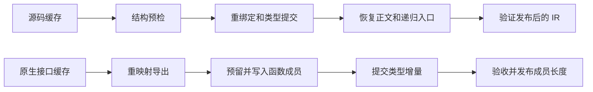

# 语义缓存恢复发布与回滚自举

## Intent · 目标

将语义缓存恢复的发布顺序、函数签名预留和失败回滚迁入 RX/ZX。保留成功结果与暂存区域的生命周期，以及源码缓存失败后继续分析的行为。

## Data · 正式入口

源码缓存由 `Project.finishInput` 进入恢复。原生接口从 `NativeCache.load` 进入缓存恢复，发布出口随后与普通原生分析汇合。上一阶段已迁移编号映射和签名写入，本批覆盖外层发布、共享容量预留和回滚。[上一阶段](语义缓存恢复映射与准入自举.md)

## Edges · 所有权与失败恢复

预检通过后再保存恢复位置。函数、名义来源和类型的有效长度先回退，载荷区域随后回卷。可复用的已校验前缀只在成功后更新。原生签名先写到预留尾部，模块完成最终登记时才推进可见长度。表的物理分配和 arena 回卷仍使用原生内存原语。

## Answer · 验收

固定清单有 735 个入口和 16 个分区，环境为 macOS arm64、Zig 0.17.0、ReleaseSmall。三套工具均由 Source 引导器构建并运行 Source 分析与生成。交错运行三轮取中位数，每套另测 18 次无变化请求。

| 生成器指标               |  固定基线 |  上一阶段 |      候选 |
| ------------------------ | --------: | --------: | --------: |
| 冷生成墙钟               |    2.78 s |    2.48 s |    2.50 s |
| 冷生成 CPU               |   12.30 s |   12.02 s |   11.97 s |
| 冷生成进程树采样峰值 RSS | 888.85 MB | 696.35 MB | 700.68 MB |
| 冷生成单进程系统峰值 RSS | 975.34 MB | 800.92 MB | 735.31 MB |
| 热重建墙钟               |    2.13 s |    1.89 s |    1.94 s |
| 热重建 CPU               |    8.26 s |    8.06 s |    8.14 s |
| 无变化墙钟               |  38.47 ms |  34.34 ms |  34.80 ms |
| 无变化 CPU               |  37.30 ms |  33.24 ms |  33.75 ms |

冷生成墙钟中位数较上一阶段增加 0.02 秒，CPU 减少 0.05 秒，进程树采样峰值增加 4.33 MB。候选首轮墙钟为 3.59 秒，CPU 为 12.08 秒，另外两轮的墙钟均为 2.50 秒。相对固定基线，冷生成墙钟减少 0.28 秒，CPU 减少 0.33 秒，进程树采样峰值减少 188.17 MB。测量覆盖生成阶段。

相邻版本的 11,758 个生成文件及 v18 唯一性缓存载荷逐字节一致，输入戳除外。与固定基线的既有差异清单逐项一致。

同一候选编译工具通过语义缓存、缓存编解码、原生声明与链接、持久化缓存和原生生成回归，共 104 个构建步骤、109 项 Zig 测试和 6 项 Node 检查。候选重新构建下一代引导器，两个阶段共同生成的 506 个文件逐字节一致。初始 seed 构建也通过。

正式 CLI 使用 96 个源码模块和 8 个原生接口，交错测量 10 轮热缓存恢复。两版均复用全部缓存条目，应用 Zig 和 ABI 文件逐字节一致。相对 `0d1aa887a`，墙钟中位数由 31.52 ms 降到 31.37 ms，CPU 由 34.04 ms 降到 33.92 ms，单进程峰值 RSS 由 12.30 MB 增至 12.35 MB。
