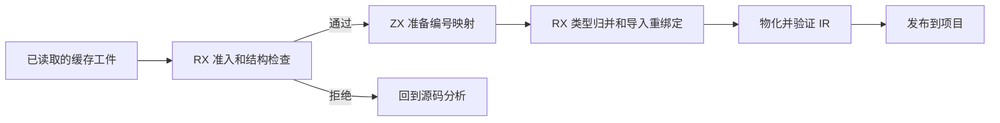

# 语义缓存恢复映射与准入自举

## Intent · 目标

把源码模块和原生接口缓存恢复的准入、编号映射准备及重绑定交由 RX/ZX。恢复过程借用已存在的工件列，保持映射区的原有分配粒度和已提交数据的生命周期。

## Data · 正式入口

普通源码从 `Project.finishInput` 进入语义缓存恢复，原生接口从 `NativeCache.load` 进入原生缓存恢复。现有 RX 已执行多项校验及重绑定。Zig 仍分别调度准入与恢复，决定临时映射的布局、初始化和可见范围，并为各步骤构造映射切片。

## Edges · 所有权与回滚

保留准入顺序和失效、分配失败的区分。源码缓存先完成结构预检，再把原工件与项目的列交给 RX 完成映射预留、类型归并和重绑定。暂存类型归并计划的区域在提交类型后释放，编号映射继续使用恢复调用的临时内存。原生缓存通过准入和结构校验后，ZX 才为类型与输入输出端口编号预留一块缓冲，再将各段借给随后的映射步骤。

原生工件和项目函数此前都通过聚合更新实现签名写入，依赖生成器对只读签名列与可写签名列选用同样的表示。本批两处共用 ZX 构造的签名行，直接写入各自预留的位置。工件保存实际写入的列，项目仍在原生模块通过检查并发布后统一推进列长度。持久表的容量预留及恢复失败后的回滚继续使用原生存储操作。

## Answer · 验收

语义缓存、缓存编解码、原生声明、原生链接、模块工件、跨进程缓存和原生生成七组回归通过 145 个构建步骤、214 项 Zig 测试以及 6 项 Node 集成测试，覆盖重复命中、依赖变化、缓存损坏、原生声明重排和分配失败。

候选和下一代引导器分别通过 25 个构建步骤，对本批入口独立生成的 417 个分区文件逐字节一致，输入戳除外。初始 seed 的 lexer 通过 14 个构建步骤。

使用上一提交 `a66befb52` 和候选源码构建两套 CLI。两者以相同设置首次分析 96 个源码模块和 8 个原生接口，之后交错各测 10 次，全部命中磁盘缓存并复用。程序和 ABI 文件在首次生成及后续恢复时逐字节一致。缓存命中墙钟中位数从 30.73 毫秒到 30.90 毫秒，CPU 从 33.27 毫秒到 33.36 毫秒，单进程峰值 RSS 从 12.30 MB 到 12.33 MB。

固定清单有 735 个入口和 16 个分区，环境为 macOS arm64、Zig 0.17.0、ReleaseSmall。三套工具均由 Source 引导器生成，运行 Source 分析和生成。交错运行三轮取中位数，每套另测 18 次无变化请求。

| 生成器指标               |  固定基线 |  上一阶段 |      候选 |
| ------------------------ | --------: | --------: | --------: |
| 冷生成墙钟               |    2.82 s |    2.54 s |    2.55 s |
| 冷生成 CPU               |   12.48 s |   12.20 s |   12.17 s |
| 冷生成进程树采样峰值 RSS | 885.29 MB | 698.56 MB | 699.94 MB |
| 冷生成单进程系统峰值 RSS | 925.75 MB | 797.34 MB | 798.06 MB |
| 热重建墙钟               |    2.20 s |    1.94 s |    1.95 s |
| 热重建 CPU               |    8.50 s |    8.23 s |    8.24 s |
| 无变化墙钟               |  36.19 ms |  32.81 ms |  32.48 ms |
| 无变化 CPU               |  35.14 ms |  31.79 ms |  31.54 ms |

冷生成墙钟较上一阶段增加 0.01 秒，CPU 减少 0.03 秒，进程树采样峰值增加 1.38 MB。相对固定基线，冷生成墙钟减少 0.27 秒、CPU 减少 0.31 秒，进程树采样峰值减少 185.35 MB。生成阶段之外的 Zig 编译和链接另行验收。相邻版本的 11,758 个生成文件及 v18 唯一性缓存载荷逐字节一致，排除输入戳。与固定基线的既有差异清单逐项一致。
