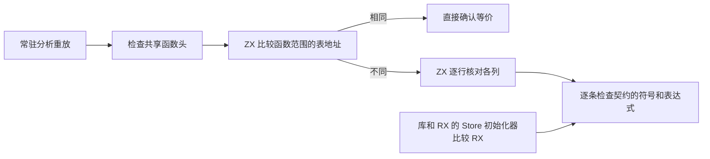
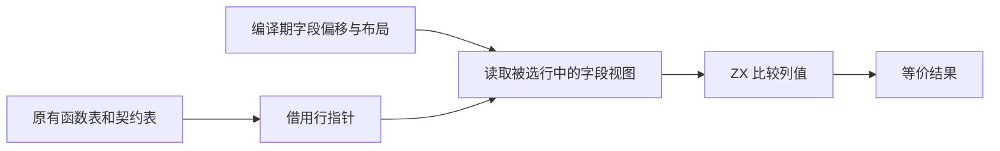

# 链接函数与契约等价检查自举

## Intent · 目标

把常驻分析重放和库 Store 初始化器合并使用的函数等价检查迁入 RX/ZX。比较沿用原有 IR 列布局，不分配中间列，也不复制函数体或契约。

## Data · 正式路径

常驻混合分析重新分析一个模块后，`mixed/reuse.zig` 用函数签名和函数体确认该模块的后续依赖是否仍可复用。此前 Zig 逐行选择 Store、符号、表达式、控制流和契约表。遇到不同的表地址时，再把各字段装成临时列描述，调用 ZX 比较。契约中的符号和表达式也由 Zig 逐条遍历。源码库和已分析 RX 的 Store 初始化器去重共用后一个检查。

## Edges · 比较与借用边界

Zig 根据现有表定义在编译期记录字段偏移和元素表示，并在入口借用已有的行指针列。底层 `memory/columns` 负责范围身份检查和从指定行借用字段。字段比较、短路和契约遍历由 ZX 完成。普通列与间接列共用标签屏蔽、可空编号与文本比较规则。

共享表先按整段地址确认，保留原来的同址快路径。遇到分开保存的数据，每张表每行只取一次地址，再读取需要比较的字段。字节列继续使用现有字节比较后端。有差异时立即返回。Store 初始化器的头部、类型和列检查之后，由同一 RX 流程检查非空契约。

函数表扩容之后的独占列借用仍在 Zig 宿主。Store 登记表遇到同名冲突时，宿主仍负责从登记结果选出两条函数。此次迁移覆盖被选函数的等价算法。

## Answer · 验收

以 `4f06eeba7` 为本批比较的固定对照。初始 Zig seed 和 `7c9b225c3` 的 Source 引导器都生成了函数体和 Store 比较入口。正式回归通过 84 个构建步骤和 59 项 Zig 测试，覆盖库链接、库重放、独立导入、原生链接和语义缓存。

在 macOS arm64、Zig 0.17.0、ReleaseSmall 上，用现有多别名库档案和仓库的 `identity.zx` 契约夹具验证两种实现。分别检查共享指针列、指针列独立但函数体共享、独立解码后内容等价、首行表达式差异与只改变契约内部表达式。所有比较判定一致。测量只计比较循环，排除读档和解码，版本交错执行，排除首轮后取七轮中位数。

| 场景                           | 每轮比较次数 | 旧实现墙钟（ms） | 候选墙钟（ms） |
| ------------------------------ | -----------: | ---------------: | -------------: |
| 800 行，指针列共享             |        1,200 |            1.403 |          0.017 |
| 800 行，指针列独立且函数体共享 |        1,200 |            1.438 |          0.636 |
| 800 行，两次独立解码           |        1,200 |          309.383 |        301.740 |
| 800 行，仅首行表达式有差异     |        1,200 |            0.258 |          0.244 |
| 1 行，独立解码的非空契约相同   |       12,000 |            6.299 |          6.430 |
| 1 行，仅契约内部表达式有差异   |       12,000 |            6.294 |          6.128 |

正式库档案入口另用两套由 `7c9b225c3` 生成并执行 Source 分析与生成的库构建器，对照正序、逆序、原生、混合及 Store 共八组输入。每组十轮交错并丢弃首轮，所有档案逐字节一致。最大单组墙钟增量约 0.06 ms，CPU 增量约 0.03 ms，峰值 RSS 增量约 0.02 MB。Store 正序墙钟 3.670 → 3.575 ms，CPU 3.021 → 2.929 ms，峰值 RSS 8.34 → 8.31 MB。本批测量范围为比较循环和库档案构建。

回归日志、夹具摘要及原始样本位于 `.zig-cache/verification-tmp/compiled-install/` 下的 `comparison-verified-regression.log`、`comparison-equivalence.json` 和 `comparison-archives.json`。
