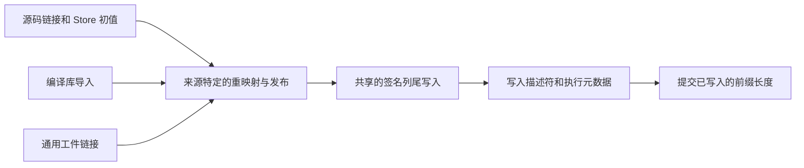

# 链接函数列尾发布自举

## Intent · 目标

统一源码链接、编译库导入和通用工件链接的函数签名发布。Source 将重映射后的签名直接写入已预留的列尾，工作循环只携带函数体和执行元数据的可写视图。

## Data · 正式路径

## Edges · 存储与错误边界

继续使用已有函数表和列预留机制。描述符归属、外部签名字段、函数索引、分配域和错误前已完成的前缀沿用原契约。递归根函数仍可留作独立结果。

原生声明文件当前无法导入普通 ZX 类型，原生记录参数也会让本路径失去可写状态入口。签名沿用已有 `SignatureRow` 的列契约，通过叶子参数调用通用的列尾写入。函数体引用、Store 模式和根索引继续使用类型化可写视图。Zig 仍提供分配器、重映射存储和这些列的借用绑定。

## Answer · 验收

原 `FunctionStorage.reservedTail` 和签名列的可写视图往返已退出上述正式路径。Source 仍按完整记录推进发布进度，并在故障时提交完整写入的前缀。窄清单确认源码批次、单个根函数、Store 初值、编译库和通用工件均生成可写状态入口，签名列绑定顺序与写入顺序一致。

库链接、编解码、重放、导入、原生链接、语义缓存、RX 推导、公开 Store 库和 RX 边界九组回归通过，共 138 个构建步骤、239 项 Zig 测试及 10 项公开 CLI 检查。

macOS arm64、Zig 0.17.0、ReleaseSmall。候选与对照均由 `7c9b225c3` 的 Source 引导器生成编译模块，执行 Source 分析和生成。档案生成沿用 `4f06eeba7` 固定基线，直接对照为 `bcb5b009b`。八组样本各取九轮中位数。所有档案逐字节一致。较直接对照最大增量分别为墙钟 0.065 ms、CPU 0.015 ms 和峰值 RSS 0.033 MB。较固定对照最大增量分别为 0.083 ms、0.026 ms 和 0.049 MB。

公开源码库发布与 `dadb1f21a` 对照，关闭生成缓存并交错执行，去掉首轮后取七轮中位数。

| 源码库样本    |          墙钟，ms |           CPU，ms |  峰值 RSS，MB |
| ------------- | ----------------: | ----------------: | ------------: |
| 原始 Store 库 |   33.832 → 33.875 |   37.240 → 37.223 | 16.43 → 16.35 |
| 32 个公开别名 | 914.766 → 915.280 | 959.038 → 959.749 | 43.94 → 43.76 |

两组各有 14 个和 46 个发布文件逐字节一致。本批性能证据覆盖库链接与发布，编译器完整冷构建未纳入测量。原始记录位于 `.zig-cache/verification-tmp/function-tail/`。
