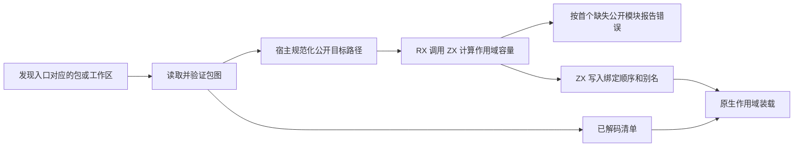
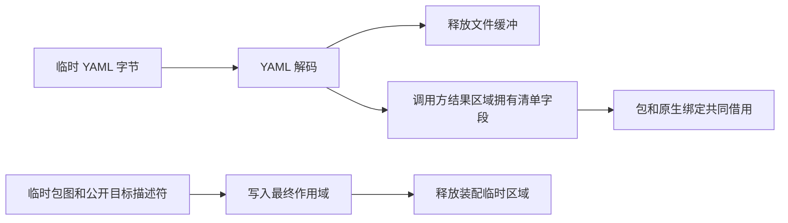

# 项目包作用域装配与清单复用

## Intent · 目标

将已解析包图的作用域装配迁入 RX/ZX。源码、编译库、安装包和工作区别名走同一发布路径。项目图与原生配置复用同一份已解析清单，保持边界核验、导入优先级和诊断顺序。

## Data · 正式调用链

`cli.project.loadWithInputs` 使用包图的包序和依赖边生成编译器作用域。之前 Zig 为每条依赖重新规范化目标根目录和公开入口，为不同别名逐条登记模块。图分析结束后释放原清单，原生配置再从相同文件读取、解析一遍。

现在平台宿主按包规范化一次公开入口及工件路径。RX 先由 ZX 计算发布容量并选择第一个缺少公开模块的依赖，再写入包作用域的最终绑定表。依赖仍按原有顺序发布，包自身的公开模块随后写入。同包的入口路径和编译工件路径由所有绑定借用。清单解码在调用方的结果区域产生供后续阶段复用的数据。

## Edges · 兼容与所有权

作用域选择沿用最长物理目录前缀，源码与编译工件使用既有清单及已安装包校验。内层模块的显式项目文件和包自身入口保持原有规则。公开绑定的行只复制路径描述符，字符串和底层数据由结果区域持有。根导出的别名复制到结果区域，子路径导出只构造最终导入名。

工作区发现仍验证目录、符号链接和清单位置。watch 直接观察图装载阶段取得的清单字节，在发布前继续完整核验输入。路径规范化、YAML 解析与文件读取由原宿主承担。入口发现阶段为识别上层工作区仍可能提前读取清单。

## Answer · 验收

11 组回归通过，共 875 个构建步骤、630 项 Zig 测试和 2,098 项命令集成检查。覆盖工作区与别名、包自身和子路径导入、安装与锁文件、原生和编译库发布、watch 编辑及失败恢复。实际源码包与编译库消费生成的二进制同上一版逐字节一致，三组执行结果一致。六种原生配置诊断也保持原样。

初始 seed 和 `7c9b225c3` Source 引导器在同一 CLI 窄清单生成 201 份 Zig 文件。逐文件对照中有 34 份只涉及一致的局部变量重命名。

三版 CLI 均由 `7c9b225c3` Source 引导器构建，运行时使用 Source 分析和生成。macOS arm64、Zig 0.17.0、ReleaseSmall，关闭生成缓存。固定对照为 `dadb1f21a`，直接对照为 `256718a9d`。每组交错执行，去掉首轮后取八轮中位数。九个场景的 327 份产物逐字节一致。

| 场景                            | 墙钟 ms（固定 / 直接 / 候选） | CPU ms（固定 / 直接 / 候选） | 峰值 RSS MB（固定 / 直接 / 候选） |
| ------------------------------- | ----------------------------: | ---------------------------: | --------------------------------: |
| 源码库，默认配置                |         17.64 / 17.32 / 17.51 |        18.94 / 18.71 / 18.91 |             12.62 / 12.44 / 12.46 |
| 编译库，显式配置                |         16.20 / 15.63 / 16.69 |        17.54 / 17.15 / 17.87 |             11.26 / 11.09 / 11.12 |
| 源码库，大量别名                |         19.49 / 19.44 / 17.93 |        20.77 / 20.70 / 19.40 |             14.43 / 14.07 / 13.83 |
| 编译库，大量别名                |         18.77 / 18.88 / 19.54 |        20.23 / 20.15 / 21.06 |             13.64 / 13.18 / 12.77 |
| 源码库，52 个模块和 142 条依赖  |         75.94 / 75.59 / 75.38 |        77.04 / 76.86 / 76.75 |             16.22 / 15.79 / 15.94 |
| 编译库，52 个模块和 142 条依赖  |         76.29 / 75.66 / 75.43 |        77.45 / 76.95 / 76.63 |             15.80 / 15.32 / 14.71 |
| 源码装载，32 个原生模块         |            3.03 / 2.99 / 2.82 |           2.82 / 2.68 / 2.67 |                7.47 / 7.57 / 7.51 |
| 源码装载，2,048 个原生模块      |         47.82 / 16.29 / 11.87 |        47.55 / 16.16 / 11.70 |             18.04 / 17.37 / 13.71 |
| 源码装载，96 个包共用 65 个导出 |            8.85 / 8.91 / 6.43 |           9.02 / 8.93 / 6.57 |              11.23 / 11.40 / 9.19 |

源码装载场景测量至生成 Zig，排除原生后端构建。96 个包共用 65 个导出的样本中，墙钟较直接对照下降 27.9%，峰值 RSS 下降 2.20 MB。2,048 个原生模块的样本中，墙钟额外下降 27.1%，峰值 RSS 下降 3.66 MB。编译库显式配置样本墙钟增加约 1.06 ms，九组场景的最大单阶段 CPU 增量约 0.91 ms。完整自举冷构建未重测。

原始结果位于 `.zig-cache/verification-tmp/project-scope-assembly/`，包括 `regression.log`、`final-regression.log`、`check.log`、`generation-parity.log` 和 `comparison.json`。正式回归复用了首次运行通过的 Zig 测试，修正接口接线后补齐 CLI 和集成回归。
