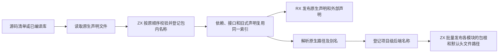
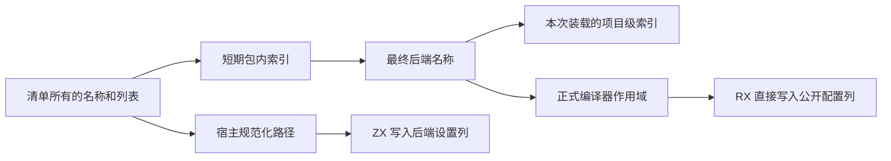

# 项目原生作用域绑定自举

## Intent · 目标

把项目级原生声明发布、跨包名称登记及后端作用域设置接到正式的 RX/ZX 路径。源码包、已编译库及旧式外部声明沿用同一装载入口。消除包内重名检查、依赖绑定和跨包登记的重复线性查找。

## Data · 正式调用链

`project.loadWithInputs` 为 ZX、RX、Gateway、原生应用构建和库发布装载包作用域。此前每个原生模块重新扫描之前出现的模块，每条依赖重新扫描本包名称列。汇总原生声明、旧式外部声明以及后端设置也由 Zig 循环逐条构造。

包内校验现在将名称登记在 ZX 哈希索引。后续解析接口、外部声明和模块依赖时借用同一索引和已生成的名称。作用域之间使用编译器已有的 Source 名称登记。接口与外部声明的公开投影由 RX 顺序调用两项批量 ZX 写入，后端设置按作用域写入最终表。

## Edges · 语义与所有权

包内校验依次检查路径或头文件、命名和重名。项目级冲突仍在当前模块依赖、路径和别名解析后报告，作用域与发布顺序保持原样。原生声明和旧式外部声明在编译器作用域内继续保留原始导入名和绑定身份，公开配置使用绑定后的导入键。头文件显式路径、空覆盖和作用域默认值各自保留。

索引借用清单中的名称，桶存储及名称列的临时描述符随作用域释放。项目级索引只在本次装载中保留。发布代码借用行列并直接写入结果表。文件读取、平台路径规范化、分配器和可变输出表的容量由 Zig 宿主管理。

## Answer · 验收

九组正式回归通过，共 890 个构建步骤、687 项 Zig 测试和 2,045 项命令集成检查。源码包与编译库消费各构建一份原生程序。两版二进制逐字节一致，三组执行结果一致。非法模块名、保留名、包内重名、跨包后端名称冲突、未知依赖及非法接口路径六种诊断一致，失败路径均未发布产物。

初始 seed 与 `7c9b225c3` Source 引导器分别生成 CLI 和编译器窄清单。两组共 258 份 Zig 文件内容一致，其中 44 份仅涉及各文件内部一致的局部变量重命名。

三版 CLI 均用 `7c9b225c3` Source 引导器构建，运行时执行 Source 分析及生成。macOS arm64、Zig 0.17.0、ReleaseSmall，关闭生成缓存。固定基线为 `dadb1f21a`，直接对照为 `037081097`。版本交错运行，排除首轮后取八轮中位数。八个场景共 326 份产物在三版及各轮逐字节一致。

| 场景                           | 墙钟 ms（固定 / 直接 / 候选） | CPU ms（固定 / 直接 / 候选） | 峰值 RSS MB（固定 / 直接 / 候选） |
| ------------------------------ | ----------------------------: | ---------------------------: | --------------------------------: |
| 源码库，默认配置               |         18.12 / 18.37 / 17.01 |        19.36 / 19.92 / 18.21 |             12.56 / 12.51 / 12.48 |
| 编译库，显式配置               |         16.22 / 15.69 / 15.83 |        17.74 / 17.07 / 17.23 |             11.26 / 11.11 / 11.08 |
| 源码库，大量别名               |         18.96 / 19.42 / 20.15 |        20.38 / 20.64 / 21.26 |             14.41 / 14.19 / 14.07 |
| 编译库，大量别名               |         19.55 / 18.82 / 18.68 |        20.86 / 19.85 / 20.08 |             13.62 / 13.19 / 13.19 |
| 源码库，52 个模块与 142 条依赖 |         76.59 / 76.38 / 76.63 |        77.87 / 77.70 / 77.72 |             16.21 / 15.97 / 15.79 |
| 编译库，52 个模块与 142 条依赖 |         76.74 / 77.23 / 77.22 |        77.75 / 77.84 / 77.79 |             15.81 / 15.25 / 15.34 |
| 源码装载，32 个配置模块        |            2.96 / 2.96 / 2.94 |           2.84 / 2.82 / 2.78 |                7.48 / 7.46 / 7.59 |
| 源码装载，2,048 个配置模块     |         49.14 / 49.29 / 16.85 |        48.93 / 49.12 / 16.61 |             18.03 / 18.06 / 17.37 |

源码装载用极小的 ZX 入口，只生成 Zig，隔离后端编译，把成本集中到大清单与名称绑定。2,048 模块样本相对直接对照墙钟下降 65.8%，CPU 下降 66.2%。源码库大量别名样本相对直接对照的墙钟增加约 0.73 ms，相对固定基线增加约 1.19 ms。32 模块样本峰值增加约 0.13 MB。源码与编译库的发布时间以毫秒波动为主。完整自举冷构建未重测。

原始结果位于 `.zig-cache/verification-tmp/native-scope-binding/`，包括 `regression.log`、`check.log`、`generation-parity.log` 和 `comparison.json`。项目的清单读取仍经宿主。包图装载与原生配置装载各自读取清单，后续可沿两者的生命周期继续消除重复读取和解析。
