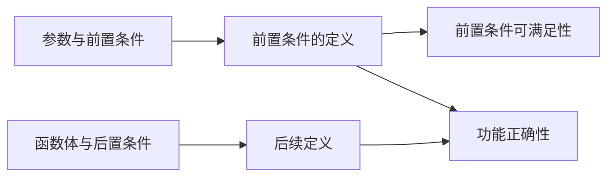

# 验证前置条件查询只输出契约定义

## Intent · 目标

降低 `zxc verify` 的查询写出成本与 Z3 读取成本，保留验证语义、功能正确性查询和反例证据。

## Data · 根因

验证器先计算前置条件，再求值函数体及后置条件。符号图已共享相同函数和实参的求值结果，也已对重复符号项编号。生成 SMT 时，两个查询过去都携带最终符号图的全部定义。前置条件在函数体求值开始前已经确定，但 Z3 检查可满足性时仍要读取函数体产生的定义。普通和大符号图样本都能复现。

源码已证实正式构建拆分生成 Zig，公开 watch 跨轮复用未改变的 ZX 解析结果，后端仍每轮启动 Zig 进程。只读聚合值已有借用和独占更新机制，集合链仍可能分配中间数组。Gateway 已有请求 arena，未转义的 JSON 文本可借用请求体，响应缓冲发送后释放。当前 Gateway 的串行接入已复现慢连接阻塞其他连接。Store 锁竞争缺少测量证据，普通 ZX 循环没有通用的逐次原子取消检查。参见[诊断复查](编译器与应用性能诊断复查.md)、[监听构建复用解析结果](监听构建复用解析结果.md)和[Gateway 请求底层分配器](Gateway请求底层分配器.md)。

## Edges · 边界与限制

符号定义仅引用已存在的符号，后续求值不能增加前置条件对新定义的依赖。验证器记录前置条件求值结束时的定义数，全部定义仍按顺序只写一次，前置条件查询借用最终缓冲区的对应前缀。函数体求值、异常和溢出检查、正确性查询、反例与超时设置沿用原实现。初始 seed 的查询代码从同一 RX/ZX 源码重新生成。

## Answer · 验收

`test-verification` 与 `test-verification-resources` 共 67 个构建步骤、3 项 Zig 测试通过。覆盖实际 Z3 的普通验证、公开 ZX/RX 契约、枚举域、反例、不可满足的前置条件、无效 IR 与分配失败回收。单独执行了重新生成的初始 seed 查询入口，确认它也使用正确的定义范围。

在 macOS arm64、Zig 0.17.0、ReleaseSmall 上对比固定基线 `a03822c99`、上一提交 `888d0b7a0` 和本次候选。CLI 由 `7c9b225c3` 的 Source 引导器生成，运行时使用 Source 分析与生成。版本交错执行，排除首轮后各取九轮中位数。实际求解器为 Z3 5.3.3。进程峰值 RSS 按十进制 MB 计。

| 输入                                   | 前置条件 SMT 大小（上一提交 → 候选） | 墙钟（固定 / 上一提交 / 候选，ms） | CPU（固定 / 上一提交 / 候选，ms） | 峰值 RSS（固定 / 上一提交 / 候选，MB） |
| -------------------------------------- | -----------------------------------: | ---------------------------------: | --------------------------------: | -------------------------------------: |
| 三次符号调用，实际 Z3                  |                     5,724 → 137 字节 |              12.39 / 12.21 / 11.82 |             11.36 / 11.20 / 10.92 |                  25.20 / 25.21 / 25.21 |
| 192 次符号调用，实际 Z3                |                 2,975,788 → 137 字节 |           317.28 / 318.48 / 247.89 |          315.19 / 316.54 / 246.43 |                  89.64 / 89.64 / 89.64 |
| 同一大样本加 `requires(!in)`，实际 Z3  |                 2,975,940 → 220 字节 |           318.97 / 319.61 / 247.83 |          316.32 / 317.68 / 246.37 |                  89.64 / 89.62 / 89.64 |
| 192 次符号调用，以固定响应隔离实际求解 |                 2,975,788 → 137 字节 |           175.21 / 175.91 / 173.63 |          173.73 / 174.54 / 172.34 |                  47.94 / 44.66 / 41.71 |

对照的正确性查询、源证据文件、两次求解结果和模型文件逐字节一致。可满足性查询的唯一差异是省去函数体及后置条件的定义。实际 Z3 的大样本墙钟降低约 22%，峰值基本持平。隔离求解时的编译器峰值较上一提交低 2.95 MB，较固定基线低 6.23 MB。原始日志在 `.zig-cache/verification-tmp/verification-preconditions/`。

本次缩减可满足性查询的工作量。函数体仍按不同实参求值，正确性查询体积保持原样。公开 watch 的语义重放、集合链中间数组、Gateway 连接并发和共享 Store 的一般区域回收保留在各自的优化范围内。完整冷构建耗时和应用运行期不在本次测量范围。
