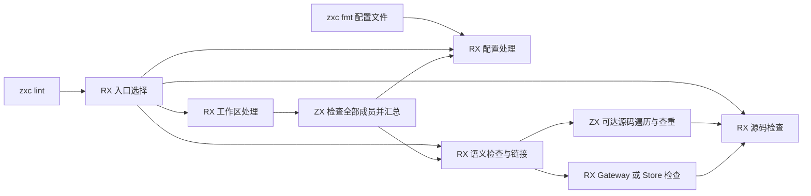
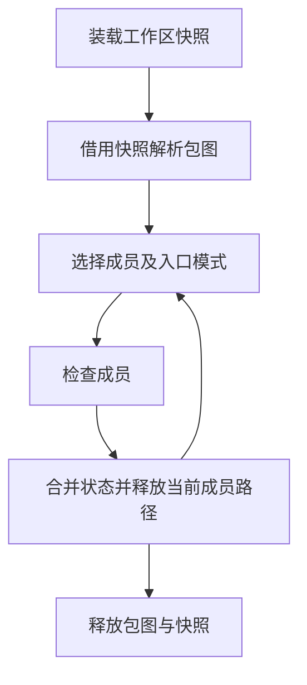

# CLI 的 Lint 与配置处理自举

## Intent · 目标

将普通 lint、语义 lint、工作区 lint 以及 lint 和 fmt 共用的配置处理迁入 RX/ZX。保留 CLI 诊断顺序、只读检查约束、输出格式和临时数据生命周期。

## Data · 正式路径

`zxc lint` 原先在 Zig 中选择命令模式和源码类型。语义 lint 在普通入口、公开库、Store 与 Gateway 间分派，逐源检查可达模块，再验证链接。工作区 lint 在完成包图检查后依次检查所有成员，并汇总失败。配置处理按显式类型或文件名选择清单、索引和锁文件的读取、验证及输出方式。

## Edges · 生命周期与诊断

工作区发现取得的清单快照用于包图加载。包图借用快照时由工作区检查持有它，先释放包图、再释放快照。每个工作区成员按原顺序进行检查，普通诊断不会阻止后续成员被检查。语义检查按原有模块、ZX 文件和 Store 的顺序检查，首次失败即结束。ZX 和 RX 格式检查继续在原内容上工作，配置文件只有按既有写入模式才发布修改。

Zig 仍负责文件 I/O、编辑写入、格式化和分析 API、哈希表访问，以及结果的分配、释放和诊断输出。Gateway 分析器和清单格式语义校验仍通过对应编译器 API 执行。本阶段迁移 CLI 的执行分支、跨步骤编排及遍历。

## Answer · 验收

`test-semantic-lint`、`test-configuration-formatting`、`test-rx-formatting` 和 `test-zx-import-order-cli` 全部通过，共 90 个构建步骤、288 项 Node 检查和 4 项 Zig 测试。工作区测试覆盖同一次调用汇报多个成员错误、符号链接、包名冲突和依赖图错误。配置回归覆盖清单的语义保全、索引格式化和锁文件只读限制。窄清单中 488 个 Zig 工件逐字节一致，另外 54 个只是 seed 与 Source 的临时变量编号不同。

macOS arm64，Zig 0.17.0，ReleaseSmall。固定对照为 `dadb1f21a`，直接对照为 `1bca9aa71`。三套 CLI 的编译模块都由 `7c9b225c3` Source 引导器生成，运行时使用 Source 分析与生成。每种输入按版本交错运行，排除预热后取十二轮中位数，确认退出状态和输出字节一致。RSS 为进程峰值，MB 按十进制计。

| 场景                      | 墙钟 ms（固定 / 直接 / 候选） | CPU ms（固定 / 直接 / 候选） | 峰值 RSS MB（固定 / 直接 / 候选） |
| ------------------------- | ----------------------------: | ---------------------------: | --------------------------------: |
| ZX 普通 lint              |            2.01 / 1.98 / 1.97 |           1.75 / 1.73 / 1.71 |                4.10 / 4.08 / 4.06 |
| RX 普通 lint              |            2.37 / 2.62 / 2.38 |           2.04 / 2.23 / 2.07 |                4.28 / 4.21 / 4.26 |
| ZX 语义 lint              |            1.99 / 1.81 / 1.81 |           1.75 / 1.55 / 1.55 |                6.32 / 6.08 / 6.09 |
| RX 语义 lint              |         28.18 / 27.75 / 27.79 |        34.15 / 33.83 / 33.88 |             16.38 / 15.80 / 15.83 |
| 含编译库的语义 lint       |      240.26 / 231.34 / 231.85 |     239.68 / 230.84 / 231.31 |             40.17 / 36.75 / 36.81 |
| Store 语义 lint           |            3.48 / 3.49 / 3.48 |           3.22 / 3.22 / 3.23 |                7.09 / 6.60 / 6.83 |
| 含 ZX 入口的工作区 lint   |            3.96 / 3.74 / 3.60 |           3.67 / 3.44 / 3.29 |                7.14 / 6.97 / 6.86 |
| 96 个仅含清单的工作区成员 |            6.75 / 6.32 / 4.33 |           6.50 / 6.07 / 4.08 |                4.72 / 4.67 / 4.39 |
| 清单 fmt 标准输出         |            1.13 / 1.13 / 1.13 |           0.88 / 0.88 / 0.88 |                3.60 / 3.67 / 3.67 |

复用发现快照后，96 成员场景相对直接对照墙钟下降 31.5%，CPU 下降 32.9%。九组样本相对直接对照墙钟最多增加 0.51 ms，CPU 最多增加 0.47 ms。Store 语义 lint 的峰值 RSS 相对直接对照增加 0.23 MB，较固定对照下降 0.26 MB。清单 fmt 的峰值 RSS 较固定对照增加 0.07 MB，与直接对照一致。本阶段对照实际 lint 和配置命令。原始记录保存在 `.zig-cache/verification-tmp/lint-workflow/`。
