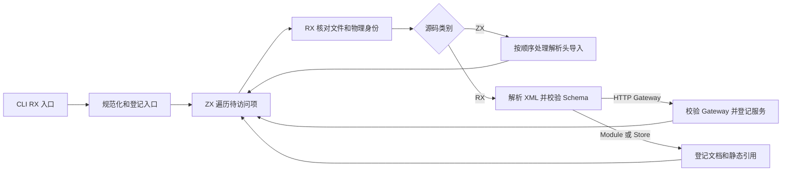
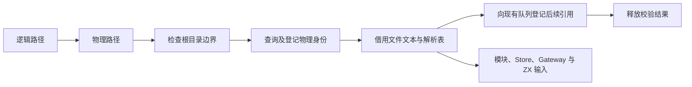

# CLI 的 RX 文档装载自举

## Intent · 目标

把 CLI 的 RX 文档入口和装载队列迁入 RX/ZX，覆盖普通 Module、Gateway、Store，以及从这些入口到达的 ZX 文件。

## Data · 调用路径

`rx/collection.zig` 同时服务普通 RX 编译、统一库和 Gateway 分析、语义 lint、入口检查及 Store 类型收集。原有 Zig 循环在队列扩展时依次规范化逻辑路径、登记文件观察、核对物理路径、读取并校验文本、登记模块及继续收集引用。HTTP Gateway 展开其已校验的服务引用，ZX 入口逐条扫描解析头的导入。

## Edges · 数据与次序

RX 明确区分物理路径越界、已登记的同一逻辑路径、冲突别名和缺失文件。只有非根 ZX 的缺失允许延后诊断。文件观察、物理身份登记、源码读取和记录原始字节保持同一顺序。Store 和 Gateway 仍使用文档局部的文件文本，普通 Module 和 ZX 继续使用调用方的文本缓存及保留期分配器。

ZX 队列在每次访问后释放该文档的 Schema 校验结果，读取下一项前重置引用临时区。打开解析头后，通过已有缓存按索引借用导入记录，Gateway 也按原顺序借用已校验的服务路由。编译器和 CLI 仍记录原有的逻辑路径及引用位置。

Zig 继续持有平台文件访问、解析缓存、队列和索引的原生存储。XML 引用的具体解析仍使用编译器已有的引用收集规则及 CLI 借用适配器。自举还需迁移这些宿主状态和剩余解析职责。

## Answer · 验收

`test-rx-project-cli`、`test-rx-store-paths`、`test-rx-watch`、`test-semantic-lint`、`test-gateway`、`test-library-publish` 和 `test-public-verification` 全部通过。构建系统报告 112 个成功步骤，Node 集成检查通过 160 项，Gateway 另通过 86 项运行检查。覆盖文件及目录符号链接、两种冲突登记顺序、缺失路径、混合模块、公开证明和监听恢复。窄清单上，初始 seed 与 Source 引导器的 338 份 Zig 文件中，304 份逐字节一致，34 份仅有临时标识编号差异。

固定对照为 `dadb1f21a`，上一阶段为 `b8adc2c22`。三套 CLI 均由 `7c9b225c3` 的 Source 引导器构建并执行 Source 分析和生成。平台为 macOS arm64、Zig 0.17.0 和 ReleaseSmall。关闭生成缓存，版本交错运行，每版取预热后八轮中位数。RSS 为被测 CLI 进程的系统峰值，按十进制 MB 记录。

| 输入             | 墙钟 ms（固定 / 上阶段 / 候选） | CPU ms（固定 / 上阶段 / 候选） | 峰值 RSS MB（固定 / 上阶段 / 候选） |
| ---------------- | ------------------------------: | -----------------------------: | ----------------------------------: |
| RX 引用 ZX 闭包  |           18.94 / 18.65 / 18.64 |          26.50 / 26.18 / 26.40 |               19.06 / 18.88 / 18.85 |
| 16 个入口共享 RX |        803.39 / 763.78 / 767.33 |       962.38 / 922.34 / 925.88 |               70.77 / 54.36 / 54.80 |

两组输入的全部生成文件和发布文件逐字节一致。RX 引用 ZX 闭包的墙钟与上阶段基本持平，CPU 增加 0.22 ms。共享 RX 库的墙钟、CPU 各增加约 3.54 ms，峰值 RSS 中位数增加 0.44 MB。上阶段的峰值样本范围为 53.62～55.28 MB，候选为 53.77～55.72 MB。较固定对照，共享 RX 库的墙钟、CPU 和峰值 RSS 分别减少约 36.06 ms、36.49 ms 和 15.97 MB。回测覆盖 RX 依赖生成和库发布。完整自举冷构建仍通过独立场景验收。

原始记录保存在 `.zig-cache/verification-tmp/rx-collection/`。按场景与路径排序后的完整产物摘要为 `2e6eea0f2d09bcf39150b9c96bae280b83618294f3883c73236f67d29c09698f`。
